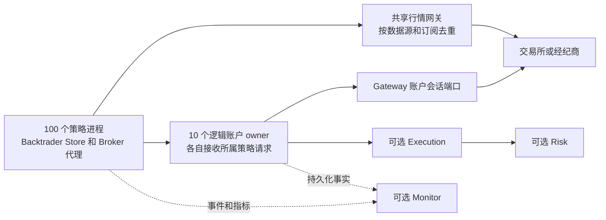

# bt_api_py 迭代04 可选组件与可配置通信完善计划

日期：2026-10-13

状态：设计完成，待实施；本文不代表功能已经实现或运行验收通过。

范围：`bt_api_gateway`、`bt_api_risk`、`bt_api_execution`、`bt_api_monitor`，以及配套的 `bt_api_transport_zmq`、SDK 装配和 Backtrader 接入。

本迭代将四个子包完善为可以分别选择的功能。**四个组件全部默认关闭；完全不配置，也能继续使用原有 BtApi 和 Backtrader 路径。** 启用组件后，由 `config.yaml` 指定实例、作用范围、挂载位置和通信配置。第一版通信实现统一使用 `bt_api_transport_zmq`，为以后增加其他后端保留接口。

主要规模目标是 **100 个策略进程属于 10 个真实账户**。按账户集中管理共享状态和交易写入，按行情订阅需求复用上游连接。四个 Python 包不等于四个独立微服务；可以在同一个账户工作进程中组合，也可以部署到不同机器。

## 1 用户要求和迭代边界

### 1.1 已确定要求

1. 不开发新的 Optional16 验收入口。已经停用的入口继续停用，历史记录保留；功能验收复用各包及 SDK 的正常入口。
2. gateway 重点解决行情转发、账户信息转发和上游连接共享。同品种的多个策略不应各连一份行情，同账户的多个策略不应各自重复登录账户。
3. risk、execution、monitor、gateway 都是可选功能，允许单独使用和组合使用；未配置、未启用的组件不得成为普通使用路径的安装或启动前提。
4. 通信后端可配置。首版只实现 ZMQ，不同时引入 NATS、Redis、Kafka 或 gRPC 服务。
5. 支持同机多进程，并完成跨机器通信设计与验证；首版跨机器部署采用静态服务地址和固定账户归属。
6. 结合 Backtrader 使用，同时保留组件独立于 Backtrader 的公开接口。
7. 当前交付仅为本计划。后续代码开发按现有各仓 `dev`、小轮验收、明确范围提交的方式推进。

### 1.2 本迭代不承担的工作

- 自动跨机器主备切换、共识集群、Kubernetes 调度、热迁移和无中断配置热更新。
- 新增 TWAP/VWAP 等算法执行器、机器学习风控、完整合规系统或监控前端平台。
- 一次性支持所有交易所的生产写单。通用功能按合同实现；具体交易所按实际接入能力逐个验证。
- 重写全部历史 gateway/forwarding API、删除旧配置或修改历史验收结论。
- 把“可不启用风控包”解释为取消已有权限、输入校验、账户身份校验或交易所限制。

## 2 当前基线和实际缺口

源码核对基线为主仓 `cfe6543e7bc9aaa3622624f1b490b4d5f99f3766`。下列是当前代码事实，不是目标能力的完成声明。

| 位置 | 当前已有能力 | 本迭代缺口 |
|---|---|---|
| `bt_api_gateway`，`8a702c2` | 持久化命令路由、账户 writer authority、本地事件 journal、游标与快照接口 | 没有完整的上游行情订阅共享、账户会话管理和远程快照加增量闭环 |
| `bt_api_risk`，`126d906` | 风险规则基础、持久化预留、分配、冻结与 admission 合同 | 真实账户状态接入、策略虚拟分账、完整订单敞口转换、账户级并发组合尚不完整 |
| `bt_api_execution`，`bf67f06` | intent/order 状态机、持久化派发与 UNKNOWN、观察回填、部分撤单和 CTP 基础合同 | 多策略共用账户 owner、完整撤单与成交归属、统一恢复和 Backtrader 主路径接入尚不完整 |
| `bt_api_monitor`，`a2d108f` | 指标、健康检查、durable outbox、只读查询、受验证控制入口 | 实际事件生产链、账户和策略聚合、断线补传、控制执行结果闭环尚不完整 |
| `bt_api_transport_zmq`，`43751c7` | 版本化 wire、ROUTER/DEALER、远程 CURVE/ZAP、命令 ACL、序号和有限内存重放 | 没有行情 PUB/SUB 实现；私有事件的持久化读取、消息派发接口和配置工厂需要补齐 |
| `bt_api_py/forwarding`、`bt_api_base/gateway` | 旧行情和账户转发、局部订阅计数、source supervisor | 两套协议并存，ZMQ 构造硬编码；订阅生命周期、退订与新子包没有贯通 |
| `bt_api_py/runtime_plugins` | 代码登记、按需加载、受约束的装配 | 当前 managed 路径固定要求 execution/risk/monitor 等组合，并非独立可选组件体系 |
| Backtrader Store/Broker | 现有 direct/forwarding 接入、订单和账户投影 | 同一 Cerebro 共享 Broker；不能直接等同于跨进程账户 owner 或每策略独立虚拟账户 |

优先复用的源码：

- [组件合同](../../../bt_api_py/runtime_plugins/contracts.py)、[可信登记](../../../bt_api_py/runtime_plugins/catalog.py)、[现有组合](../../../bt_api_py/runtime_plugins/managed.py)。
- [现有转发运行器](../../../bt_api_py/forwarding/service.py)、[订阅源生命周期](../../../bt_api_py/forwarding/source_supervisor.py)、[旧 ZMQ 传输](../../../bt_api_py/forwarding/transport.py)。
- [Gateway 定位及 journal](../../../bt_api/bt_api_gateway/README.md)、[Risk admission 边界](../../../bt_api/bt_api_risk/README.md)、[Execution 合同](../../../bt_api/bt_api_execution/README.md)、[Monitor outbox](../../../bt_api/bt_api_monitor/README.md)、[ZMQ 传输合同](../../../bt_api/bt_api_transport_zmq/README.md)。

Backtrader 迭代44仅负责参数与配置校验，其目标 v5 配置还不是当前运行能力。本计划承接其字段校验接口，不把本迭代的服务、订单和进程功能塞回迭代44，也不重复建设校验器。

## 3 四个包的职责和状态归属

| 组件 | 核心职责 | 自己维护的状态 | 配置挂载目标 |
|---|---|---|---|
| gateway | 共享行情源、账户会话、查询合并、数据标准化与转发 | 上游连接、订阅引用、会话代次、账户原始事实和可重放读模型 | Store 的行情/账户端口；账户 owner 的 provider session 端口 |
| risk | 交易前准入、账户和策略限额、资源预留、敞口与冻结 | 风险政策、分配版本、预留、占用、冻结及处理依据 | 最终派发前的 admission 端口；策略只读预算接口 |
| execution | 接收交易意图、幂等派发、订单/撤单生命周期、成交归属与恢复 | 意图、订单、成交、撤单动作、写入关联、UNKNOWN、策略虚拟持仓 | Broker 的订单端口；账户 owner 的订单处理端口 |
| monitor | 消费事实，提供运行状态、指标、告警、只读查询和经授权的控制请求 | 事件消费游标、查询投影、指标、告警、控制请求及结果 | 进程事件/指标出口；独立查询服务 |

`bt_api_py` 负责配置解析后的组合、账户路由、适配器注入和生命周期。`bt_api_transport_zmq` 只负责通信，不持有交易所登录凭据、不决定订单状态、不判断风险规则。领域包不导入 ZMQ，也不硬编码其他通信后端。

一个实际账户的原始余额和持仓事实来自 provider，经 gateway 或原有 provider adapter 获取；execution 维护订单与策略归属，risk 使用这些事实计算限制。monitor 是消费者，不用监控缓存替代交易准入事实。没有 execution 时，risk 使用独立的订单观察端口接收原有 Broker 的订单事实，不自行实现另一套 OMS。

## 4 进程和账户管理模型

### 4.1 推荐组合



图示为组件全部启用时的逻辑关系。`AccountOwner` 是 SDK 的账户装配和写入归属，不是新增第五个业务包，也不要求四包全部存在。

- 策略与账户采用显式映射，例如 `s001–s010 -> a01`。服务端以可信配置/身份授权校验映射，不能相信消息自行声明的 `account_id`。
- 一个 owner 可以服务同账户多个策略；多个账户也可以共处一个工作进程，但账户队列、状态和权限隔离。首版推荐一个账户一个工作进程，便于故障隔离。
- gateway、execution、risk 的写入检查绑定同一逻辑 owner 及代次，不各自选举相互独立的账户 writer；各包原有必须保持的存储/租约约束由组合层协调。
- 账户键包含 provider、environment、真实账户引用，以及必要的产品/子账户维度，避免同名账户或模拟/生产混用。
- 行情可在多个账户之间共用，但仅合并数据源、环境、产品、品种、频道、深度、周期及访问权完全兼容的订阅。
- “一份连接”指一套必要的上游连接集合，不承诺把独立的行情、私有 WebSocket、REST 或 CTP 会话合成一个 socket。
- 策略退出只释放自己的订阅和代理；最后一个订阅者退出才按策略释放上游，不能关闭别人的账户会话。

### 4.2 同机与跨机器

首版支持三种明确部署：普通进程内组合、同机多进程、静态跨机器部署。同进程采用同一领域端口直接调用，不为本地调用强行绕 ZMQ；跨进程通过配置选择 ZMQ 端点。

跨机器时，一个账户的写入仍固定到一个 owner。其他机器部署策略、共享行情或 monitor，不能各启动一个可写的同账户副本。租约和进程心跳不能单独阻止旧节点继续对外写入；没有外部 fencing 能力时不开放自动接管。计划内恢复先确认旧写入路径失效、处理在途订单、恢复状态，再人工切换固定归属。

SQLite journal 留在状态 owner 的本地磁盘，由远程接口访问。SQLite WAL 要求共享数据库的进程位于同一主机，不能用网络共享目录冒充跨机器数据库。[SQLite 官方 WAL 说明](https://www.sqlite.org/wal.html)

## 5 可选配置与兼容合同

### 5.1 缺省和启用规则

| 输入 | 目标行为 |
|---|---|
| 没有新增组件/通信配置 | 完全走既有普通路径；不增加四包安装要求，不导入或启动新增组件资源 |
| `components: {}` | 与未配置等价 |
| 某组件块存在，但 `enabled` 缺失或为 `false` | 该组件关闭；不加载其可选依赖，不创建实例 |
| 仅一个组件 `enabled: true` | 只装配该组件及其实际需要的通信适配器；不隐式开启其他三个 |
| 通信 profile 存在，但没有启用的远程组件引用它 | 纯配置可校验，不创建 socket、后台线程或服务进程 |
| 明确启用但包缺失、字段错误或引用不存在 | 清楚报告组件及字段错误；不静默关掉，不回退到 direct |
| 已启用组件运行中失联 | 执行该组件既定失联策略；不得当成“未配置”处理 |

关闭块仍检查外层结构、`enabled` 类型和保留字段拼写；不读取外部凭据、不要求服务地址可达，也不调用包级业务初始化。未知组件名、未知 backend 和任意 Python 模块路径均拒绝。

这里的“不创建资源”指新增可选功能的资源，不取消用户原本显式选用的旧 ZMQ 路径或原有日志行为。没有配置不要求新增 `config.yaml`；已有配置缺少新增块也不强制迁移。

### 5.2 单独启用时必须有实际用途

| 组合 | 应提供的功能 | 边界 |
|---|---|---|
| 全部关闭 | 原有回测、行情、模拟或已支持的交易入口 | 不新增共享账户或风控保证；已有入口限制继续有效 |
| gateway 单独开启 | 共享行情和账户查询/推送 | 默认只读共享；不会因为启用网关而开启写单 |
| monitor 单独开启 | 现有策略/进程的指标、健康和事件观测 | 不依赖 gateway/risk/execution，不接管交易 |
| risk 单独开启 | 原有 Broker 写入前的可选风险准入、预算查询和订单观察 | 通过现有订单端口接入；声明账户级能力时必须有统一最终准入点 |
| execution 单独开启 | 已支持 provider port 上的订单管理、幂等和恢复 | 保留交易授权、身份及参数校验；不声明启用了 risk 包的限额/组合风控 |
| execution + risk | 订单生命周期与风险预留的完整闭环 | 最终派发前再次校验，未知结果继续保留对应占用 |
| gateway + execution | 共享会话和账户订单 owner | 通过同一会话端口派发，不再为 execution 重建重复账户连接 |
| 任意组合 + monitor | 增加观测和允许的控制请求 | 监控进程故障不自动中断交易；业务持久化失败另行处理 |

以上是新可选路径的开发目标。现有 `managed_live_direct`/`managed_live_gateway` 是固定组合的旧合同，保留原语义，不通过删除配置绕过其准入。本迭代增加独立登记的可选装配路径，让普通路径和可选组件使用不必选择这些旧 profile。

execution 单独启用需要实现与 risk 包解耦的基础 admission 端口，验证已有的写授权、账户身份、provider 能力及订单参数；risk 启用后再叠加风险 admission。不能把当前测试专用 `allow_unprotected=True` 或固定返回 True 的假验证器变成生产默认值。对应适配器未实现时明确限制该路由的写能力，而不是暗中要求用户安装另外三个组件；单独启用的完整验收仍须完成。

基础 admission 采用类型明确的服务端合同，由宿主原有的可信授权上下文和代码登记的验证器提供，绑定账户、策略、具体动作/意图摘要、owner 代次及有效期，在最终派发处重新验证。客户端提交的对象、摘要或配置中的 `enabled` 本身不构成授权。验证通过只代表基础派发条件满足，不提供账户资金或组合风险上限保证。

### 5.3 配置结构

Backtrader 新功能采用目标 `config_schema_version: 6`，复用迭代44的 `components.<name>.config_schema_version/settings` 外壳，组件配置新版本为 2。v6 增加启用和挂载字段及 `communication`；v4/v5 旧路径按既定版本读取，不偷偷解释新字段。SDK 独立使用时只接收这些组件/通信子块，不依赖 Backtrader 的根 schema。

组件公共字段放在各自 `settings` 内：

| 字段 | 含义 |
|---|---|
| `enabled` | 布尔值，缺省 false；存在配置块不代表启用 |
| `placement` | `embedded`、`client`、`owner`；开启时必填 |
| `instance_id` | 本地装配实例名称；不同组件可以属于同一个账户工作进程 |
| `register_to` | 代码登记的挂载槽列表；不能是导入路径或任意对象属性 |
| `scope_ref` | 可信部署配置中的账户/策略/进程作用域引用 |
| `transport_ref` | `client/owner` 的通信 profile 引用；embedded 不要求 |
| `options` | 组件自身的政策、订阅、存储、采集等领域设置，由所属包校验 |

首批挂载槽固定为 `store.market`、`store.account`、`broker.orders`、`order.admission`、`runtime.telemetry`。槽按运行环境提供：独立 SDK 使用同义端口，Backtrader 由 Store/Broker/runtime 适配。独占槽只能有一个实例；`runtime.telemetry` 可多消费者。挂载关系必须生成可检查的装配图，循环依赖、同槽争用、跨账户误绑在启动前拒绝。

`bt_api_py` 是组件装配图、作用域引用和 communication 跨组件校验的唯一维护者；各包拥有自身 `options` 校验，ZMQ 包拥有 backend 设置校验。Backtrader 只把根 v6 配置和可信运行上下文映射到 SDK 接口，不复制字段规则。`client` 实例由 SDK 工厂创建代码登记的代理适配器，并非把 gateway 服务端 journal 类装进策略进程；`owner` 创建服务端领域实例和通信入口；`embedded` 创建本地领域实例。客户端与 owner 在各自进程使用各自配置，不能将两种角色混成一个自动推断的实例。

下例是 **v6 目标配置片段，当前不可直接运行**。未出现的组件均关闭，账户/策略身份仍来自已有可信登记。

```yaml
config_schema_version: 6
components:
  gateway:
    config_schema_version: 2
    settings:
      enabled: true
      placement: client
      instance_id: account-a01-gateway
      register_to: [store.market, store.account]
      scope_ref: account-a01
      transport_ref: account-a01-zmq
      options:
        access: read_only
  monitor:
    config_schema_version: 2
    settings:
      enabled: true
      placement: embedded
      instance_id: strategy-metrics
      register_to: [runtime.telemetry]
      scope_ref: current-strategy
      options:
        metrics_enabled: true
communication:
  config_schema_version: 1
  profiles:
    account-a01-zmq:
      backend: zmq
      config_schema_version: 1
      endpoints:
        rpc_connect: tcp://127.0.0.1:7601
        market_connect: tcp://127.0.0.1:7602
      request_timeout_ms: 2000
      high_water_mark: 1000
      max_message_bytes: 1048576
      security_profile_ref: local-account-a01
```

owner 配置使用明确的 `rpc_bind`、`market_bind`；客户端使用 `*_connect`，不根据 URL 或进程角色猜测 bind/connect。跨机器替换连接端点并引用 CURVE 身份及服务端 ACL；秘密值不内联到公开 YAML。服务端安全 profile 绑定账户、策略和操作权限；`scope_ref` 只是选择项，不能自行创建授权。

通信 profile 可复用，但 `transport_ref` 不是账户路由表。服务端维护 account→owner 和 strategy→account 的可信映射；多个账户共用 RPC 端点时仍逐请求鉴权。首版选中的 backend 名称由代码登记工厂解析，配置不能填任意 distribution、module、class 或 source hash。

旧 `BtApi(transport_mode=...)` 保持兼容；`bt_api_base.gateway.GatewayConfig.transport` 的 `tcp/ipc` 仍代表端点类型，不改成后端选择。新字段明确使用 `backend: zmq`，避免三个概念混用。

### 5.4 配置生命周期

解析 → 无可选导入的外层/引用预校验 → 按需加载已启用组件的纯校验接口 → 包级语义及跨组件校验 → 生成装配图 → 加载运行实现 → 创建实例 → 连接/恢复 → ready。纯校验接口必须与业务初始化分离；关闭组件不加载它的校验器。解析和校验不得启动进程、网络连接或创建状态库。`placement: client` 只连接外部 owner，不自动拉起一个本地替代服务。

首版通过重启应用配置变化；不支持运行中关闭正在管理未完成订单的组件。启动失败按反向顺序关闭本次已创建资源，不关闭调用者共享的 context。关闭时停止新请求、记录在途状态和消费游标，再有界排空；超时明确记录未完成状态，不清空 UNKNOWN 或风险占用。

## 6 通信抽象与 ZMQ 第一版

### 6.1 接口归属

在 `bt_api_base` 放置最小、无 ZMQ 依赖的通信端口和消息头合同；`bt_api_py` 维护代码登记的 backend 工厂；`bt_api_transport_zmq` 实现端口。领域 DTO 继续由四包拥有，通过 SDK 映射到版本化 wire payload，不把交易领域对象搬到 transport。

端口按用途分为请求应答、行情发布订阅、持久化事实读取/确认、生命周期。后端声明支持的能力；一个只支持广播的后端不能被配置成可靠私有事件通道。后续增加其他后端时实现同一端口、登记工厂并通过合同测试，无须修改策略和四包业务逻辑。

| 数据/动作 | ZMQ 首版路径 | 可靠性和业务语义 |
|---|---|---|
| 行情 | PUB/SUB；控制请求走 ROUTER/DEALER | 实时广播；订阅确认、丢失检测和恢复属于应用合同 |
| 订阅/退订、快照/状态查询 | ROUTER/DEALER | 请求 ID、超时、关联响应、服务端作用域检查 |
| 下单/撤单/风控请求 | ROUTER/DEALER | 先由业务 owner 持久化；超时不自动重发写入，按稳定 ID 查结果 |
| 私有账户、订单、成交、关键风险事件 | 经鉴权 RPC 批量 `read_after` 与 `ack` | 从持久化 journal/outbox 读取，按消费者游标重放；每个订阅策略有独立进度 |
| 普通指标 | 有界队列经 RPC 批量发送 | 可采样/丢弃并记录计数；不占用交易请求队列 |
| 关键监控事实和控制请求 | 持久化 outbox/ledger + RPC | 允许重投递，按事件/命令 ID 幂等，持久化处理后确认 |

首版不把账户隐私数据放入所有客户端可订阅的共享 PUB 端口。SUB topic 过滤不是服务端权限控制；私有流采用服务端鉴权后的游标拉取。以后可增加经过同等授权的定向推送，不改变读模型合同。

账户事实先进入 gateway 的规范账户流；对策略可见的事件在同一个本地事务中生成策略视图和连续的 `view_cursor`。快照与后续读取都绑定该视图、epoch 和 cursor，并记录对应的账户源版本。账户级授权查询使用账户视图；策略查询使用对应策略视图，不暴露隐藏事件，也不使用源序号缺口推测其他策略活动。这个投影层是新增工作，不能直接将现有 `(account_scope, strategy_scope)` journal 键解释成已经实现的全账户流。

接收端在业务投影与本地消费 cursor 持久化后才发送 ACK；崩溃发生在提交后 ACK 前时允许重投递，由事件 ID 去重。gateway 新增按可信消费者身份、视图和 epoch 隔离的服务端进度记录；monitor 的源端复用其 outbox checkpoint。ACK 只表示该消费者已经接收并保存到某 cursor，不是交易所确认，也不能代替接收端自己的恢复点。服务端拒绝越权、超出已发范围或错误 epoch 的 ACK。压缩遵循各 journal 的快照/保留政策，不依赖所有慢消费者无限等待；落后于保留边界必须重建快照，订单/审计历史的保留不由客户端 ACK 决定。以上不宣称现有 gateway 已有 ACK API。

PUB 在达到高水位时可能丢消息，不能给它附加“消息必达”的承诺。行情逐笔/深度增量与允许只取最新值的 ticker 分别配置恢复策略，不能一律合并或丢弃。[libzmq socket 语义](https://libzmq.readthedocs.io/en/latest/zmq_socket.html)

### 6.2 最小消息合同

- 新消息头使用 wire 协议 **v2**。现有 `bt_api_transport_zmq` v1 严格字段集合保持原样；旧 forwarding schema、transport v1 和目标 v2 使用明确的协议选择与适配器，不能直接给 v1 添加字段。适配器只能用于已定义的兼容操作；旧端无法表达 epoch、权限或恢复语义时明确拒绝该操作，不伪造字段补全。
- 消息头包含协议版本、消息种类、request/event ID、correlation ID、账户/策略作用域、生产者 stream ID 与 epoch、序号、时间和 schema 版本。字段按消息类型规定必填性，金额和数量采用明确的十进制表示与单位。
- 序号只在规定的流内有序；不同账户不追求全局顺序。流重建必须更换 epoch。权限过滤后的可见流有自己的游标，不能把被过滤事件误判为丢包。
- 服务端从鉴权身份取得允许的作用域和 kind；请求中的 account/strategy 只用于匹配。禁止 pickle、任意对象反序列化和敏感字段回显。
- `RECEIVED/DURABLE`、`ADMITTED`、`DISPATCHED`、provider `ACKED` 与 `FILLED` 分开表达。socket send 成功和服务器函数返回都不等于交易所接受。
- 写请求一旦可能发送但没有确定结果，返回 UNKNOWN 和原请求 ID；查询及可重放事件可以有界重试，写单不能生成新 ID 后盲目重试。
- 首版每个请求客户端只允许一个在途 RPC，由所属 I/O 线程串行发送，并有有界等待队列。响应必须匹配 transport request ID、correlation ID、预期 scope 和操作类型；流读取还校验 stream/epoch。连接被认证到指定服务，写请求另外校验预期 owner 代次。初次只读发现返回的代次不能自行成为写授权。
- transport request ID 与业务 intent/command ID 分开：查询/对账使用新的请求 ID，payload 引用原有稳定业务 ID。接收循环丢弃晚到的无关响应并继续等待至原总截止时间，不重置超时，不让旧响应污染下一请求；超时后保留 UNKNOWN 业务记录。首版不实现无限响应缓存或多在途无界 demux。

### 6.3 Socket 与平台约束

PUB/SUB、ROUTER/DEALER 由各自所属 I/O 线程创建、使用和关闭，其他线程通过有界队列交接。context 可以按进程共享，socket 不能由多个线程并发使用；PyZMQ 官方明确区分了二者。[PyZMQ 线程安全说明](https://pyzmq.readthedocs.io/en/latest/howto/morethanbindings.html)

Windows 基线使用 loopback TCP 和 spawn 多进程；`inproc` 仅限同进程同 context。IPC 仅在实际 libzmq/平台支持并通过验证时开放，不把 Linux 的 IPC 结果当成 Windows 结果。远程 TCP 必须显式配置 CURVE 身份和服务端 ACL；加密连接仍需账户和动作授权。[CURVE 官方说明](https://libzmq.readthedocs.io/en/latest/zmq_curve.html)

涉及真实私有账户的 loopback TCP 同样需要可信客户端身份，不能把 `127.0.0.1` 或客户端自选的 ROUTER identity 当成授权。P2 补齐本地与远程一致的 CURVE/ACL 接入；不带身份认证的本地配置仅用于明确标记的合成测试。进程内调用则使用宿主已经验证的作用域上下文。

## 7 各组件功能工作包

### G Gateway 共享连接与转发

**G1 订阅管理。** 统一旧 SubscriptionManager 与 SourceSupervisor 可复用的语义。首个订阅者启动上游，重复订阅幂等，最后一个订阅者离开触发退订/释放。断线策略进程通过会话租约回收引用；重连以当前有效订阅集合恢复。上游不支持单品种退订时保留必要连接并明确报告，不伪造退订成功。

**G2 账户会话。** 每个账户由一个 session owner 管理登录、私有流、REST 查询预算及重连。相同正在进行的查询可合并，缓存必须包含来源时间、会话代次和新鲜度。查询降级不得把旧余额标成当前可用余额；session 失效使依赖它的写入准入失效。

**G3 快照与增量。** 构建账户读模型，在同一版本边界得到快照及 cursor，再读取其后增量。多个 provider 查询无法证明原子快照时，显式给出各字段观察时间和一致性等级；风险规则不能假装强一致。保留期不足时返回 GAP_REQUIRED_SNAPSHOT，消费者替换基线后再续读。定期查询流 head，检测没有后续消息时的尾部丢失。

**G4 转发隔离。** 市场订阅分发与私有账户读取分开；慢策略有独立有界队列，不阻塞其他策略。账号不符、scope 越权、过期会话必须在返回数据前拒绝。

**G5 下行调用。** gateway 会话端口可被 execution 或已有授权订单端口使用；gateway 不复制订单状态机。已有命令 journal 保留为接入记录，确定订单结果来自 execution/provider 观察；`returned_unverified` 不改成 ACKED。

沿用现有 gateway 写路由时，`GatewayCommandRouter` 和 `GatewayAccountWriterAuthority` 必须指向同一个实际 SQLite 文件，装配时核验文件身份。第 E5 项允许不同包拥有不同 journal，不解除这对对象现有的同库要求。

### R Risk 账户与策略准入

**R1 规则范围。** 首版实现可验证的订单金额/数量、净/总敞口、账户可用资源、策略预算、活动订单数量和请求速率限制；日内损失/回撤规则仅在完整权益和基线可用时启用。所有规则定义计价单位、合约乘数、价格来源和过期条件，跨币种先明确定价再汇总。缺失或过期的必需事实应拒绝增加风险，而非使用零值或虚构余额。

**R2 并发预留。** 在最终共同的账户准入点校验“已有占用 + 在途预留 + 本次新增”及策略分配，原子生成一次性预留。各策略读取同一余额后分别检查，不算账户级风控。策略进程内预检查仅作早期提示，不能替代最终检查。

**R3 生命周期。** 未派发预留可按合同过期；已派发、UNKNOWN、活动挂单、已成交敞口分别转换和保留，不能因 TTL 到期全部释放。部分成交只转换对应数量；撤单回执不能抹掉此前成交。释放/解冻引用确定订单事实并幂等处理。

**R4 策略分配。** `allocation` 表达预算或额度，不冒充交易所子账户。按策略保存版本及调整历史；减配低于已用/预留时拒绝新增并等待处置，不强制删除持仓。真实账户资源上限始终优先于各策略预算。

**R5 独立使用。** 为原有订单路由提供 admission/订单观察适配器，使 risk 无需 execution 包也能工作。没有统一 owner 或完整观察来源时，只能声明策略级或只读预检查，不能标成跨进程账户级保护。

### E Execution 账户订单管理

**E1 独立装配。** 拆分当前风险包依赖与基础写入准入；没有 risk 包也可按已有授权路由管理订单，启用 risk 后才增加其业务政策。没有 monitor 时保留自己的 journal/outbox；没有 gateway 时使用已有 provider adapter。

**E2 订单与撤单。** 统一 intent ID、稳定 client order ID、provider order ID 和策略归属；同 ID 同内容幂等返回，内容冲突拒绝。撤单拥有独立动作 ID，关联目标订单；覆盖部分成交、撤单与成交竞态、晚到响应、重复回报及成交去重。

**E3 恢复。** 记录派发前状态与关联；可能已提交而缺少结果时保留 UNKNOWN，不直接改成失败重发。启动后核对活动订单、成交、余额/持仓及外部变更，数据不完整时暂停相关新增风险操作。区分“请求确定送达”“订单还在活动”“风险资源可以释放”。

**E4 虚拟分账。** 维护策略订单、成交、虚拟持仓、费用和已实现盈亏；账户层另有未归属残差桶。人工订单和无法归属的成交不能随意分配给一个策略。首版不跨策略自动净额合单；相同品种的策略订单分别追踪，交易所净持仓与虚拟分账按声明的规则对账。平仓只能消耗该策略可支配数量及账户实际能力。

**E5 跨包一致性。** 各包继续拥有状态，不宣称多个 SQLite 文件是一个事务。先持久化 intent，再请求带稳定 ID 的预留，记录回执后才派发；崩溃恢复查询既有预留与订单状态，不创建重复预留/订单。业务状态与事件在所属包同一本地事务中写出，跨包按幂等消费和恢复状态推进。

### M Monitor 观测与控制闭环

**M1 统一事实接入。** 接入 gateway 连接/订阅/数据年龄、execution 订单与 UNKNOWN、risk 预留/拒绝/冻结、策略心跳和进程资源。区分账户事实、策略归属事实和策略估计值；monitor 不另算一份交易权威状态。

**M2 可靠消费。** 用现有 outbox 和 checkpoint 接通实际生产者；事件 ID 加内容校验去重，sink 持久化成功才 ack。重启后可补传，普通高频指标有单独的采样/丢弃政策。交易关键 journal 存储满需要业务阻断，普通 monitor 不可达只造成观测降级，二者分开报告。

**M3 查询与告警。** 提供账户/策略维度的持仓、订单、盈亏来源、风险占用、连接状态、事件延迟和恢复状态查询。告警覆盖行情 stale、断线、积压、拒单异常、UNKNOWN、预算超限及 owner 不可用；同类告警合并并有恢复通知。

**M4 控制请求。** 首版支持请求暂停新增订单、恢复和撤单，不让 monitor 直接调用 provider。服务端重新校验身份、scope、有效期、命令 ID 和当前账户状态；记录已接收、已执行、拒绝或未知结果。恢复请求不能自动解除尚未解决的风险冻结。不启用 monitor 时，账户 owner 自身的授权管理接口仍可使用。

## 8 Backtrader 接入

1. 策略进程中的 Store/Broker 使用本地端口或远程代理，策略代码不直接创建 ZMQ socket，不持有共享账户的 provider 凭据。
2. gateway 挂到 Store 的行情与账户读取；execution 挂到 Broker 的提交/撤单/订单观察；risk 挂到最终订单 admission，并可给 sizer 提供只读预算；monitor 挂到运行事件和指标出口。
3. 首版共享账户运行采用一个策略进程一个 Cerebro/Broker 投影。现有单 Cerebro 多策略方式保持兼容，但不由此宣称每策略资金天然隔离。
4. 远程回报通过安全队列送回 Backtrader 执行线程，再转换成 `notify_order`、`notify_trade` 和数据状态；网络线程不直接修改策略对象。
5. 明确 `getcash/getvalue/getposition` 的视图。启用虚拟分账时返回当前策略视图，账户总值走独立查询接口；只启用 gateway 时仍是显式标记的真实账户视图，不能把账户总余额当成每策略预算。
6. 网络断开或账户流不完整时标记 stale，恢复基线和订单状态后才重新放行依赖这些数据的操作。普通关闭组件不改变既有 Broker 通知顺序。
7. `validate/doctor` 展示实际启用组件、挂载槽、账户路由及后端，默认不探测远端；状态检查与交易就绪分别表达。

## 9 分轮实施与交付顺序

所有轮次初始状态均为 **待开发**。轮次是可独立审查的工作范围；每轮按包再拆成可验收的小提交，不把多个仓库的全部工作攒到最后一次提交。

| 轮次 | 交付范围和主要仓库 | 依赖 | 退出条件 |
|---|---|---|---|
| P0 合同与迁移规格 | 四包/base/SDK：字段表、端口、挂载槽、账户映射、错误码、旧 API 映射；核对迭代44字段 | 本计划 | 缺省、单独启用、未知结果、数据归属和迁移规则形成可测试规格；无未注明的强制组件 |
| P1 可选配置骨架 | 四包纯配置接口；SDK 惰性装配/实例图；Backtrader v6 接口衔接 | P0 | 不配置和全关闭保持兼容；仅配置而未启用无副作用；无关依赖缺失不阻塞普通路径 |
| P2 可替换通信与 ZMQ | base 端口；transport_zmq 请求/行情/可靠读取；SDK 工厂和旧协议适配 | P0/P1 | 从配置创建真实 loopback TCP 客户端/服务端；消息关联、scope、限流、关闭与重连验证通过 |
| P3 Gateway 共享读取 | gateway 订阅和账户会话、snapshot/replay；SDK provider 适配 | P2 | 一个账户十策略共享上游；最后订阅者退订、异常退出回收、快照并发一致性和私有流授权通过 |
| P4 Execution 订单闭环 | execution 独立 admission、订单/撤单/归属/恢复；SDK provider port | P1/P2；共享会话路径用 P3 | 单独 execution 可用；同 ID 不重复派发；部分成交/撤单/UNKNOWN 和重启恢复通过 |
| P5 Risk 账户协调 | risk 单独接入与 execution 集成、分配/预留/资源转换 | P1/P4 合同 | 竞争订单不超账户/策略额度；各种结果对应正确占用；risk 单独和组合路径均通过 |
| P6 Monitor 事实闭环 | monitor 单独采集、生产者 outbox、查询/告警/控制 | P1；生产者集成用 P3–P5 | 单独开启可观测原有策略；补传去重和控制结果可追踪；monitor 故障不触发交易绕路 |
| P7 Backtrader 完整接入 | Store/Broker/runtime 代理、虚拟账户视图、公开样例和兼容迁移 | P3–P6 | 通过正常 Backtrader 入口运行；通知/资金/持仓含义正确；全关闭仍通过旧路径回归 |
| P8 多进程和跨机器交付 | 100 策略/10 账户、静态双机部署、故障与负载验证、运维说明 | P7 | 下表完整执行，记录实际证据等级；未完成环境项明确列为未验收 |

P2 首先统一通信接口；P3 先交付用户最需要的共享行情和账户只读功能。P4/P5 再闭合交易与风险，避免把所有功能绑在一个巨型实现轮次。P6 的单独指标采集可在 P1 后并行，其跨组件事实验收等待实际生产者完成。

未来每轮记录：范围、实际来源仓库/分支、用例及结果、局限、提交 SHA。子包先提交，父仓随后更新对应 gitlink，Backtrader 再集成已提交版本；只暂存本轮文件。回滚使用已记录的兼容版本，不直接降级正在持有订单/预留的新 schema 数据库。

## 10 验收计划

不用旧 Optional16 的 16 格矩阵作为新功能的验收入口。以下编号属于本迭代普通测试/集成用例，按真实行为验收，不以脚本数或 source/fake 用例总数代替可用性。

| 编号 | 必须验证的行为 | 证据类型 |
|---|---|---|
| CFG01 | 原有配置、不含新块、空 components、四包显式关闭四种输入均保持普通行为 | 隔离安装与正常 SDK/Backtrader 路径；记录未加载可选包及新增资源为零 |
| CFG02 | 四个组件分别单独开启；关闭的包即使未安装也不影响其余组合 | 真实装配与组件功能测试；不能只检查解析返回值 |
| CFG03 | 全部启用及 gateway+execution、execution+risk、任意+monitor；错账户、挂载冲突、缺 backend 和拼错字段 | 配置正反例及无副作用检查 |
| TRN01 | 配置驱动 ZMQ 请求响应、晚到响应、超时 UNKNOWN、尺寸/HWM/并发上限、正常关闭 | 真实 socket/进程的合成集成；无 provider |
| TRN02 | 行情慢订阅者、首次订阅就绪、断线、epoch 改变、乱序/重复/末尾丢失、gap | 故障注入和 seq/head 观察；不把 PUB send 成功算接收成功 |
| TRN03 | 本地和远程未授权 client、跨账户/策略读取、伪造 scope/ROUTER identity、重放控制请求 | 真实 CURVE/ACL RPC；身份由服务端取得，逐请求校验作用域和动作 |
| GW01 | 同账户十策略订阅同一品种，上游只订阅一次；任一策略退出不影响其余九个 | 真实策略进程 + 可计数合成 provider；最后退出释放一次 |
| GW02 | 十账户一百策略，重复公共行情去重，账户会话恰好按十个账户隔离 | 连接/订阅观测；可合并连接集合数量按 provider 合同计算 |
| GW03 | 快照边界接续、过滤流、过期 cursor 重建；接收端提交后 ACK 前崩溃、越权/越界 ACK | 真实 journal/本地消费事务/服务端进度；账户数据无混入、无静默缺口 |
| GW04 | 旧写路由 router/authority 同文件绑定通过，异文件或错误 owner 绑定拒绝 | 实际存储身份与零 provider 调用检查 |
| EXE01 | 相同请求重复提交只派发一次，重复 ID 不同内容拒绝，撤单与成交竞态正确 | 真实状态机/存储 + 合成 provider |
| EXE02 | 派发前、派发中、回报前、写回报后崩溃及重启；不产生第二次未知写单 | 故障注入、provider 调用计数、重启后真实持久化状态 |
| EXE03 | 多策略同品种、部分成交/手续费/人工外部订单进入正确分账与残差 | 订单和虚拟持仓/账户事实对账 |
| EXE04 | execution 单独启用的基础 admission 正例，以及缺失/过期/错账户/错动作/旧 owner 代次反例 | 正例走真实组合端口；所有反例 provider 调用为零，不导入 risk 包 |
| RISK01 | 十账户一百策略同时竞争，各账户十策略抢剩余额度，账户与策略限额均不能超用或串账 | 真实跨进程共同 admission、持久化预留和账户隔离 |
| RISK02 | TTL、UNKNOWN、部分成交、撤单及重启的敞口转换；汇率/乘数/数据过期 | 规则及完整订单观察链；不凭模拟余额宣称账户通过 |
| MON01 | 原有策略 monitor 单独运行；事件重投递不重复累计；断线补传；指标可丢计数 | 真实 producer/outbox/sink，不替换整个传递链 |
| MON02 | monitor 停机不阻塞非监控必需的交易路径；授权控制得到最终结果，重复控制幂等 | 正常入口与故障场景；未解决冻结不能被 resume 清除 |
| BT01 | Backtrader 正常数据推进与通知、策略资金/持仓视图、重连恢复和全关闭回归 | 真实 Cerebro/Store/Broker，替换最末端 provider 即可 |
| DIST01 | 策略与 owner/monitor 分布至少两台机器；静态地址、加密、断网和恢复 | 真正双机证据；同机多个进程不冒充跨机器 |
| DIST02 | owner 故障停止相关写入；失联不启动第二 writer、不自动改成 direct | 双机分区/恢复和实际调用计数；不宣称自动 HA |
| LOAD01 | 一百独立策略进程、十账户、共享订阅、慢消费者及重复重连稳定运行 | 真实进程负载报告，包含机器配置和数据分发量 |
| VENUE01 | 选定交易所的正常入口完成真实共享行情、账户读取、订阅恢复 | 每 venue 独立的只读/模拟环境验证，列出实际账户及权限条件的脱敏引用 |
| VENUE02 | 如交付某 venue 写能力，验证提交/撤单/成交/对账/风险全链路 | 已授权测试/模拟账户的真实结果；未完成时该 venue 写能力仍未验收 |

LOAD01 初始工程负载为 100 策略进程、10 合成账户、20 公共行情主题、总计每秒 200 条上游消息、每条约 256 字节、全部策略订阅，连续 30 分钟；同时每账户每秒 2 次合成订单生命周期。记录输入 200 条/秒与输出约 20,000 条/秒的区别。这只是初始验收负载，不能代表全部行情场景或极限性能。

量化报告包括吞吐、端到端 p50/p95/p99、请求超时、序号缺口、补传时长、CPU、内存、队列/磁盘水位、连接数及关闭后资源。强制要求队列/磁盘保留界限生效、关键事实不静默丢失、无跨账户泄漏、无重复未知派发；性能阈值在 P0 根据固定机器基线登记，未登记或未达到时不能声称性能验收通过。跨机单向延迟需要记录时钟同步误差，否则使用往返时延，不比较不同主机的单调时钟。

源码测试、真实本地 socket/进程、真实双机、真实 provider 是四种不同证据。按层复用已有测试，不另起多代临时 runner 或反复运行已接受测试来增加通过数。只对受本轮影响的行为补充分辨力足够的测试。

## 11 迁移和交付完成定义

### 11.1 迁移顺序

先增加新配置/端口和兼容适配器，旧用户保持原行为；再使新正常入口统一走 `bt_api_transport_zmq`。旧 forwarding wire 与新 wire 采用显式协议适配及版本拒绝，不直接混接，不凭异常自动改协议。稳定后另行发布废弃通知，本迭代不直接删除旧 API。

所有组件的 Python 安装依赖、导入路径、命令入口和示例同步说明“未安装且未配置也可用”。四包不加入普通安装的强制依赖；可提供分别安装的 extras。现有其他必需依赖的移除另作兼容评估，不为本迭代顺手裁剪。

### 11.2 完成定义

- 四包职责清楚，分别开启有实际功能；普通路径完全不配置也能运行。
- config.yaml 明确选择实例、挂载点、作用域和通信 profile；ZMQ 由代码登记工厂创建。
- gateway 完成共享订阅、账户会话及一致性等级明确的快照/增量恢复。
- execution 和 risk 既能独立接入，也能正确组合；账户级并发、订单不确定性和虚拟分账有明确处理。
- monitor 接到真实生产者，查询/告警/授权控制闭环完整，关闭或失联不隐式改变订单路由。
- 正常 Backtrader 入口通过本迭代的兼容、进程、双机和场景验收；具体 provider 的可用范围按 VENUE01/VENUE02 单独列明。
- 使用说明提供零配置、四种单独启用、推荐账户组合、同机 ZMQ、双机 ZMQ、停机/恢复和旧配置迁移示例。

本次仅新增本计划，未修改运行代码、配置加载器或子包版本，未运行组件服务、账户或功能验收。后续实施从 P0 开始，不恢复 Optional16，也不将历史 source/fake 结果计为本迭代已完成。
