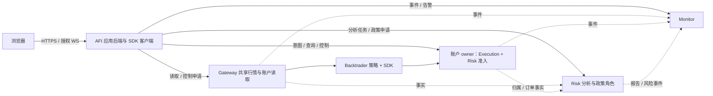

# ai-for-investor 接入与组合风控职责迁移

日期：2026-10-13。状态：**设计计划，全部新增能力待开发**。本文件是 [迭代10正式计划](正式迭代计划.md)第 14 节的配套规格，沿用组件可选、SDK 代理、配置式 ZMQ、账户唯一 owner、组协调及旧转发退役合同。没有新增 Optional16 验收入口。

本次只读审阅 `D:/source_code/ai-for-investor` 当前公开源码。该 checkout 在 master，HEAD 为 `0203154fa7cb831f45b5213fa3666a3983198e7d`，存在大量原有索引/工作区差异；以下链接是可见源码观察，不证明它们等于干净 HEAD。没有修改其文件、分支或索引，没有读取真实配置、凭据、数据库，也没有运行服务或策略。后续开发遵守已有 dev 工作区、小轮验收和逐仓提交原则，实施前先核定 AFI 原有工作区状态。

## 1 决策与边界

建议把 ai-for-investor（下称 AFI）定位为投资工作台和面向前端的应用后端：负责组合定义、研究/AI 交互、身份、审批、展示和应用流程；依赖四包提供共享领域服务。四个包分别可用，不要求用户为查看一个行情页面同时部署四个服务，也不把服务实现在 AFI 里再保留一份。

| 模块 | 权威职责和数据 | AFI 保留什么 |
|---|---|---|
| `bt_api_gateway` | provider 会话/凭据使用、合约目录、共享行情订阅、账户原始事实和读取快照、恢复/查询调度 | 独立 Gateway 管理页、用户订阅偏好和有权限的控制请求；HTTP/WS 展示适配 |
| `bt_api_execution` | 订单意图、订单/成交状态、策略归属/虚拟持仓、未知结果/对账、受支持订单组进度 | 交易工作台、手工/AI 目标确认、订单投影和应用流程；不另建 OMS |
| `bt_api_risk` | 账户最终准入与预留、组政策、权威政策版本/静态预算；独立 worker 的通用估值/收益及组合风险分析 | 风险工作台、组合成员定义、政策草稿/审批交互、报告解释；不保留本地备用规则或预览计算引擎 |
| `bt_api_monitor` | 遥测/业务事件消费、告警规则/去重/状态、运行健康、授权控制请求与结果关联 | 告警展示、用户投递偏好和确认操作；不以应用轮询再维护一套权威告警引擎 |
| AFI 自有业务 | 用户/权限、研究/回测任务、投资目标、组合目录、原始手工/批量导入记录及来源、审批与应用审计 | 继续属于 AFI；不得将用户历史数据随运行器删除 |

本期不增加第五个“portfolio 服务包”。展示组合是业务目录，账户事实来自 G、真实订单与归属来自 E、派生估值及风险来自 R，M 消费这些事实。通用估值/收益内核在 R 内独立分层并使用可选分析依赖，不能塞到账户派发循环里。以后只有多个产品确实需要共享独立投资账簿权威时，再评估单独的组合会计服务。

投资信号、资产配置优化、AI 对话、Brinson/Fama-French 等专门绩效研究不因名称含“风险”就全部移入 R。AFI 可保留这些产品特有工作流/研究编排及暂未由 R 提供的专属模型；一旦同一模型由 R 提供，就迁出计算实现，AFI 只留输入编排、权限、解释和展示。共享行情、估值/收益基线和已迁移风险模型只能有一份实现；使用经过验证且版本固定的数值库，不重复手写一套数学内核。当前 AFI 已声明 [fincore 依赖](D:/source_code/ai-for-investor/src/backend/pyproject.toml:36)，是否复用某个具体算法需逐项核对数值语义。

NautilusTrader 将订单/持仓执行、风险检查和组合派生统计分开；QuantConnect 将组合目标、风险调整、执行分层。这些成熟实现支持职责分离，但没有要求本项目必须照搬其进程或包划分。本计划选择可独立部署的服务角色，并保持 AFI 为消费者。[NautilusTrader 架构](https://nautilustrader.io/docs/latest/concepts/architecture/)、[QuantConnect Algorithm Framework](https://www.quantconnect.com/docs/v2/writing-algorithms/algorithm-framework/overview)

## 2 当前实现与要解决的问题

| 当前源码观察 | 对目标设计的影响 |
|---|---|
| 组合页聚合运行工作区、快照和日志；“risk posture”仅看盈亏正负。见 [页面判断](D:/source_code/ai-for-investor/src/frontend/src/views/PortfolioPage.vue:830)、[后端来源选择](D:/source_code/ai-for-investor/src/backend/app/api/portfolio/api.py:678) | 盈利也可能高杠杆/高集中度。风险卡片改为政策使用率、敞口、数据质量、未决订单与冻结状态；盈亏单独展示 |
| 组合 equity 分支会按 account key 去重，但持仓/配置比例按 strategy sources 展开。见 [持仓来源](D:/source_code/ai-for-investor/src/backend/app/api/portfolio/api.py:1233)、[权益去重](D:/source_code/ai-for-investor/src/backend/app/api/portfolio/api.py:1590)、[配置汇总](D:/source_code/ai-for-investor/src/backend/app/api/portfolio/api.py:1736) | 同账户多策略存在重复汇总风险，不能把每策略看到的全账户持仓相加；引入明确账户视图和归属视图 |
| PortfolioLedger 是用户手工/批量交易行账本，缺少真实订单/成交关联；导入 API 接收交易行数组并保存格式标签，未见 CSV 解析或原始文件留存。按固定初始 NAV 和交易价格重建曲线，读取快照可能触发写入。见 [导入 API](D:/source_code/ai-for-investor/src/backend/app/api/portfolio/ledger.py:60)、[模型](D:/source_code/ai-for-investor/src/backend/app/models/portfolio_ledger.py:20)、[初始值](D:/source_code/ai-for-investor/src/backend/app/services/portfolio_ledger.py:16)、[快照重算](D:/source_code/ai-for-investor/src/backend/app/services/portfolio_ledger.py:160)、[估值路径](D:/source_code/ai-for-investor/src/backend/app/services/portfolio_ledger.py:338) | 保留已有记录和导入业务，补来源行 ID；若后续支持 CSV，解析/来源保存仍属 AFI。当前现金存取直接改变 NAV，并非流量中性收益，买卖按数量×价格计算。迁出通用计算并显式记录资本/现金流/价格来源；它不是 OMS/live 账户权威。重算用明确任务，查询不改账 |
| RiskControlService 是进程内配置/告警/日计数单例，静态检索未见其 check 方法接入已审阅发单链；同名 HTTP 告警查询却读取 DB Alert。见 [服务](D:/source_code/ai-for-investor/src/backend/app/services/risk_control_service.py:75)、[配置入口](D:/source_code/ai-for-investor/src/backend/app/api/risk_control.py:122)、[告警读取](D:/source_code/ai-for-investor/src/backend/app/api/risk_control.py:225) | 不能将规则 CRUD 页面当强制风控证据；R 管政策和准入，M 管告警状态，AFI 展示各自权威结果 |
| AITradingService 会先检查 TradingRiskGuard，确认时再检查并调用 DirectOrderService；仓位比例超限是警告/确认规则，guard 有对象内日计数，已审阅范围未发现 record_trade 应用调用。见 [AI 初检](D:/source_code/ai-for-investor/src/backend/app/services/ai_trading_service.py:90)、[确认/发单](D:/source_code/ai-for-investor/src/backend/app/services/ai_trading_service.py:335)、[软规则和计数](D:/source_code/ai-for-investor/src/backend/app/services/trading_risk_guard.py:174) | 仅覆盖 AI 入口的检查不能视作全局硬限额或可靠账户日额度；保留 AI 信心/解释与人审流程，通用风险检查统一调用 R，最终派发由账户 gate 决定，进程重启不能清掉额度 |
| RiskGateService 实际用于 live 启动/交接；paper 返回空检查并通过，live 若干缺失计划值/观测值转零可能通过正向限额，限额 ≤ 0 会跳过对应比较。见 [启动校验](D:/source_code/ai-for-investor/src/backend/app/services/risk_gate_service.py:93)、[阈值判断](D:/source_code/ai-for-investor/src/backend/app/services/risk_gate_service.py:198)、[数值处理](D:/source_code/ai-for-investor/src/backend/app/services/risk_gate_service.py:349) | 保留产品审批和研究准入，通用风险计算迁 R；缺失事实显式标识并按 live 政策拒绝依赖判断，启动审查不能替代每单最终准入 |
| 风险分析主要消费回测/导入序列，VaR 有历史/参数/Monte Carlo，stress 是历史窗口；基准比较按数组长度截取。见 [API](D:/source_code/ai-for-investor/src/backend/app/api/risk_analytics.py:107)、[VaR](D:/source_code/ai-for-investor/src/backend/app/services/risk_analytics/var_cvar.py:48)、[stress](D:/source_code/ai-for-investor/src/backend/app/services/risk_analytics/stress_test.py:13)、[benchmark](D:/source_code/ai-for-investor/src/backend/app/services/risk_analytics/benchmark_metrics.py:22) | 迁出可复用内核并统一输入/模型版本；按时间而非数组长度对齐，历史窗口回看与假设冲击重估分别命名；报告不授予订单权限 |
| Gateway runtime 由 AFI 进程启动并放在 manager 内，配置解析失败返回 None，后续存在无 gateway endpoint 的启动路径。见 [runtime](D:/source_code/ai-for-investor/src/backend/app/services/gateway/runtime.py:851)、[启动构造](D:/source_code/ai-for-investor/src/backend/app/services/gateway/runtime.py:535)、[进程内 manager](D:/source_code/ai-for-investor/src/backend/app/services/live_trading/manager.py:293) | 连接 owner 独立于 ASGI worker，错误配置显式失败；受管账户不得自动退 direct，多应用副本不能重复登录 |
| DirectOrderService 直接发 place_order/raw ZMQ 命令；CLOSE 读取匹配品种/方向的持仓，按请求数量生成市价平仓单并可拆单。见 [下单](D:/source_code/ai-for-investor/src/backend/app/services/direct_order_service.py:174)、[通信](D:/source_code/ai-for-investor/src/backend/app/services/direct_order_service.py:1678)、[平仓](D:/source_code/ai-for-investor/src/backend/app/services/direct_order_service.py:1516) | 换成 SDK 订单/控制代理，补齐业务幂等、归属和 scope；匹配品种/方向不等于拥有该策略仓位，普通操作不能减掉其他策略的归属头寸 |
| QuoteService 自行管理订阅并可能自动连接 MT5；部分 direct 健康来自策略是否运行；监控服务进程内轮询规则。见 [Quote](D:/source_code/ai-for-investor/src/backend/app/services/quote_service.py:595)、[自动连接](D:/source_code/ai-for-investor/src/backend/app/services/quote_service.py:895)、[健康](D:/source_code/ai-for-investor/src/backend/app/services/gateway/health.py:263)、[监控](D:/source_code/ai-for-investor/src/backend/app/services/monitoring_service.py:328) | 订阅/会话迁 G，规则状态迁 M；页面读取不自动登录，策略活着不能证明账户或行情健康 |

页面名称也不等于已有完整产品：当前 RiskControlPage 调用 [paperRuntime 风险规则 API](D:/source_code/ai-for-investor/src/frontend/src/api/paperRuntime.ts:45)，不是上述 `/risk-control`；PortfolioLedgerPage 存在但 [旧路由重定向到 overview](D:/source_code/ai-for-investor/src/frontend/src/router/index.ts:460)。迁移先登记真实入口，不能照着文件名创建重复页面。所有“未见接入”是静态审阅范围内的结论，不是完整运行覆盖证明。

目前 live `/portfolio` 工作区聚合与 PortfolioLedger 是不同数据面，没有据此确认已存在通用多账户/策略 membership 目录；模型 source_type 字符串也不证明来源隔离。分析结果的 ok/degraded 是报告状态。sizing 的 [API 默认 5 个观测](D:/source_code/ai-for-investor/src/backend/app/api/risk_analytics.py:165)与 [内核默认 30 个](D:/source_code/ai-for-investor/src/backend/app/services/risk_analytics/position_sizing.py:12)还可能使入口结果不一致，迁移时统一显式参数而非保留隐式差异。

## 3 部署、配置和安全委托

图表示逻辑职责。首版账户 G 私有 worker 与 E/R admission 同进程，公共行情 hub、分析 worker、M 可分别部署；独立 G 只读部署仍可用。R 的账户、组政策、`portfolio_analytics` 角色采用固定白名单工厂配置，科学计算与同步 admission 分进程，避免大任务阻塞下单。政策权威目录是 R 的持久化职责，首版固定唯一管理者，不需要新增分布式共识/自动主备。

AFI 后端只安装 SDK/base 和选择的 transport；`application_client` 是应用代理身份，不能伪装成任意 strategy 注册。在 P9A 固定接口集合：market/account read、order query/intent、risk analysis、policy control、monitor query、owner control；每个 binding 指向服务/实例/scope/transport，不复制 provider 连接配置。浏览器继续 HTTPS/WS，不直接接 ZMQ。服务器 components 清单仍表示显式部署即激活，未列出能力不会被应用访问自动启动。

普通研究、回测和导入记录管理不要求四包。使用组合风险分析时才要求相应分析服务；可只部署分析 worker 并提交 imported/research 输入，不登录交易账户。没有配置时 UI 显示“未配置”，不可达显示“不可用”，过期显示“陈旧”，权限不足显示“无权限”；已有 AFI 本地模型迁出后不再暗中回退。只配置 Gateway 可读取市场/账户，但没有 E/R 合同不开放受管交易。

权限需要贯穿应用和服务：AFI 先校验用户对组合、账户、策略的对象权限，再用可信应用身份加有界委托发送请求；服务校验签发方、真实操作者、动作/scope、有效期和防重放信息。不能只靠自报 user_id、ROUTER identity、前端按钮或拥有一个应用主密钥取得全部账户。现有 [workspace 服务用户检查](D:/source_code/ai-for-investor/src/backend/app/services/workspace_service.py:567)可复用思路；[部分 Gateway API](D:/source_code/ai-for-investor/src/backend/app/api/live_trading/api.py:147)虽有登录依赖，调用 manager 时仍需补上对象级作用域。

部署端管理 provider secret_ref，只有实际 session owner 解析。AFI 不再持久化 provider 密钥副本或向策略环境复制，浏览器拿不到可解析秘密的权限；迁移覆盖 [现有 credential JSON 写入路径](D:/source_code/ai-for-investor/src/backend/app/services/live_trading/manager.py:978)，其底层采用 [owner-only 文件权限](D:/source_code/ai-for-investor/src/backend/app/services/live_trading/manager.py:220)，不据此声称加密。本轮不操作现有秘密。IB Client Portal 等外部程序和人工登录交互仍属部署/产品流程，登录界面可在 AFI 发起；会话事实归 G。需要长期运行的外部程序由部署端管理，不依赖 AFI worker 生命周期。

AFI 的 [ws_gateway.py](D:/source_code/ai-for-investor/src/backend/app/services/ws_gateway.py:16)是浏览器主题转发，可保留并强化逐用户授权、有界队列/重连基线；它不是交易 Gateway。该类自身 validator 只检查 token 非空，JWT 身份和 topic ACL 在 [topics 入口](D:/source_code/ai-for-investor/src/backend/app/api/data/topics.py:97)执行，不能把转发类当独立认证边界。应用失联不改变已授权策略的订单路由，不要求已接管的每个订单再次同步调用 AFI；审批授权须有服务端可验证的有限寿命和撤销语义。

## 4 组合风控产品如何组织

| 入口 | 本期功能 | 依赖和使用场景 |
|---|---|---|
| 组合总览 | 多账户/多策略成员、净值与现金流、总/净敞口、集中度、预算使用率、对账/数据覆盖和风险事件；下钻到原始事实 | G/E 事实 + R 派生分析；只读 imported/paper 也可使用，但明确来源 |
| 组合风险分析 | 回撤、相关性、VaR/ES、历史窗口和受支持情景冲击、报告版本对比、缺失输入解释 | 独立 R 分析 worker；研究/人工调仓前评估，不是订单批准 |
| 风险政策 | 账户/策略/可执行组合限额、静态预算分配、草稿/审批/发布及逐账户生效状态、冻结原因 | R 权威政策；共享账户和多账户运营；普通用户无自批增额能力 |
| 交易工作台 | 手工意图、AI 建议目标及差量预览、确认/拒绝、订单/组进度、失败处置结果 | E 唯一入口和账户 R；沿用 AI/策略业务体验，不再直接发 provider 命令 |
| Gateway 管理 | 服务/数据源、账户会话、订阅使用者、合约能力、数据年龄/缺口、查询配额、连接控制 | 独立入口，可只用 G；读权限和连接/账户管理权限分开，不强制所有查看者为管理员 |
| 运行监控 | 策略/账户/组/系统事件、延迟与积压、UNKNOWN/对账差异、告警去重/确认、处置链接 | M 聚合服务事实；监控不可达不改变交易入口 |

组合风控可以把其他页面的摘要和链接集中展示，导航组织不意味着合并部署。优先改造已有组合页、纸面规则页、Gateway 页、AI/交易工作台，复用现有 [研究交接审批界面](D:/source_code/ai-for-investor/src/frontend/src/views/StrategyPage.vue:1426)和 [AI 建议/风险提示](D:/source_code/ai-for-investor/src/frontend/src/views/AITradingPage.vue:484)，不另起一个同质化前端项目。审批人取服务端认证身份，不能信任浏览器传入固定字符串。

用户依次完成：选择带来源的组合成员 → 检查事实完整性 → 查看报告 → 提交有版本的政策或交易目标 → 获得所需审批 → 查看各账户生效/订单实际结果。至少区分“分析完成”“政策已发布”“账户已激活”“订单已接收/已派发/交易所接受/终态”。报告绿色不自动解除冻结；收益为正不自动低风险；告警已确认不等于风险已解决。

## 5 输入、估值和风险合同

### 5.1 成员和事实

- 组合目录包含 tenant/owner、portfolio_ref、不可变 membership_version、base_currency、来源模式和成员范围。业务展示成员与订单组授权分别建模，变更成员不能自动扩权。
- 账户总视图按完整 AccountKey + resource/position key 去重；策略视图只消费 E 的归属账及未分配/外部活动残差。不能将全账户仓位复制给十个策略后相加，也不能把账户总值与其策略切片再次求和。
- 可嵌套展示组合以叶子事实集合求并集；重叠组合允许分别观察，但标注不可直接相加。可执行预算采用有唯一责任归属的分配树/目录，不因一个账户属于两个展示组合就授予双份额度。页面权重只表示展示/目标比例，不创造真实持仓所有权。
- 快照携带各来源的 as_of、接收时间、cursor/epoch、覆盖范围、账户/订单对账状态，以及价格、FX、合约元数据版本。跨账户聚合不假装原子同一时刻；登记最大允许时间偏差，超界报 degraded 或拒绝依赖判断。
- research/imported/paper/live 不混合冒充实盘总账。组合报告可比较多种来源，但不得把模型价格、日志缓存或手工导入视为账户权威；缓存必须保留来源与陈旧状态。

### 5.2 数值和模型

| 能力 | 合同及本期优先级 |
|---|---|
| 估值/收益基线（优先） | 区分现金、权益、资产市值、衍生品名义额、保证金；记录合约乘数/原生数量、计价币/结算币/报告币。现金流、手续费、资金费/融资、已实现/未实现分别处理；初始资本来源明确，收益说明时间加权或资金加权口径，不把充值当盈利 |
| 敞口与限额（优先） | 总/净敞口、杠杆、账户/策略/合约/底层集中度、保证金/现金缓冲、日亏损与回撤、未决/UNKNOWN 风险；使用已有 R 预留账，不按页面净额解除逐账户限制 |
| 相关性与 VaR/ES | 按日期、时区/交易日和频率对齐；定义缺口/异常值政策，不能简单删除非有限值或截取等长数组。记录方法、窗口、置信度、持有期、收益定义、样本阈值、协方差处理/分布假设、模型版本；随机模拟保存种子。先迁移并校验已有方法，不能据此声称通过实盘模型校准 |
| 压力测试 | 历史窗口表现与假设冲击重估分开；冲击因子、价格/FX/利率/波动率、估值模型及非线性覆盖显式列明。缺少期权模型/Greeks 或价格来源返回不可计算，不用线性近似冒充完整期权重估 |
| 流动性与容量 | 有可信盘口/成交量时展示价差、深度/参与率或估计平仓成本，并列明数据时点和假设；无数据不生成伪精确天数。先复用已有可信输入，不额外启动独占行情连接 |
| sizing/调仓建议 | Kelly、风险预算分配和目标差量是建议；限制样本和极端参数，须经审批/账户准入。首版提供可解释预览与已有单腿/受限组执行，不新增全自动组合优化器、任意篮子或 TWAP 平台 |

统一 API 将比例和百分数分开：如 ratio=0.30，显示为 30%；RiskControl 的百分数字段与 TradingRiskGuard 的 0–1 比率逐字段转换，RiskGate 回撤另有 >1 除以 100 的历史处理，不能对所有数字盲目换算。记录原始值/单位和转换版本，歧义字段拒绝迁移。当前 var_95/99 是带符号的下尾收益率分位值，cvar_95/99 是下尾均值，典型亏损样本为负但不保证总为负；新 API 明确 `return_quantile` 与正向损失幅度 `loss_amount/loss_ratio` 的转换，不能悄悄改符号后继续沿用旧阈值。订单金额/数量使用既定精度模型；分析浮点精度、舍入与容差另行登记。

不同产品的 PnL 币种和估值公式不能默认相同。NautilusTrader 文档区分线性/反向合约 PnL 币种，并指出多币种组合需要转换；本计划据此要求元数据和 FX 来源可追溯，不只把数字相加。[持仓和 PnL 说明](https://nautilustrader.io/docs/latest/concepts/positions/)

分析请求固定 input_snapshot_id/digest、组合版本、模型版本及参数，返回 job_id、状态、覆盖率/数据质量、结果和原因。采用有界队列、按用户/组合的并发配额、超时/取消及结果保留策略；重算产生新报告，旧报告保留。分析 job_id 的幂等不能替代交易 intent_id 的幂等。同步准入需要的风险字段必须有独立可验证的新鲜度合同，不能直接相信历史报告。

### 5.3 政策、预算和控制

政策流程为 draft → reviewed/approved → published → 每账户 active/rejected/pending。草稿和审批交互在 AFI，权威不可变版本、授权校验和生效记录在 R；保存操作者、变更前后值、理由、适用范围、版本和时间。首版按受控重启/维护窗口激活，服务恢复后确认实际版本，避免与主计划“不做热更新”的边界冲突。不同账户允许暂时不同版本，页面如实展示。

跨账户硬预算只做保守静态分配：同一预算目录原子保证各账户已分配额度加缓冲不超总预算；各账户只消费已确认分配给自己的份额。增加新分配前扣除仍可能生效的旧分配；收回旧额度必须等对应账户确认止增并核清持仓、预留和 UNKNOWN，不能仅因失联或版本发布就再次分给别的账户。已有风险超过新额度时记录超限并按政策止增/处置，不能删除占用或伪造已合规。

每份预算固定 metric、unit/reporting_currency、估值/换汇合同及版本；首版只允许同一量纲的分配求和，例如同一报告币的总名义额上限。保证金、可承受亏损和名义额是不同预算账，不能混加；原生数量跨合约也不能直接相加。账户预留按政策指定的可信新鲜价格/FX 和保守余量换算，输入缺失/陈旧拒绝新增依赖风险。目录分配、已消费量和市场重估分别记录，重估超限不会凭空增发预算。

这种分配约束的是可授予额度，不保证市场价格变化后组合市值风险永不越限。异步 VaR/相关性和 M 告警只提供观测/处置触发；跨账户冻结/减险可能部分成功，不承诺同一时刻完成。动态全局风险原子准入、自动跨账户资金划拨另行设计，不能混入本期的“组合支持”。

手工单、AI 确认目标、策略单共用账户唯一入口。AFI 提交稳定 intent_id、目标/审批版本、scope、有效期和真实操作者；E 持久化并检查同 ID 同内容，断线或 AFI 重启按原 ID 查询。目标转订单须明确账户/策略归属、当前持仓和已在途订单，目标过期/事实不完整时重新评估，不机械重复补足。审批是必要业务条件，不替代 R 最终准入；AI 不能自批加杠杆或解除冻结。

一次用户操作先生成并持久保留 client_operation_id，HTTP 重试沿用同一 Idempotency-Key。AFI 在发送 RPC 前，以 tenant/操作者/操作键的唯一约束持久化规范化内容摘要及 intent_id 映射；多 worker 并发只能得到同一映射，同键不同内容拒绝。该表属于应用请求记录，不维护第二套订单状态机；服务受理后仍以 E journal 为准。新业务决定才创建新操作键，不能把未知请求当作新决定重发。

审批凭据绑定规范化意图/目标摘要、成员版本、账户/合约/腿范围、数量与价格边界、政策版本、操作者及有效期，由 owner 验证并在接受意图时幂等消费；目标或关键版本改变须重新审批。撤销阻止尚未接受的新意图；已接受的订单/组已产生独立管理责任，撤销改为向 owner/协调者提交有稳定 ID 的止增和处置请求。按预先批准的有界政策撤单/减险，不直接中止必需对冲或任意撤保护腿；各账户确认之前显示撤销待处理/部分完成，不能宣称全局立即撤销。服务端已接受的处置授权与客户端租约分开，未决责任不因审批到期消失。

停止进程、禁止新增、策略级撤单、归属减仓、账户级管理是不同动作及权限。已有组的腿只能经协调者处理；普通页面不能任意撤去保护腿。请求受理、部分完成、UNKNOWN 和最终完成分别返回；不能把“停止策略”写成“账户已平”。M 可发授权控制请求，但账户 owner 保存执行事实，告警 ACK 不会清除风险冻结。

## 6 源码迁移清单与退出条件

| 现有功能 | 迁移目标 | AFI 最终保留/删除 |
|---|---|---|
| `services/gateway/{runtime,manual,launch_builder,health}`、manager 内 Gateway runtime/会话状态 | G 服务 + SDK 代理，交易控制转 E/R | 保留 API/页面/DTO 映射；删除本地会话 owner、旧 GatewayRuntime 导入与解析失败回 direct；IB 浏览器登录说明和部署请求可保留 |
| `quote_service` 的 provider 订阅/自动连接 | G 共享订阅与合约数据 | 保留 watchlist/用户偏好和浏览器扇出；删除重复行情连接与账户登录 |
| `direct_order_service`、manager 的订单/批量撤平控制 | E 意图/查询/有界控制端口 | 保留确认交互、应用请求映射；删除 raw ZMQ/provider 派发，现有函数名可作为薄 API facade，不能藏第二套执行器 |
| `live_trading/service.py` 的 CCXTStore/Data/后台策略路径 | 先核对活动消费者，连接/订单分别接 G/E；策略进程编排仍可属于 AFI | 静态搜索未发现 submit_live_strategy 的活动调用，不据此直接恢复它；若无消费者则退役，若保留须同样迁移，不留旁路 |
| RiskControlService、TradingRiskGuard 通用规则/计数、RiskGateService 的重复市场风险判断 | R 准入/政策；风险事件接 M | 保留 AI 信心解释、人审和研究就绪业务规则；删除共享风险公式、内存额度和本地备用预览；检查 paper risk rule 实际入口一起迁移 |
| `risk_analytics/*`、`portfolio_ledger_analytics` 共用风险/估值/收益计算、portfolio API 重复聚合 | R 独立分析 worker 和统一输入/输出合同 | 保留研究编排与产品专用绩效展示；已抽取内核删除，API 只调用服务并投影，不复制数值实现 |
| PortfolioLedger CRUD/import/export、历史审批/研究记录 | AFI 业务数据；派生结果关联 R 报告 | 原始数据保留，定义迁移 schema 和来源 ID；无需造交易所 order/fill ID，也不将全部导入迁入 E |
| monitoring_service/alert_evaluation 的后台采样/规则/告警状态 | M 事件规则与持久状态 | 保留通知偏好和 UI；如保留应用投递 adapter，使用 M 的事件/投递 ID 幂等，不重复评估阈值 |
| `ws_gateway`、data topic 权限、应用 REST 路由 | AFI 薄展示适配 | 保留用户隔离/有界推送；不能提供绕过服务授权的原始账户 topic |

迁移可借鉴逐功能替换的 Strangler Fig 模式：先建立稳定 facade，逐项导向新实现，再移除旧实现。微软也强调一个数据事实源及替换验证；本计划允许同一固定输入上的只读计算对比，**不允许两套真实账户 writer 为了对比同时运行**。[Microsoft 迁移模式](https://learn.microsoft.com/en-us/azure/architecture/patterns/strangler-fig)

1. **P9A：合同和基线。** 按真实路由/调用登记消费者、单位、源身份、旧数据/政策和权限；准备脱敏固定数值基准、版本兼容矩阵及转换拒绝条件。应用与服务均不反向 import 对方业务代码，DTO/端口按主计划留 base，SDK 提供轻量适配。
2. **P9B：先只读。** 接 G 共享资源、R 分析 worker 和 M 基本事实；改组合/Gateway 页面。相同冻结输入做只读影子对比，差异逐项解释，不能为匹配旧错误而保留重复计数/错误符号。先迁离线输入，再真实账户读取，分别标证据；策略归属视图等待 P4 的实际归属事实，不用全账户仓位假造。仍有旧写客户端的账户不能仅因读页面迁好就切掉原会话，等待该账户读写闭包就绪。
3. **P9C：政策和写链路。** 单账户少量策略接版本政策/审批/同一 owner，覆盖手工与 AI 意图；之后扩多账户及已验收组模板。迁移前停止新增并核对在途订单/预留/残差，保留原业务 ID；不直接把日志交易当已确认完整账户账本。
4. **P9D：删除旧领域实现。** 每功能在新链路通过后移除旧运行器、内存规则、直发命令、活动任务及旧状态写入。保留原始导入、历史审批、订单关联和必要只读历史数据；AFI DB 中的服务投影是可重建缓存，不能再被当权威修改。P9D 先清理 AFI 依赖，不等待 P7R；旧公共 gateway/forwarding 物理删除由 P7R 统筹，必须等 AFI 读写/启动消费者在 P9B/P9C 切换或退役，且 P9D 完成对应旧依赖清理；不能只迁读端就删除仍供旧发单使用的 wire。
5. **逐仓交付。** 子包先在各自 dev 验收/提交，父仓更新 gitlink 和兼容版本，AFI/Backtrader 再集成指定已提交版本。回退只选有已验证数据/政策兼容性的完整版本，不能降级仍持有新订单/预留的数据库或恢复第二 owner；不能安全回退时保持止增并按恢复政策处理。

## 7 验收与范围控制

正式计划新增 P9A–P9D 和 AFI01–AFI12。原 CFG/GW/EXE/RISK/MON/ARB/DIM/MIG 案例仍有效；AFI 集成必须走真实 HTTP → SDK → 独立服务正常入口，前端截图或 fake API 不能证明风控拦截、账户共享或实盘可用。跨机器与 provider 行为继续分别按 DIST/VENUE 验收，不创建另一套平行验收基础设施。

优先交付顺序是：可信组合只读总览和独立 Gateway → 统一分析口径与数据质量 → 版本政策和账户准入 → 手工/AI/策略共用执行入口 → 监控控制闭环与旧实现删除。后续高阶组合优化、复杂衍生品全量情景模型、动态全局预算、自动主备及 HFT 都需独立范围和证据，不借本次改造宣称完成。

本轮验收仅为文档链接、配置示例、计划编号、阶段依赖和职责一致性检查。没有新的功能/真实账户 PASS，未更改 AFI 工作区或任何运行代码。
