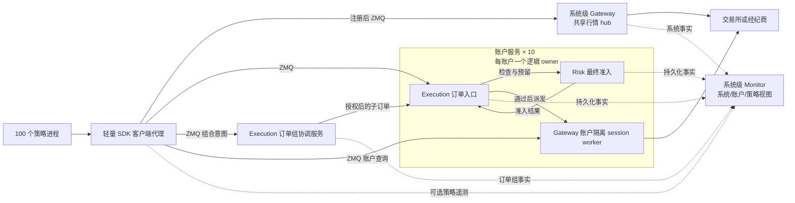
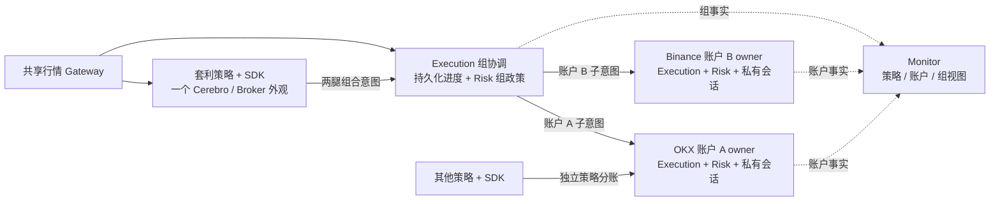

# bt_api_py 迭代10 可选组件与可配置通信完善计划

日期：2026-10-13

本版修订：在多策略、多账户、多品种及旧转发退役设计上，加入 ai-for-investor 的组合风控与基础设施接入，并完成职责、配置和迁移顺序的整体复核。四包成为共享领域能力，ai-for-investor 保留产品界面、组合定义、审批及薄 API 适配，迁出重复的连接、交易、风险和监控实现。Gateway 等能力可有独立产品入口，不强制塞进同一页面或进程。四包继续可选，策略只用 SDK 代理。本轮补齐应用身份、人工分账、受管 paper、发行兼容与逐账户切换合同，仍仅为迭代计划。

实施状态（2026-10-13）：已按用户后续指令进入开发；上文及第 15 节的“本轮仅计划”描述保留为前次文档审查记录。实际交付和证据级别以[开发与验收进度](开发与验收进度.md)为准。
编号依据：本仓已有迭代04（CTP）及迭代09，本计划由误用的迭代04改为迭代10；Backtrader 迭代44引用保持原义。

状态：设计完成，待实施；本文不代表功能已经实现或运行验收通过。

范围：`bt_api_gateway`、`bt_api_risk`、`bt_api_execution`、`bt_api_monitor`，以及配套的 `bt_api_transport_zmq`、SDK 装配、Backtrader 和 ai-for-investor 接入。

本迭代将四个子包完善为可选择部署的服务端功能。**不部署服务、不配置客户端时，BtApi 和 Backtrader 的普通 direct/回测路径照常运行；旧远程转发配置须显式迁移。显式启动某项服务后，声明的组件默认运行，不再重复填写 `enabled: true`。** 策略端 `config.yaml` 申请接口、订阅及代理挂载，服务端 `config.yaml` 决定提供的能力、账户政策和访问权限；策略的注册申请不能改变服务政策。第一版通信实现统一使用 `bt_api_transport_zmq`，为以后增加其他后端保留接口。

主要规模目标是 **100 个策略进程使用 10 个真实账户，策略与账户多对多关联**。一个策略可同时使用多个账户，一个账户可服务多个策略。按账户集中管理共享状态和交易写入，跨账户套利按订单组协调，按行情订阅需求复用上游连接。四个 Python 包不等于四个独立微服务；可以在服务端工作进程中组合，也可以部署到不同机器。

## 1 用户要求和迭代边界

### 1.1 已确定要求

1. 不开发新的 Optional16 验收入口。已经停用的入口继续停用，历史记录保留；功能验收复用各包及 SDK 的正常入口。
2. gateway 重点解决行情转发、账户信息转发和上游连接共享。同品种的多个策略不应各连一份行情，同账户的多个策略不应各自重复登录账户。
3. risk、execution、monitor、gateway 都是可选部署的服务端功能，允许单独使用和组合使用；未选择部署的组件不得成为普通路径的安装或启动前提。已启动服务的能力按部署清单激活，策略申请注册使用；共享账户政策和账务不能逐策略自行退出。策略端只用 SDK 代理，不安装、导入或实例化四个领域包。
4. 通信后端可配置。首版只实现 ZMQ，不同时引入 NATS、Redis、Kafka 或 gRPC 服务。
5. 支持同机多进程，并完成跨机器通信设计与验证；首版跨机器部署采用静态服务地址和固定账户归属。
6. 结合 Backtrader 使用，同时保留组件独立于 Backtrader 的公开接口。
7. 当前交付仅为本计划。后续代码开发按现有各仓 `dev`、小轮验收、明确范围提交的方式推进。
8. 同一套利策略的多腿可落在不同交易所或同交易所的不同账户；策略只提交组合意图，已接受订单组的执行、对冲和恢复由服务端负责，不能依赖策略进程一直存活。
9. 旧 `bt_api_py/forwarding` 和 `bt_api_base/gateway` 不作为最终架构保留；需要的行情、账户会话与转发功能迁入 `bt_api_gateway`，通信实现归 `bt_api_transport_zmq`，SDK 仅保留代理/装配。当前仍只修改计划，代码迁移和删除列入实施轮次。
10. 多策略、多账户、多品种是基础模型；行情源、账户资源、订单归属和组合腿使用各自完整键。全场景覆盖清单见[场景覆盖与旧转发迁移清单](场景覆盖与旧转发迁移清单.md)，覆盖登记不代表策略已可实盘或认证案例通过。
11. ai-for-investor 的组合风控和相关基础设施后续依赖这四个组件，不长期保留重复领域实现。组合工作台、Gateway、执行与监控可分开呈现，详见[ai-for-investor 接入与组合风控职责迁移](ai-for-investor接入与组合风控职责迁移.md)。本轮仍只完善计划。

### 1.2 本迭代不承担的工作

- 自动跨机器主备切换、共识集群、Kubernetes 调度、热迁移和无中断配置热更新。
- 在策略进程嵌入 gateway、risk、execution 或 monitor 的领域实现；单策略调试和研究也不为新服务路径增加这种部署模式。
- 新增 TWAP/VWAP 等算法执行器、机器学习风控、完整合规系统或另起独立监控前端项目。复用 ai-for-investor 现有前端接入四组件属于本期范围。
- 一次性支持所有交易所的生产写单。通用功能按合同实现；具体交易所按实际接入能力逐个验证。
- 改写历史验收结论、删除历史证据或恢复 Optional16。旧转发运行代码、入口和配置消费路径的退役属于本期范围；历史已发布版本和冻结的测试材料不改写。
- 把“可不启用风控包”解释为取消已有权限、输入校验、账户身份校验或交易所限制。
- 跨交易所原子成交、自动资金划转、共享保证金和全系统组合优化。本期顺序交付两腿组及期权示例需要的受限三腿组；任意多腿执行算法另行扩展。原生条件/止盈止损/算法单先登记能力及明确拒绝未实现请求，不因字段存在就承诺其生命周期已实现。
- 将异步组合 VaR/压力测试当作跨账户原子准入，或让 AI 建议直接修改生效规则/下单。组合分析和静态预算分配纳入本期，动态全局风险资源协调与新的组合优化算法另行设计。

## 2 当前基线和实际缺口

最初源码核对基线为主仓 `cfe6543e7bc9aaa3622624f1b490b4d5f99f3766`，场景清单后续使用 `1905c024` 文档版本。本次整体审查开始于 `66b608e1b179f705df0a0502a3297c04c6c97212`，只复核公开边界源码和仓库元数据，未运行组件。下列基线说明已有能力，不是目标能力的完成声明。

本轮共同引用的仓库定位（2026-10-13）：

| 仓库 | 分支 / HEAD | 观察边界 |
|---|---|---|
| bt_api_py | dev / `66b608e1b179f705df0a0502a3297c04c6c97212` | 文档修改前索引/工作区干净 |
| base | dev / `eaa0c5dab3a16d601d061aed373c89f6e34d057f` | 中立合同及依赖检查 |
| gateway | dev / `8a702c22e1c58400bd7c659392aadfd0575c1ebc` | 既有能力基线保持 |
| risk | dev / `126d90667a39c67bcd2da2cb2c63abd8cf8b7e7f` | 复核分析导出与安装依赖 |
| execution | dev / `bf67f062869cc2194e07b06a7ce7bb7f630c0161` | 既有能力基线保持 |
| monitor | dev / `a2d108fb2ee8c0f2a034b9ffdbf3aed4bdd8f0c6` | 既有能力基线保持 |
| transport_zmq | dev / `43751c7b5fb87054517bf28fc05d0321bbea6496` | 既有能力基线保持 |
| Backtrader | dev / `4370013d35a3efef5a26689de1322048121bcd60` | 原有工作区修改保留，链接指向可见源码 |
| ai-for-investor | master / `0203154fa7cb831f45b5213fa3666a3983198e7d` | 原有索引/未跟踪状态保留，不能把可见源码当干净 HEAD |

| 位置 | 当前已有能力 | 本迭代缺口 |
|---|---|---|
| `bt_api_gateway`，`8a702c2` | 持久化命令路由、账户 writer authority、本地事件 journal、游标与快照接口 | 没有完整的上游行情订阅共享、账户会话管理和远程快照加增量闭环 |
| `bt_api_risk`，`126d906` | 风险规则基础、持久化预留、分配、冻结与 admission 合同 | 真实账户状态接入、策略虚拟分账、完整订单敞口转换、账户级并发组合尚不完整 |
| `bt_api_execution`，`bf67f06` | intent/order 状态机、持久化派发与 UNKNOWN、观察回填、部分撤单和 CTP 基础合同 | 多策略共用账户 owner、完整撤单与成交归属、统一恢复和 Backtrader 主路径接入尚不完整 |
| `bt_api_monitor`，`a2d108f` | 指标、健康检查、durable outbox、只读查询、受验证控制入口 | 实际事件生产链、账户和策略聚合、断线补传、控制执行结果闭环尚不完整 |
| `bt_api_transport_zmq`，`43751c7` | 版本化 wire、ROUTER/DEALER、远程 CURVE/ZAP、命令 ACL、序号和有限内存重放 | 没有行情 PUB/SUB 实现；私有事件的持久化读取、消息派发接口和配置工厂需要补齐 |
| `bt_api_py/forwarding`、`bt_api_base/gateway` | 旧行情和账户转发、局部订阅计数、source supervisor | 作为迁移来源盘点；需要的行为迁入新 gateway/transport，完成消费者切换后删除两套运行实现 |
| `bt_api_py/runtime_plugins` | 代码登记、按需加载、受约束的装配 | 当前 managed 路径固定要求 execution/risk/monitor 等组合，并非独立可选组件体系 |
| Backtrader Store/Broker | 现有 direct/forwarding 接入、订单和账户投影 | 同一 Cerebro 共享 Broker；不能直接等同于跨进程账户 owner 或每策略独立虚拟账户 |

现有源码及迁移来源（旧转发文件仅供迁移核对，不是目标运行依赖）：

- [组件合同](../../../bt_api_py/runtime_plugins/contracts.py)、[可信登记](../../../bt_api_py/runtime_plugins/catalog.py)、[现有组合](../../../bt_api_py/runtime_plugins/managed.py)。
- [现有转发运行器](../../../bt_api_py/forwarding/service.py)、[订阅源生命周期](../../../bt_api_py/forwarding/source_supervisor.py)、[旧 ZMQ 传输](../../../bt_api_py/forwarding/transport.py)。
- [Gateway 定位及 journal](../../../bt_api/bt_api_gateway/README.md)、[Risk admission 边界](../../../bt_api/bt_api_risk/README.md)、[Execution 合同](../../../bt_api/bt_api_execution/README.md)、[Monitor outbox](../../../bt_api/bt_api_monitor/README.md)、[ZMQ 传输合同](../../../bt_api/bt_api_transport_zmq/README.md)。

Backtrader 迭代44仅负责参数与配置校验，其目标 v5 配置还不是当前运行能力。本计划承接其字段校验接口，不把本迭代的服务、订单和进程功能塞回迭代44，也不重复建设校验器。

## 3 四个包的职责和状态归属

| 服务端组件与层级 | 核心职责 | 服务端维护的状态 | 策略侧使用方式 |
|---|---|---|---|
| gateway：系统共享服务，内部按账户分区 | 共享行情源、账户会话、查询合并、数据标准化与转发 | 公共行情订阅；按账户隔离的凭据、会话代次、原始事实和可重放读模型 | SDK Store 代理注册订阅/账户读取；provider session 仅供账户服务派发 |
| risk：账户准入、可选组政策与独立组合分析角色 | 账户/策略额度、预留与冻结；组风险；版本化估值/收益/风险分析 | 账户/组政策和占用；独立 analytics worker 保存分析任务、输入版本及结果，不阻塞账户热路径 | SDK 查询预算/报告；最终 admission 始终在账户 owner，分析报告不是派发授权 |
| execution：账户订单权威，加可选组协调角色 | 账户负责派发/归属；组协调负责同账户或跨账户的两/三腿顺序、补偿及恢复 | 每账户订单/成交/UNKNOWN；协调服务独立持久化 group/leg 进度及关联 | SDK Broker 代理申请账户订单或订单组接口；协调者也只调用账户订单入口 |
| monitor：系统级观测服务，账户/策略/订单组视图 | 消费事实，提供运行状态、指标、告警、只读查询和经授权的控制请求 | system/process、account、strategy、group 维度的投影、指标、告警与控制结果 | SDK 可选上报策略遥测；账户及组协调服务自身的事实上报不由策略关闭 |

`bt_api_py` 负责配置解析后的组合、账户路由、适配器注入和生命周期。`bt_api_transport_zmq` 只负责通信，不持有交易所登录凭据、不决定订单状态、不判断风险规则。领域包不导入 ZMQ，也不硬编码其他通信后端。

一个实际账户的原始余额和持仓事实来自 provider，经服务端 gateway 或原有 provider adapter 获取；execution 维护订单与策略归属，risk 使用这些事实计算限制。monitor 是消费者，不用监控缓存替代交易准入事实。没有 execution 时，risk 由账户服务内的 SDK 派发适配层接收原有订单端口的事实，不自行实现另一套 OMS。SDK 代理允许缓存只读投影、消费游标和有界待发送指标，不拥有四包的业务状态库、规则引擎或连接 owner。

ai-for-investor 后端是这些接口的产品客户端，通过 SDK 做权限委托、API/UI 映射和业务流程；浏览器使用现有 HTTPS/WebSocket，不直连 ZMQ。账户、实盘订单、有效风险政策和监控事件的权威分别留在服务端。组合定义、原始导入材料、用户审批和展示偏好可留在应用层；已迁移的领域计算/状态机不在应用层再保存一份备用实现。导入账本与 live 事实的具体边界见第 14 节及配套文档。

层级描述状态和管理范围，不等同于进程数量。Gateway 是系统级部署组，由行情 hub 与多个账户 session worker 组成；每个实际 RPC 服务有独立 service_id、作用域、epoch 和地址，不共用一个能读取所有私有数据的 system scope。Monitor 可以集中部署但按账户授权查询。Risk/Execution 的账户角色可以共享进程，各账户状态和准入隔离；其订单组角色部署在服务端协调进程，管理指定策略/组合的腿状态与规则（第 13 节），不由 Monitor 汇总代替。

### 3.1 同名数据的权威边界

| 数据/职责 | 唯一负责方 | 消费者不得做的推断 |
|---|---|---|
| provider 报告的余额/持仓/权益、原始订单回报 | G 或已有 provider port 保存来源事实 | 权限过滤的账户视图不等于策略拥有的头寸；provider 权益不等于可跨账户使用的现金 |
| 订单、成交、费用、成本基线、原币已实现 PnL 与策略/人工 book 归属 | E 或满足同等合同的既有 OMS | 真实账户与归属账分别核对；M/R/AFI 不能改写成交或消除未分配残差 |
| 准入额度、预留、冻结和账户有效政策 | R 账户角色；无 R 时不得宣称有相同保护 | allocation 是限额，不是资金划拨、现金或保证金事实 |
| 报告币估值、收益、组合风险指标及模型结果 | R 分析角色，保留来源和模型版本 | 不能覆盖 provider 事实或 E 成本账，不能用历史报告代替当前准入 |
| 指标/告警、ACK 与处置结果投影 | M | 阈值计数不成为另一套准入规则，确认告警不解除 R 冻结 |
| 研究/导入组合、投资目标、用户审批及界面流程 | AFI | 业务组合成员关系不自动变成服务授权或可执行订单组 |
| 策略逻辑、Cerebro 调度、离线模拟 Broker/Analyzer | Backtrader | 回测/模拟成交不冒充 live 成交；本地 Analyzer 输出不授予远程写权限 |

通用报告算法迁出 AFI，不要求 E 的基础成交记账反向依赖 R 的科学计算包；成本账与报表估值按各自合同保留。普通离线回测的既有 Analyzer/模拟 Broker 继续本地运行，不因“统一组合分析”强制启动 R。需要 AFI 共享风险报告时才使用相应分析代理。

## 4 进程和账户管理模型

### 4.1 推荐组合



图示为推荐的四组件启用部署；箭头表示调用关系，最终 provider 派发和账户订单事实仍由 execution 的账户 owner 角色管理，组协调角色管理跨账户进度，risk 不直接写 provider。`AccountOwner` 是 SDK 的服务端账户装配和写入归属，不是新增第五个业务包，也不要求四包全部存在。组件不在部署清单内时采用第 5.2 节定义的服务端适配，不在策略进程补一个组件实例。

Gateway 的系统级定位不要求将全部私有连接集中到一个大进程。首版将公共行情 hub 独立部署，账户 session worker 放在对应账户 owner 的同一进程内，作为其内部组成，共用该账户 RPC 服务身份。部署清单登记市场服务及各账户服务的端点和 worker 实例，同一真实账户只有一套必要会话集合。将私有 session worker 拆出 owner 进程需另行完成远程派发幂等、授权和 UNKNOWN 恢复合同，不作为首版已支持拓扑。

每个账户唯一的远程订单写入口是 `service.order_entry`，由 execution 或 risk-only 的 SDK 派发适配器实现；该 owner 只有一个最终 dispatcher。risk admission 和 `service.provider_session` 在首版属于账户服务内部端口，不作为策略可直接调用的写接口。账户查询仍可访问相应只读端口；管理控制经授权接口进入同一个账户命令处理链。

- 策略与账户采用多对多显式映射，例如 `s001 -> {okx-a01, binance-a02}`、`s002 -> {okx-a01}`。服务端逐账户校验可信身份和动作授权，不能相信消息自行声明的 `account_id`；多账户不要求拆成互不知情的两个策略。
- 一个 owner 可以服务同账户多个策略；多个账户也可以共处一个工作进程，但账户队列、状态和权限隔离。首版推荐一个账户一个工作进程，便于故障隔离。
- gateway、execution、risk 的写入检查绑定同一逻辑 owner 及代次，不各自选举相互独立的账户 writer；各包原有必须保持的存储/租约约束由组合层协调。
- 账户键绑定 provider、environment、真实账户/子账户；认证主体经可信目录映射到该账户，不作为复制账户身份的维度。产品和保证金池另作资源分区。多个产品共用真实资金池或会话时必须协调同一账户 owner，不能仅因产品名不同就创建第二个 writer 或把共享余额重复分配。API key 是凭据引用，轮换或增加 key 不创建新账户身份。
- 行情可在多个账户之间共用，但仅合并数据源、环境、产品、品种、频道、深度、周期及访问权完全兼容的订阅。
- “一份连接”指一套必要的上游连接集合，不承诺把独立的行情、私有 WebSocket、REST 或 CTP 会话合成一个 socket。
- 策略退出只释放自己的订阅和代理；最后一个订阅者退出才按策略释放上游，不能关闭别人的账户会话。

### 4.2 同机与跨机器

新服务路径只支持两种部署：同机多进程和静态跨机器部署。策略到服务始终通过配置的 ZMQ 客户端代理访问；策略进程不直接调用四包实现。同一个服务进程内的领域模块可以经内部端口调用，例如一个账户进程组合 gateway、execution 和 risk，这属于服务端内部组合。

四组件均未部署时保留原有 direct/回测路径，不为了“兼容”启动空服务。切换到服务管理的账户后，策略进程不持有该账户的 provider 凭据，不同时为同一账户保留可绕过服务的 direct writer。后续拆分服务应依据独立扩容、故障隔离或部署边界，首版不为了包名不同强制增加网络往返。

跨机器时，一个账户的写入仍固定到一个 owner。其他机器部署策略、共享行情或 monitor，不能各启动一个可写的同账户副本。租约和进程心跳不能单独阻止旧节点继续对外写入；没有外部 fencing 能力时不开放自动接管。计划内恢复先确认旧写入路径失效、处理在途订单、恢复状态，再人工切换固定归属。

SQLite journal 留在状态 owner 的本地磁盘，由远程接口访问。SQLite WAL 要求共享数据库的进程位于同一主机，不能用网络共享目录冒充跨机器数据库。[SQLite 官方 WAL 说明](https://www.sqlite.org/wal.html)

### 4.3 多策略 多账户 多品种的公共模型

三种“多”可以同时出现，不通过为每个策略或品种复制服务实现。多个策略可交易同一账户同一合约，一个策略可使用多个账户和合约；逻辑分区与部署进程数分开。

| 标识与作用域 | 最小合同 |
|---|---|
| 策略 | 稳定 strategy_ref 表示独立归属实例；run_id/运行代次表示一次运行。同一代码的两次独立资金分配必须有不同策略身份 |
| 账户与资源池 | 可信 AccountKey 表示真实账户；resource_pool_ref 标识共享现金/保证金、币种和保证金模式。产品划分不自动隔离真实资源，多个 API key 不产生多份余额 |
| 合约 | InstrumentKey 至少区分 provider/venue、环境、产品类型和规范化合约 ID，保留原生 symbol。不同到期月、行权价、认购/认沽、结算资产、线性/反向合约不能因简称相同混用 |
| 行情订阅 | MarketSubscriptionKey = 数据源/权限集合 + InstrumentKey + channel/depth/timeframe；账户身份只有在数据权限要求时才参与。一个合约的多个周期可共享兼容上游，但保留各自投影 |
| 订单与成交 | 业务 ID 绑定策略或人工 book 归属、account/instrument 及适用的 group/leg；外部订单号、成交号按 provider 实际唯一范围加执行域、账户、环境、会话/交易日等命名空间，不能全局按裸字符串去重 |
| 持仓与可平量 | PositionKey = account + allocation_owner_ref（策略、人工 book 或未归属桶）+ instrument + position_side + 必要的 hedge_flag/今昨仓桶；真实净持仓与虚拟分账分别维护 |
| 组合 | portfolio/group/leg 引用真实账户和合约；同账户不同合约、不同账户相同合约均合法。合成价差不是可直接下单的原生合约，除非适配器声明原生组合单能力 |

托管 paper 的身份另含明确执行域及模拟账户 ID，不伪装成真实经纪账户；所有授权、订单/成交键、账本和资源池均与 live 隔离。真实 venue demo/testnet 仍是对应 sandbox 环境的 provider 账户，不等于本地 paper。公共行情可以共享，执行域不能因共享行情而合并，详见 AFI 配套规格第 3.1 节。

合约定义统一提供价格/数量步长、乘数、计价和结算币种、保证金及费用来源、交易状态、交易日历、到期日和元数据版本。期权再提供 underlying/strike/expiry/right；风险因子如 Greeks 必须注明来源、模型版本、单位和新鲜度。Gateway 提供原始事实及分发，风险规则使用可信输入，策略模型仍留在策略中；不把统计建模和信号优化搬入网关。以唯一合约标识贯穿行情、订单、持仓和记账的做法可参考 [NautilusTrader 合约模型](https://nautilustrader.io/docs/latest/concepts/instruments/)，本项目账户/环境键按自己的合同补充。

所有列表/快照必须声明查询范围、分页是否耗尽、过滤条件、观察时间和版本；“只查询 BTC”不能被解释为完整账户只有 BTC，“未返回某合约”不能自动视为零持仓。风险上限按资源池、账户、策略、合约/底层资产和组合分层检查；币种/单位不兼容时拒绝直接相加。跨账户全局预算首版只做可信静态分配，总分配不超过上限；动态全局重新分配另行设计。

本期 resource_pool_ref 限于一个 AccountKey 内。产品/保证金模式到真实池的映射由 provider 合同确定；复合占用可引用多个池，但同一份现金/抵押品只能登记一次，不能因多个产品或币种投影重复生成可用额度。若两个 AccountKey 实际共享抵押品，必须先统一真实资源归属；无法形成单一账户准入 owner 的配置，本期拒绝受管写入。跨账户静态预算只是限额分配，不代表共享实际资金。

## 5 可选配置与兼容合同

### 5.1 服务启用、策略注册和政策的边界

| 概念 | 决定方 | 含义 |
|---|---|---|
| 服务能力 | 运维部署清单 | 进程提供哪些组件/端口；显式启动后清单内组件激活 |
| 账户/系统政策 | 服务端可信配置 | 账户额度、策略分配、权限、观测及恢复要求；客户端不能修改 |
| 策略使用申请 | 策略端配置 | 订阅、查询、交易或上报哪些接口，以及本地代理挂载位置 |
| 有效注册 | 对应服务端 | 校验真实身份、策略与账户映射、可用能力和政策后，授予明确范围的会话 |

**启动服务就是启用其声明能力，不再要求双方填写相同的 enabled 开关。** 专用启动模板分别提供 Gateway、Risk、Execution、Monitor，账户组合模板可展开 execution+risk+账户 session worker；模板只生成可检查的明确部署清单。普通 SDK 导入、安装包或启动未指定角色的通用进程，不自动开启所有组件。模板须带版本并在启动摘要展示展开结果，不能随软件升级悄悄增加组件。

新服务配置中，`components` 的键就是本进程的激活清单；缺少组件则不加载它。键存在但缺少必要账户、政策、存储或身份引用时报告配置错误。业务规则有自己的适用条件和参数；服务运行不代表开启每一种业务规则，更不代表立即登录全部账户或自动开始交易。

政策再区分三类，不能互相替代：`registration_policy_ref` 定义真实身份可申请哪些接口/动作/作用域；risk 按角色使用 `options.account_policy_ref` 或 `options.group_policy_ref` 定义限额和风险规则；`service_requirements_ref` 定义哪些数据、恢复状态和依赖必须满足才可交易。就绪要求只校验部署及运行事实，不自动激活缺失组件。服务端回执分别返回适用的访问政策、风险政策和就绪要求版本，没有 risk 包时明确无该包政策，不能伪造“风控已通过”。分析模型/政策目录角色的不同引用见第 5.6 节。

| 输入/事件 | 目标行为 |
|---|---|
| 无新服务部署，策略无 clients 或 clients 为空 | 原有普通路径，无新增四包依赖/资源 |
| 服务清单声明组件并显式启动 | 创建并恢复该组件，就绪后接受注册；不再要求 enabled |
| 策略 clients 声明 SDK 代理 | 申请接口，授权成功才挂载；不加载领域包、不启动服务 |
| 服务未提供必需能力，或账户政策要求的服务未就绪 | 启动/注册失败，明确原因；不自动改为 direct |
| 明确声明非必需的遥测/只读扩展申请失败 | 显式返回未授予/降级；不能移除订单链必要的风控或记账 |
| 通信 profile 未被使用 | 纯配置校验，不创建资源 |
| 显式启动通用服务但 components 为空 | 拒绝无能力部署；普通路径不会启动该服务，二者不混为一谈 |
| 已授予接口运行中失联 | 按既定失联政策处理，不重新解释成“未配置” |

新 schema 不接受 `enabled`，避免“已声明但又关闭”的歧义；删除申请项表示不使用接口，删除服务组件表示下一次维护启动不部署。旧 v4/v5 的历史语义保持不变，不能将旧 enabled 缺省直接按新语义迁移；转换必须明确列出最终激活清单。未知组件名、未知 backend 和任意 Python 模块路径仍拒绝。

**“未申请就不适用”仅限可选接口与附加功能，不适用于共享账户的事实和政策。**

| 策略未申请的接口 | 对该策略不提供什么 | 仍然有效的服务端行为 |
|---|---|---|
| gateway 行情/账户读取 | 不创建其订阅/读取代理 | 其他策略及账户服务仍可使用会话；只回收该策略订阅引用 |
| execution 订单接口 | 不授予该受管账户的下单能力 | 原有订单、成交、持仓仍被管理；不能改走 Gateway 直连写单 |
| risk 预算查询 | 无本地预算查询代理 | 已启用的账户风控仍作用于全部受管订单，所有占用计入账户总量 |
| monitor 策略遥测 | 不采集该策略的附加指标/自定义日志 | 已启用的账户/系统事件、订单拒绝与审计仍由服务端产生 |

策略特有的附加风控规则可按服务端已批准的策略 profile 选择，账户底线不随选择关闭。例如账户上限 100，策略 A 已占 80，策略 B 没申请 risk 查询便下单 40；仍须拒绝，否则不构成账户级风控。某策略停止注册也不能释放它尚未结束的订单预留。

策略未申请服务而继续使用旧路径，仅限未纳入服务管理的账户/运行环境。同一真实账户不能一部分策略受管、一部分策略用同一凭据绕过。外部人工活动必须纳入观察及未分配残差；事实不完整时停止依赖它的新增风险，不能宣称完整账户保证。

### 5.2 单独启用时必须有实际用途

| 组合 | 应提供的功能 | 边界 |
|---|---|---|
| 均不部署 | 原有回测、行情、模拟或已支持的交易入口 | 不新增共享账户或风控保证；已有入口限制继续有效 |
| gateway 单独开启 | 共享行情和账户查询/推送 | 默认只读共享；不会因为启用网关而开启写单 |
| monitor 单独开启 | 独立 monitor 服务接收现有策略 SDK 发射器的指标、健康和事件 | 不依赖 gateway/risk/execution，不接管交易 |
| risk 单独开启 | 账户服务内原有派发路径的风险准入、预算查询和订单观察 | 策略经 SDK 订单代理到服务端最终准入点；不要求 execution/gateway 包 |
| risk 只部署 portfolio_analytics | 对显式提供的 research/imported/paper 或授权快照计算估值/收益和组合风险 | 无账户登录、无派发授权；live 自动取数依赖相应事实端口，科学计算与账户准入分进程 |
| execution 单独开启 | 独立账户执行服务在已有 provider port 上管理订单、幂等和恢复 | 保留交易授权、身份及参数校验；不声明启用了 risk 包的限额/组合风控；不满足账户强制政策时不开放写能力 |
| execution + risk | 订单生命周期与风险预留的完整闭环 | 最终派发前再次校验，未知结果继续保留对应占用 |
| gateway + execution | 共享会话和账户订单 owner | 通过同一会话端口派发，不再为 execution 重建重复账户连接 |
| 任意组合 + monitor | 增加观测和允许的控制请求 | 监控进程故障不自动中断交易；业务持久化失败另行处理 |

以上是新可选路径的开发目标。现有 `managed_live_direct`/`managed_live_gateway` 是固定组合的旧合同，不通过删除配置绕过其准入；其历史语义在对应旧发行版本保留。目标发行版按第 11.3 节明确迁移或拒绝旧受管 profile，不为保留它们继续在策略嵌入四包或运行退役模块。本迭代增加独立登记的可选装配路径，普通 direct/回测仍按原兼容规则运行。

“不部署 execution 包”与“不管理订单”不同。受管账户没有 execution 时，原有 OMS/SDK 派发适配器必须继续提供唯一订单入口、幂等、完整订单观察和恢复；否则只能只读。服务可选性不承诺任意缺失必要依赖的组合都能实盘下单。

execution 单独启用需要实现与 risk 包解耦的基础 admission 端口，验证已有的写授权、账户身份、provider 能力及订单参数；risk 启用后再叠加风险 admission。不能把当前测试专用 `allow_unprotected=True` 或固定返回 True 的假验证器变成生产默认值。对应适配器未实现时明确限制该路由的写能力，而不是暗中要求用户安装另外三个组件；单独启用的完整验收仍须完成。

基础 admission 采用类型明确的服务端合同，由宿主原有的可信授权上下文和代码登记的验证器提供，绑定账户、策略、具体动作/意图摘要、owner 代次及有效期，在最终派发处重新验证。客户端提交的对象、摘要或注册申请本身不构成授权。验证通过只代表基础派发条件满足，不提供账户资金或组合风险上限保证。

### 5.3 配置结构

P0 固定角色登记：Gateway 的行情共享角色命名为 `market_hub`，账户会话角色为 `account_session_worker`；Execution 使用 `account_owner` 或 `group_coordinator`；Risk 使用 `account_admission`、`group_policy`、`portfolio_analytics` 或 `policy_catalog`。Monitor 首版按显式端口装配，不额外发明 role 字段。角色决定允许的端口集合，不能凭配置任意导出方法。

`risk.group_policy` 的组内准入端口命名为 `service.group_admission`，仅供同一协调服务内部调用。账户预留公开端口 `service.group_reservations` 仍由账户 Risk 提供，协调服务经 `upstream.account_reservations` 访问；两者不混用，也不把组准入端口开放给策略。

Backtrader 新服务路径采用目标 `config_schema_version: 6`，角色为 `process_role: strategy_client`，根部使用 `registration`、`clients` 和 `communication`。SDK 服务启动配置单独使用 `service_config_schema_version: 1`、`process_role: service`、`components`、可选出站 `clients`、`registration_policy_ref` 和 `communication`，不装载 Cerebro。四包 `components.<name>.config_schema_version/settings` 外壳沿用迭代44的校验形式，新增服务端合同版本为 2；客户端合同独立版本为 1。以上新版本尚未发布，本修订直接替代前稿的 enabled/register_to 设计。

v4/v5 中仍受支持的普通 direct/回测配置按既定版本读取，不偷偷解释新字段；引用已退役 forwarding/base gateway 的配置明确要求迁移。v6 策略角色拒绝领域 `components` 和原草案的 `placement: embedded`；旧受约束入口不作为本迭代的新嵌入式部署方式。SDK 独立使用时直接读取客户端或服务配置子块，不依赖 Backtrader 的根 schema。

| 配置位置 | 字段及用途 |
|---|---|
| 策略 `registration` | strategy_ref 声明要绑定的策略；运行时生成 run_id；服务端按认证 principal 验证身份归属；应用/服务身份另见第 5.6 节 |
| `clients.<name>.settings` | 块存在即申请 SDK 代理；`bindings` 选择挂载槽和目标服务；`options` 仅含 SDK 代理超时、心跳等选项 |
| 每个 client binding | `mount`、`service_id`、`instance_id`、`scope_ref`、`transport_ref`；账户槽还需 `account_ref`，订单组槽还需 `portfolio_ref`；`required` 缺省 true；引用只表达申请，不是授权或模块路径 |
| 服务根部 | `service_id`、`scope_ref`、`transport_ref` 明确服务身份、管理范围和监听 profile；`registration_policy_ref` 管访问授权，`service_requirements_ref` 管就绪要求；多个组件可共用 RPC listener |
| 服务根 `clients` | 可选出站代理；复用 `clients.<name>.config_schema_version: 1/settings` 及 binding 子 schema，仅允许 upstream.* 槽；根归 service_config_schema_version 管理，不另加客户端根版本；以 service principal 登记 |
| `components.<name>.settings` | 组件存在即激活；`instance_id`、`bind_ports`、`options` 指定实例、内部端口和领域规则；没有 enabled/placement |
| `communication.profiles` | 选择代码登记的 backend、明确 bind/connect 地址、容量、协议及身份配置引用 |

策略客户端挂载槽是 `store.market`、`store.account`、`broker.orders`、`broker.order_query`、`broker.order_groups`、`risk.read_model`、`runtime.telemetry`。服务端基础槽是 `service.market_source`、`service.account_read`、`service.provider_session`、`service.order_entry`、`service.order_query`、`service.order_admission`、`service.risk_query`、`service.telemetry_ingress`、`service.monitor_query`；应用、分析/政策/控制及服务出站槽统一见第 5.6 节。策略 risk 代理只查预算/政策状态；订单入口自行执行服务端已启用的 risk，不依赖策略先取“已批准”标记。

`bind_ports` 只描述服务进程内的端口装配，不自动导出 RPC。SDK 代码登记第 5.6 节列出的有限公开端口及其逐动作白名单，再按权限过滤；不能把分析提交、政策写入或控制隐含在只读 risk_query/monitor_query 中。`service.provider_session`、`service.order_admission` 始终仅供 owner 内部调用，`service.group_admission` 仅供组协调服务内部调用，均不出现在客户端可申请列表。组件运行不意味着全部方法可远程调用。

risk 单独部署时，由 SDK 代理把 `broker.orders` 绑定到该账户服务已有派发适配层；基础 SDK/provider adapter 注册唯一 `service.order_entry`，最终派发必须调用本账户的 `service.order_admission`，凭据仍只在 owner。risk 与 execution 同时部署时，该账户的槽绑定 execution 入口。账户类槽的唯一性是 `(mount, account_ref)`：一个 Broker 外观可包含多个账户代理，同一账户不能绑定两个 writer；`runtime.telemetry` 可有多个消费者。市场槽按市场路由区分，不能用行情 symbol 作为唯一账户键。角色不适用槽、同账户槽争用、依赖环和跨账户误绑在启动前拒绝。

账户类 binding 的 `account_ref` 是经服务端验证的完整账户键引用，必须与 `scope_ref` 指向同一账户；目标新配置要求明确填写，旧发布版本仍按各自兼容规则解析。订单组另用 `broker.order_groups` → `service.order_group_entry`，按可信 `portfolio_ref` 选择协调服务，不占用账户 `broker.orders`。该公开端口及受限的协调者账户预留/状态操作须显式加入代码登记的 RPC 白名单；后者只授予协调服务身份，不能导出原始 provider_session 或 order_admission。目标配置和授权关系见第 13.3 节。

`bt_api_py` 唯一维护客户端绑定、服务装配图及 communication 跨组件校验。客户端公共配置和 wire DTO 位于 base/SDK，不依赖四包；服务端才导入部署包的 `options` 校验器。Backtrader 只映射根 v6 配置和可信运行上下文，不复制领域规则。握手报告能力，注册再授予使用范围；离线校验不能代替远端就绪或授权。`mount` 挂本地 SDK 代理，`bind_ports` 装配服务内部端口，远程策略注册使用独立协议操作，三者不再共用 register_to 名称。

以下是 **行情/账户读取及遥测的目标客户端配置片段，当前不可直接运行**。它仅连接行情、账户和监控服务，未配置订单入口；没有任何领域组件在策略进程创建。`clients.gateway/monitor` 是 SDK 代理目录名，不表示导入同名领域包。行情与账户可以位于不同服务，因此按挂载槽分别选择端点。

```yaml
config_schema_version: 6
process_role: strategy_client
registration:
  strategy_ref: strategy-s001
clients:
  gateway:
    config_schema_version: 1
    settings:
      bindings:
        - mount: store.market
          service_id: market-main
          instance_id: market-gateway
          scope_ref: public-market-access
          transport_ref: market-zmq
        - mount: store.account
          account_ref: account-a01
          service_id: account-a01
          instance_id: account-gateway
          scope_ref: account-a01
          transport_ref: account-zmq
  monitor:
    config_schema_version: 1
    settings:
      bindings:
        - mount: runtime.telemetry
          service_id: monitor-main
          instance_id: operations-monitor
          scope_ref: current-strategy
          transport_ref: monitor-zmq
          required: false
      options:
        heartbeat_interval_seconds: 5
communication:
  config_schema_version: 1
  profiles:
    market-zmq:
      backend: zmq
      config_schema_version: 1
      endpoints:
        rpc_connect: tcp://127.0.0.1:7600
        market_connect: tcp://127.0.0.1:7602
      security_profile_ref: local-market-access
    account-zmq:
      backend: zmq
      config_schema_version: 1
      endpoints:
        rpc_connect: tcp://127.0.0.1:7601
      security_profile_ref: local-account-a01
    monitor-zmq:
      backend: zmq
      config_schema_version: 1
      endpoints:
        rpc_connect: tcp://127.0.0.1:7603
      security_profile_ref: local-monitor-access
```

对应的账户服务可组合三个包。下例同样是目标片段，政策、账户会话和安全 profile 引用由部署端单独管理；交易权限必须在实际启动时验证，示例不授予权限。行情和 monitor 服务使用相同服务外壳，只启用各自需要的组件和服务端槽。

```yaml
service_config_schema_version: 1
process_role: service
service_id: account-a01
scope_ref: account-a01
transport_ref: account-listener
registration_policy_ref: account-a01-strategy-grants
service_requirements_ref: account-a01-readiness
components:
  gateway:
    config_schema_version: 2
    settings:
      instance_id: account-gateway
      bind_ports: [service.account_read, service.provider_session]
      options:
        role: account_session_worker
        account_session_ref: a01-session
  execution:
    config_schema_version: 2
    settings:
      instance_id: account-execution
      bind_ports: [service.order_entry]
      options:
        role: account_owner
        provider_session_ref: account-gateway
  risk:
    config_schema_version: 2
    settings:
      instance_id: account-risk
      bind_ports: [service.order_admission, service.risk_query]
      options:
        role: account_admission
        account_policy_ref: a01-risk-policy-v1
communication:
  config_schema_version: 1
  profiles:
    account-listener:
      backend: zmq
      config_schema_version: 1
      endpoints:
        rpc_bind: tcp://127.0.0.1:7601
      security_profile_ref: account-a01-server
```

服务配置使用明确的 `rpc_bind`、`market_bind`；客户端使用 `*_connect`，不根据 URL 或角色猜测 bind/connect。通信参数有统一有界默认值，初始拟定请求超时 2000 ms、HWM 1000、单消息上限 1 MiB，由 P0 字段表统一登记。跨机器替换连接端点并引用 CURVE 身份及服务端 ACL；秘密值不内联到公开 YAML。服务端安全 profile 绑定账户、策略和操作权限；`scope_ref` 只是选择项，不能自行创建授权。

通信 profile 可复用，但 `transport_ref` 不是账户路由表。服务端维护 account→owner、strategy→accounts 和 portfolio→允许账户集合/协调者的可信映射；多个账户共用 RPC 端点时仍逐请求鉴权。首版选中的 backend 名称由代码登记工厂解析，配置不能填任意 distribution、module、class 或 source hash。

普通 `BtApi` direct 调用继续可用。旧 forwarding/GatewayConfig 的远程配置通过显式离线转换生成新客户端/服务配置；不继续启动旧 gateway runtime，不保留旧模块导入别名，也不把旧 `tcp/ipc` 端点类型当成 backend。旧远程参数在新版入口报告具体迁移错误；迁移后的新字段使用 `backend: zmq`。旧发布版本的配置含义保留在对应版本，不承诺新版继续运行已退役的远程路径。

### 5.4 配置生命周期

策略端：解析 → SDK 公共 schema 与引用预校验 → 生成申请/代理绑定图 → 按需加载通信客户端 → 认证与能力发现 → 注册及政策确认 → 恢复消费基线 → ready。整个过程不导入四包；策略不会自动启动对应服务。

服务端：展开版本化部署模板/读取明确清单 → 外层/引用预校验 → 加载清单组件的纯校验接口 → 领域/政策及跨组件校验 → 装配 → 创建实例 → 恢复状态 → ready/接受注册。未部署组件不加载校验器。两端的离线校验都不得启动进程、网络连接或创建状态库；客户端校验成功不等于远端已运行或已授权。

首版通过受控重启使配置变化生效；不支持运行中关闭正在管理未完成订单的组件。启动失败按反向顺序关闭本次已创建资源，不关闭调用者共享的 context。关闭时停止新请求、记录在途状态和消费游标，再有界排空；超时明确记录未完成状态，不清空 UNKNOWN 或风险占用。

### 5.5 注册协议与冲突裁决

注册由 SDK 完成，策略业务代码不手工逐包注册。服务能力目录和登记表属于 SDK 控制层，不新增第五个业务微服务；首版使用静态端点及各服务的本地登记存储，不引入中心发现集群。

以下六步以 strategy_client 为例；应用/服务共用认证、能力授予、租约、注销回收、版本拒绝和恢复机制，身份字段及单活键按第 5.6 节的角色合同区分，不能要求它们提供虚构的 strategy_ref/run_id。

1. **认证和发现。** 服务返回 service_id、实例/能力列表、协议版本、服务 epoch 和就绪状态；这是可用性信息，不是授权。客户端校验目标身份后，再提交 strategy_ref、run_id、请求接口/作用域及请求 ID。
2. **服务端登记。** 按认证 principal → 可信策略 → 允许账户集合验证申请，逐账户与实际能力、动作权限、账户政策求交。订单组还校验 portfolio、协调服务身份及允许的账户/合约集合、腿数和执行政策。策略不能用自报 account_id 或 risk=false 获得豁免。每服务使用稳定注册键及内容摘要去重；同键不同内容拒绝。
3. **回执。** 返回 registration_id、实际授予接口/作用域、访问/风险/就绪要求的各自版本、强制依赖、有效期/会话 epoch、拒绝或降级原因。订单申请意味着接受服务端适用政策，不需要额外申请 risk 查询；服务不把隐藏的必需依赖伪装成客户端已选择的功能。
4. **客户端就绪。** 所有 required 申请均成功且依赖数据/账户 ready 才挂载相应能力；拒绝必需申请则启动失败。只有显式 required=false 的遥测/只读扩展可缺失；broker.orders 及账户必要条件不能标为可降级。未获订单授权的受管账户只有只读/观察能力，SDK 不挂载该账户的 direct writer。
5. **续期与重连。** 注册租约管理连接和订阅，订单账本的寿命独立。首版每个 `(strategy_ref, account_ref)` 只允许一个活跃逻辑写会话/运行代次，同一 run 可同时登记多个账户；获准的单腿客户端与组协调者委托使用同一逻辑代次，但以各自 principal 认证，不能建立两个竞争的策略写会话。组协调另绑定 portfolio 的单活协调者及代次。新 run 必须经可信恢复流程交接，不能逐账户换身份拼出第二个协调者；重连恢复旧业务 ID 和游标，不重下旧订单。
6. **注销和异常退出。** 停止新增请求、释放会话订阅；未决订单、持仓、UNKNOWN 和风险预留继续保留。账户 owner 自身的恢复/观察需求也占用 session 引用，不能因最后一个策略断线就关闭仍有责任的账户会话。

跨服务注册不承诺分布式事务。某必需服务拒绝时，SDK 注销本次已获得的临时登记，尚未进入策略运行/新订单阶段；注销失败的临时资源由租约回收，不能回滚或删除已有账户事实。注册状态不授予永久权限：每次敏感请求仍检查会话、账户/动作及当前政策，政策冲突或强制依赖缺失时拒绝写入。首版政策变化按受控重启生效，不实现任意热切换。

冲突裁决以服务端实际能力和可信政策为准；客户端必需请求不满足时明确失败，不能静默扩大授权或缩小账户保护。错误至少区分 CAPABILITY_UNAVAILABLE、SCOPE_DENIED、POLICY_REQUIREMENT_UNMET、DUPLICATE_ACTIVE_RUN 和 NOT_READY。

### 5.6 应用和服务角色的统一配置

前述第 5.5 节描述策略注册；不能要求所有调用方伪装成策略。SDK 公共客户端外壳使用 `client_config_schema_version: 1`，由 Backtrader v6 映射或 AFI 直接读取；绑定、communication 子 schema 共用，根版本不互相代替。下列均为目标合同，尚非现有运行 API。

| 调用角色 | 根配置/可信身份 | 登记和生命周期 |
|---|---|---|
| strategy_client | Backtrader v6 或 SDK 客户端外壳；registration.strategy_ref + run_id | 对受管策略/账户实施单活运行代次，允许一个 run 绑定多账户 |
| application_client | SDK 客户端外壳；registration.application_ref；运行时每 worker 一个 client_session_id | 认证应用 principal，再校验真实 actor 的有界委托；多 AFI worker 不争抢策略 run，不取得 provider 凭据 |
| service | 服务外壳 v1；自身 service_id/principal；根 clients 是可选出站 SDK 代理清单 | 组协调、分析取数、政策同步和遥测各取最小能力；不导入远端领域实现，服务间调用也需登记/鉴权 |

请求同时区分认证主体（application/service principal 与真实 actor）和业务归属主体（strategy_ref、manual_book_ref 或受管 portfolio/group）。人工单属于事先授权的稳定 manual_book_ref，并映射 E/R 的归属与预算槽，不能以临时 UI 会话、用户名或 AFI worker ID 创建新额度。应用代策略查询/控制必须取得该动作权限，不冒用策略 run 或接管其发送者身份；需要新交易时使用获准的归属与意图。SDK 目录负责旧 strategy_id 到新 strategy_ref/book/账户键的显式迁移映射，不能改名后生成第二份订单分区。

| SDK 挂载槽 | 对应公开服务端口 | 动作与权限边界 |
|---|---|---|
| store.market / application.market / upstream.market | service.market_source | 订阅/快照/恢复；逐市场及数据权限过滤 |
| store.account / application.account / upstream.account | service.account_read | 账户事实只读；不由过滤结果推定策略持仓所有权 |
| broker.orders / application.orders / upstream.orders | service.order_entry | 明确归属的意图/撤单；所有入口共用账户 dispatcher；query 权限单独授予 |
| broker.order_query / application.order_query / upstream.order_query | service.order_query | E/合格 OMS 订单与归属快照/事件查询；不授予写能力 |
| broker.order_groups / application.order_groups | service.order_group_entry | 受管组合授权下的组提交/查询/处置，不能只凭 UI 成员列表 |
| risk.read_model / application.risk_read / upstream.risk_read | service.risk_query | 有时间/版本的预算及账户政策状态查询，不派发 |
| application.risk_analysis | service.risk_analysis | 分析任务 submit/query/cancel/input_upload；每动作分别授权，不包含订单接口 |
| application.risk_policy / upstream.risk_policy | service.risk_policy | 读版本与写草稿/审批/发布分别授权；服务同步通常只读，生效回执限定对应 owner |
| runtime.telemetry / upstream.telemetry | service.telemetry_ingress | 按可信 producer 接入；不借事件正文伪造他人 scope |
| application.monitor | service.monitor_query / service.monitor_control | 查询、告警确认和控制转交分别授权；控制保留原 actor/scope，不提升为 Monitor 全权身份 |
| application.owner_control / upstream.owner_control | service.owner_control | SDK 宿主分派到 G/E/R 的限定会话/止增/撤单/减险管理；无 E 的只读 G 仅开放已实现会话操作 |
| upstream.account_reservations | service.group_reservations | 仅组协调服务对获准账户的幂等预留/状态/释放；不导出原始 order_admission 或 provider_session |

表中 upstream.* 只允许 service 角色；策略不获得 application.* 的政策管理槽。每个 binding 仍包含 service_id、instance_id、scope_ref、transport_ref，按槽要求 account_ref、portfolio_ref 或明确的管理范围；每个 mount 可使用哪些动作由代码白名单和服务授予求交。先前的注册租约、部分成功回收、版本拒绝和重连规则同时适用应用/服务，但 DUPLICATE_ACTIVE_RUN 仅针对策略运行，组协调单活另行约束。未配置 broker/application 订单槽时无写代理；已选择写功能后 required 不能关闭其强制准入/订单事实依赖。

R 的执行/分析角色明确为 account_admission、group_policy、portfolio_analytics；控制面另有 policy_catalog 固定 manager 角色。同进程 components.risk 只有一个实例/角色，需要多个同类角色时使用不同服务实例，不用覆盖 YAML 键来偷偷组合。账户和组风险分别只接受带版本的 account_policy_ref / group_policy_ref；分析角色使用 model_profile_ref、允许输入来源及任务配额，不能把模型报告当账户政策。组政策与账户政策同时满足，不能相互覆盖。

policy_catalog 保存不可变版本、预算分配、发布和生效回执，不是每单准入服务。未启用目录管理时，账户可使用部署提供的固定本地政策版本；启用时政策引用解析为经验证并持久保存的版本/摘要，不读取可变 latest。owner 恢复确认有效版本后可按该版本继续运行，目录短时失联不自动废除有效授权；政策本身缺失、失效、过期或 required 事实不满足时停止相关新增。未确认发布的政策不生效，失联账户的旧预算仍占用。紧急止增/撤销是持久控制命令，不等于任意配置热更新。

区分五种目录：现有 [CapabilityCatalog](../../../bt_api_py/runtime_plugins/catalog.py:67)只登记允许加载的代码包/版本；SDK 静态 service directory 解析端点与部署归属；各服务 registration registry 保存授予会话；R policy catalog 管风险版本与预算；AFI membership catalog 管业务组合成员。它们不能互相充当权限来源，R 政策发布也不能改写部署端访问授权。现有 [旧 preset 合同](../../../bt_api_py/runtime_plugins/contracts.py:85)不会因新增 YAML 自动支持这些角色，P0/P1 必须实现明确的版本转换或拒绝。

以下 AFI 仅分析的目标配置不包含订单、Gateway 或 live 账户申请；未配置这个可选功能不妨碍普通研究和原始导入记录管理：

```yaml
client_config_schema_version: 1
process_role: application_client
registration:
  application_ref: ai-for-investor
clients:
  risk:
    config_schema_version: 1
    settings:
      bindings:
        - mount: application.risk_analysis
          service_id: portfolio-analysis
          instance_id: analysis-risk
          portfolio_ref: research-p01
          scope_ref: research-p01-analysis
          transport_ref: analysis-zmq
          required: true
communication:
  config_schema_version: 1
  profiles:
    analysis-zmq:
      backend: zmq
      config_schema_version: 1
      endpoints:
        rpc_connect: tcp://127.0.0.1:7604
      security_profile_ref: afi-analysis-access
```

对应独立分析服务的目标片段如下。源数据上传需要用户委托和输入来源校验；不会把上传的 paper/research 记录转换成 live 准入事实。

```yaml
service_config_schema_version: 1
process_role: service
service_id: portfolio-analysis
scope_ref: authorized-analysis-portfolios
transport_ref: analysis-listener
registration_policy_ref: analysis-grants
service_requirements_ref: analysis-readiness
components:
  risk:
    config_schema_version: 2
    settings:
      instance_id: analysis-risk
      bind_ports: [service.risk_analysis]
      options:
        role: portfolio_analytics
        model_profile_ref: standard-analysis-v1
        allowed_source_modes: [research, imported, paper]
communication:
  config_schema_version: 1
  profiles:
    analysis-listener:
      backend: zmq
      config_schema_version: 1
      endpoints:
        rpc_bind: tcp://127.0.0.1:7604
      security_profile_ref: analysis-server
```

若另外交付 live 组合分析，可在分析 service 根配置加入下列出站片段，并显式调整 allowed_source_modes、授权范围及就绪要求。它不是完整服务配置，也不替换上例的离线用途；合成完整配置时保留原 listener profile，禁止 YAML 重复键。outbound profile 的身份材料解析为分析服务 principal，上游另行校验该服务对 a01 的只读授予；不借用 AFI 的用户主密钥或 provider 凭据。

```yaml
clients:
  gateway:
    config_schema_version: 1
    settings:
      bindings:
        - mount: upstream.account
          service_id: account-a01
          instance_id: account-gateway
          account_ref: a01
          scope_ref: a01-analysis-read
          transport_ref: account-read-zmq
          required: true
communication:
  config_schema_version: 1
  profiles:
    account-read-zmq:
      backend: zmq
      config_schema_version: 1
      endpoints:
        rpc_connect: tcp://127.0.0.1:7601
      security_profile_ref: analysis-service-account-read
```

P0 配置样例集除上述四个配置及一个出站片段外，必须登记以下正反组合并由 P1/P2 验证，不能只证明 YAML 能解析：risk-only + 合格原 OMS；execution-only 无 R；group_coordinator + group_policy 和最小账户委托；policy_catalog + 固定版本激活/失联；service 角色根 clients 的可信取数；AFI 双 worker + 人工 book；只读 G 无订单槽；无四包/无 ZMQ 的旧普通回测；paper 身份访问 live 端口拒绝；受管旧配置/歧义旧身份显式迁移或拒绝。没有实现的正例必须列待实现，不用占位适配器算通过。

## 6 通信抽象与 ZMQ 第一版

### 6.1 接口归属

在 `bt_api_base` 放置最小、无 ZMQ 依赖的通信端口和消息头合同；`bt_api_py` 维护代码登记的 backend 工厂及客户端公共请求/结果 DTO；`bt_api_transport_zmq` 实现端口。领域内部 DTO 继续由四包拥有，仅由服务端 SDK adapter 映射到版本化 wire payload。客户端不反序列化领域类，不为生成请求导入四包；公共消息合同随 base/SDK 版本交付。

端口按用途分为请求应答、行情发布订阅、持久化事实读取/确认、生命周期。后端声明支持的能力；一个只支持广播的后端不能被配置成可靠私有事件通道。后续增加其他后端时实现同一端口、登记工厂并通过合同测试，无须修改策略和四包业务逻辑。

| 数据/动作 | ZMQ 首版路径 | 可靠性和业务语义 |
|---|---|---|
| 能力发现、注册、续期和注销 | ROUTER/DEALER | 认证后按策略/账户授权；返回有效能力与政策，不把注册当作订单或风险预留 |
| 行情 | PUB/SUB；控制请求走 ROUTER/DEALER | 实时广播；订阅确认、丢失检测和恢复属于应用合同 |
| 订阅/退订、快照/状态查询 | ROUTER/DEALER | 请求 ID、超时、关联响应、服务端作用域检查 |
| 下单/撤单 | ROUTER/DEALER 到账户 `service.order_entry` | 先由业务 owner 持久化；启用的 risk 在服务端内部准入；超时按稳定 ID 查结果 |
| 订单组提交/查询/停止新增 | ROUTER/DEALER 到 `service.order_group_entry` | 协调服务持久化组意图，再经授权账户入口处理各腿；接收订单组不表示全部腿已成交 |
| 风险预算/政策状态查询 | ROUTER/DEALER，只读 | 返回带时间/版本的参考视图，不构成派发批准 |
| 分析任务/输入上传、政策管理、订单查询和 owner 控制 | 按第 5.6 节的独立端口经 ROUTER/DEALER | 分析、发布、账户生效及派发分别确认；读写动作分别授权，不能塞入只读查询或一般遥测 |
| 私有账户、订单、成交、关键风险事件 | 经鉴权 RPC 批量 `read_after` 与 `ack` | 从持久化 journal/outbox 读取，按消费者游标重放；每个订阅策略有独立进度 |
| 普通指标 | 有界队列经 RPC 批量发送 | 可采样/丢弃并记录计数；不占用交易请求队列 |
| 关键监控事实和控制请求 | 持久化 outbox/ledger + RPC | 允许重投递，按事件/命令 ID 幂等，持久化处理后确认 |

首版不把账户隐私数据放入所有客户端可订阅的共享 PUB 端口。SUB topic 过滤不是服务端权限控制；私有流采用服务端鉴权后的游标拉取。以后可增加经过同等授权的定向推送，不改变读模型合同。

受权限限制的行情同样不能依赖客户端 topic 过滤。首版按授权集合隔离发布端点并在连接认证时验证准入，或改用逐请求授权的行情读取端口；同一个 PUB 端点的每个已认证订阅者必须获准读取该端点全部消息。CURVE 加密不替代此授权检查，权限变化按受控重连/端点切换处理，防止已撤权连接继续收取受限行情。

账户事实先进入 gateway 的规范账户流；权限过滤投影在 G 自己的本地事务中生成可见视图和连续的 view_cursor，绑定视图、epoch 及账户源版本。这只表达可以读取哪些事实，**不确认策略所有权或虚拟持仓**；策略成交/仓位归属由 E/合格 OMS 维护。没有归属证据就不能向策略开放本不应读取的全账户细节。各源 G/E/R/M 使用各自 journal、版本和 cursor；跨包聚合保留每个来源的进度与完整性，不宣称跨库原子快照或全局总序。权限过滤不能用源序号缺口泄露隐藏活动，也不能把现有 journal 键解释成已完成这些投影。

接收端在业务投影与本地消费 cursor 持久化后才发送 ACK；崩溃发生在提交后 ACK 前时允许重投递，由事件 ID 去重。gateway 新增按可信消费者身份、视图和 epoch 隔离的服务端进度记录；monitor 的源端复用其 outbox checkpoint。ACK 只表示该消费者已经接收并保存到某 cursor，不是交易所确认，也不能代替接收端自己的恢复点。服务端拒绝越权、超出已发范围或错误 epoch 的 ACK。压缩遵循各 journal 的快照/保留政策，不依赖所有慢消费者无限等待；落后于保留边界必须重建快照，订单/审计历史的保留不由客户端 ACK 决定。以上不宣称现有 gateway 已有 ACK API。

分析输入不能绕开 1 MiB 消息与容量界限。小输入可内联；大输入使用按请求者/组合隔离的有界分块上传、完整内容摘要及完成标记，再引用该服务签发的 input_snapshot_id。限制单块/总量/并发/保留期，未完成输入不开始计算；超限明确拒绝，不接任意本地路径、URL 或 pickle。实时取数使用 service 角色根 clients 配置的受限 G/E 快照接口，不能为分析另开 provider 登录或拿 M 缓存作准入事实。

PUB 在达到高水位时可能丢消息，不能给它附加“消息必达”的承诺。行情逐笔/深度增量与允许只取最新值的 ticker 分别配置恢复策略，不能一律合并或丢弃。[libzmq socket 语义](https://libzmq.readthedocs.io/en/latest/zmq_socket.html)

### 6.2 最小消息合同

- 新消息头使用 wire 协议 **v2**。现有 `bt_api_transport_zmq` v1 已发布合同不偷偷改字段；新服务只接目标 v2，版本不匹配明确拒绝。旧 forwarding wire 随旧运行器退役，不建长期双协议监听器或自动降级；迁移转换的是配置和调用方，不把旧 wire 消息伪造为具有新授权/恢复语义的消息。
- 消息头包含协议版本、消息种类、request/event ID、correlation ID、执行域/账户/业务归属作用域、生产者 stream ID 与 epoch、序号、时间和 schema 版本。应用/服务请求另绑定 principal、真实 actor 和受限委托，人工 book 不伪装成策略 run；身份字段只有经认证匹配才有效。订单组使用 portfolio/group 作用域及明确账户集合，子订单附 account_ref、group_id、leg_id 和稳定业务 ID；不虚构组合 account_id。字段按消息类型规定必填性，金额和数量用明确十进制表示与单位。
- 序号只在规定的流内有序；不同账户不追求全局顺序。流重建必须更换 epoch。权限过滤后的可见流有自己的游标，不能把被过滤事件误判为丢包。
- 服务端从鉴权身份取得允许的作用域和 kind；请求中的 account/strategy 只用于匹配。禁止 pickle、任意对象反序列化和敏感字段回显。
- `RECEIVED/DURABLE`、`ADMITTED`、`DISPATCHED`、provider `ACKED` 与 `FILLED` 分开表达。socket send 成功和服务器函数返回都不等于交易所接受。
- 写请求一旦可能发送但没有确定结果，返回 UNKNOWN 和原请求 ID；查询及可重放事件可以有界重试，写单不能生成新 ID 后盲目重试。
- 首版每个请求客户端只允许一个在途 RPC，由所属 I/O 线程串行发送，并有有界等待队列。响应必须匹配 transport request ID、correlation ID、预期 scope 和操作类型；流读取还校验 stream/epoch。连接被认证到指定服务，写请求另外校验预期 owner 代次。初次只读发现返回的代次不能自行成为写授权。
- transport request ID 与业务 intent/command ID 分开：查询/对账使用新的请求 ID，payload 引用原有稳定业务 ID。接收循环丢弃晚到的无关响应并继续等待至原总截止时间，不重置超时，不让旧响应污染下一请求；超时后保留 UNKNOWN 业务记录。首版不实现无限响应缓存或多在途无界 demux。

### 6.3 Socket 与平台约束

PUB/SUB、ROUTER/DEALER 由各自所属 I/O 线程创建、使用和关闭，其他线程通过有界队列交接。context 可以按进程共享，socket 不能由多个线程并发使用；PyZMQ 官方明确区分了二者。[PyZMQ 线程安全说明](https://pyzmq.readthedocs.io/en/latest/howto/morethanbindings.html)

Windows 基线使用 loopback TCP 和 spawn 多进程；`inproc` 仅限同进程同 context。IPC 仅在实际 libzmq/平台支持并通过验证时开放，不把 Linux 的 IPC 结果当成 Windows 结果。远程 TCP 必须显式配置 CURVE 身份和服务端 ACL；加密连接仍需账户和动作授权。[CURVE 官方说明](https://libzmq.readthedocs.io/en/latest/zmq_curve.html)

涉及真实私有账户的 loopback TCP 同样需要可信客户端身份，不能把 `127.0.0.1` 或客户端自选的 ROUTER identity 当成授权。P2 补齐本地与远程一致的 CURVE/ACL 接入；不带身份认证的本地配置仅用于明确标记的合成测试。服务端模块之间的进程内调用使用宿主已经验证的作用域上下文，不新增策略侧进程内调用路径。

## 7 各组件功能工作包

### G Gateway 共享连接与转发

**G1 订阅管理。** 统一旧 SubscriptionManager 与 SourceSupervisor 可复用的语义。首个订阅者启动上游，重复订阅幂等，最后一个订阅者离开触发退订/释放。断线策略进程通过会话租约回收引用；重连以当前有效订阅集合恢复。上游不支持单品种退订时保留必要连接并明确报告，不伪造退订成功。

**G2 账户会话。** 每个账户由一个 session owner 管理登录、私有流、REST 查询预算及重连。相同正在进行的查询可合并，缓存必须包含来源时间、会话代次和新鲜度。查询降级不得把旧余额标成当前可用余额；session 失效使依赖它的写入准入失效。

**G3 快照与增量。** 构建账户读模型，在同一版本边界得到快照及 cursor，再读取其后增量。多个 provider 查询无法证明原子快照时，显式给出各字段观察时间和一致性等级；风险规则不能假装强一致。保留期不足时返回 GAP_REQUIRED_SNAPSHOT，消费者替换基线后再续读。定期查询流 head，检测没有后续消息时的尾部丢失。

**G4 转发隔离。** 市场订阅分发与私有账户读取分开；慢策略有独立有界队列，不阻塞其他策略。账号不符、scope 越权、过期会话必须在返回数据前拒绝。

**G5 下行调用。** gateway 会话端口只供所属账户 owner 的最终 dispatcher 在完成准入后使用，不向策略暴露另一条写路径；gateway 不复制订单状态机。已有命令 journal 保留为此链路内部的接入记录，确定订单结果来自 execution/provider 观察；`returned_unverified` 不改成 ACKED。

沿用现有 gateway 写路由时，`GatewayCommandRouter` 作为唯一派发链路内部的 adapter/journal，不另开并行 writer；它和 `GatewayAccountWriterAuthority` 必须指向同一个实际 SQLite 文件，装配时核验文件身份。第 E5 项允许不同包拥有不同 journal，不解除这对对象现有的同库要求。

**G6 多品种数据服务。** 新 gateway 统一承接旧转发需要的合约目录、ticker/trade/L2、资金费/标记价格、账户读模型、订阅引用计数和异常退出回收。频道和历史回补按 adapter 能力登记；快照不能冒充逐笔事件。支持多周期 bar 的确定性聚合与预热接口，明确时区/交易日历、bar 完成标志、迟到/修正政策及来源；不支持的历史接口明确返回能力缺失，不伪造补齐。

**G7 公平调度与共享限流。** 订阅、查询、登录和重连按 provider 的账户/API key/IP/会话配额域调度，不能让一百个客户端各自获得完整额度。每策略/账户/品种有有界队列与公平份额，撤单、对账和已接受组的处置有保留容量；限流后等待不得越过业务截止时间。跨机器首版按真实共享配额域静态分配总预算或固定一个限流 owner，禁止各节点独立按全额计算；网络分区不增发配额。

**G8 会话与市场状态。** 维护登录、认证、交易日、结算确认、订阅恢复、行情与交易通道各自的就绪状态。元数据、持仓模式或交易日发生变化时先刷新和对账再放行相关动作；期货夜盘不直接用自然日期重置身份。合约到期、停牌、换月只更新明确合约状态和订阅；有持仓的旧合约继续管理，不把旧仓自动改名为主力合约。

### R Risk 账户与策略准入

**R1 规则范围。** 首版实现可验证的订单金额/数量、净/总敞口、账户可用资源、策略预算、活动订单数量和请求速率限制；日内损失/回撤规则仅在完整权益和基线可用时启用。所有规则定义计价单位、合约乘数、价格来源和过期条件，跨币种先明确定价再汇总。缺失或过期的必需事实应拒绝增加风险，而非使用零值或虚构余额。

**R2 并发预留。** 在服务端最终共同的账户准入点校验“已有占用 + 在途预留 + 本次新增”及策略分配，原子生成一次性预留。各策略读取同一余额后分别检查，不算账户级风控。策略通过 SDK 查询得到的预算只是带版本和时间的提示，不能替代最终检查，也不在策略侧复制 risk 引擎。

**R3 生命周期。** 未派发预留可按合同过期；已派发、UNKNOWN、活动挂单、已成交敞口分别转换和保留，不能因 TTL 到期全部释放。部分成交只转换对应数量；撤单回执不能抹掉此前成交。释放/解冻引用确定订单事实并幂等处理。

**R4 策略分配。** `allocation` 表达预算或额度，不冒充交易所子账户。按策略保存版本及调整历史；减配低于已用/预留时拒绝新增并等待处置，不强制删除持仓。真实账户资源上限始终优先于各策略预算。

**R5 独立使用。** 在账户服务内为原有订单路由提供 admission/订单观察适配器，使 risk 无需 execution/gateway 包也能工作。SDK 订单代理将请求发到这个服务端派发适配层，账户凭据和最终调用均留在服务端；不采用“策略远程问风控后自己直连下单”的可绕过模式。没有统一最终入口或完整观察来源时只开放只读风险查询，不放行该受管写路径，也不能标成跨进程账户级保护。

**R6 订单组政策。** 套利组合另验证允许账户/品种、各腿保证金缓冲、未对冲敞口和持续时间、费用/滑点边界及补偿预算。组风险实例与协调者同进程，对本 portfolio 的在途组原子预留组预算；账户风险实例预留归属该账户的腿资源。组合净敞口接近零不表示任一账户没有强平风险。组政策不得放宽账户政策，不依赖 Monitor 异步缓存；账户间不建立共享资金池。

**R7 多维资源与可平量。** 在同一个账户最终准入事务中同时检查账户/资源池总额、策略预算、合约/底层资产集中度和在途占用。同账户订单组一次预留完整腿向量，不拆成两次竞争后重复使用余额；不同账户继续按第 13 节协调。共享资金、双向/净持仓及今昨仓可平量需按真实模式计算；没有可靠保证金抵扣合同，不推定价差或期权组合自动享受优惠。

**R8 衍生品与控制边界。** 期权按配置接入可信 Delta/Gamma/Vega、情景损失等输入及限额；必要输入缺失/过期时保持观察或拒绝新增，不能以零 Greeks 通过。风险硬拦截与 Monitor 阈值告警分开：阈值告警送达不构成准入；本地拒绝与交易所原生拒单分别记录，不能为了通过原生拒单案例在生产策略开放绕过风控的开关。

**R9 组合分析与政策治理。** 增加可独立部署的 `portfolio_analytics` 角色，按不可变组合成员版本和完整事实快照计算估值/收益、净/总敞口、集中度、回撤、相关性、VaR/ES 及有数据依据的压力情景；无依据项返回不可计算及原因。分析任务和科学计算依赖与账户 admission 进程隔离，可消费显式 imported/research/paper 输入而不登录 live 账户。通用估值/收益内核与风险模型分层，复用经过验证的数值库；不把投资信号/组合优化器纳入账户风险引擎。

政策采用草稿、审批、发布、账户确认生效的版本流程；应用只提交有身份和作用域的变更请求，服务端校验并保存权威有效版本。首版按受控重启/维护窗口激活，不把发布成功当所有账户生效，不因审批而绕过最终准入。跨账户强约束限于有共同预算目录验证的保守静态分配，异步总组合指标只做分析/告警；组合成员重叠、已有占用及旧版本未决责任不能被重复分配或清除。详细合同与验收见 AFI01–AFI13。

### E Execution 账户订单管理

**E1 独立装配。** 拆分当前风险包依赖与基础写入准入；没有 risk 包也可按已有授权路由管理订单，启用 risk 后才增加其业务政策。没有 monitor 时保留自己的 journal/outbox；没有 gateway 时使用已有 provider adapter。

**E2 订单与撤单。** 统一 intent ID、稳定 client order ID、provider order ID 和策略归属；同 ID 同内容幂等返回，内容冲突拒绝。撤单拥有独立动作 ID，关联目标订单；覆盖部分成交、撤单与成交竞态、晚到响应、重复回报及成交去重。

**E3 恢复。** 记录派发前状态与关联；可能已提交而缺少结果时保留 UNKNOWN，不直接改成失败重发。启动后核对活动订单、成交、余额/持仓及外部变更，数据不完整时暂停相关新增风险操作。区分“请求确定送达”“订单还在活动”“风险资源可以释放”。

**E4 虚拟分账。** 维护策略/人工 book 的订单、成交、虚拟持仓、费用和已实现盈亏；账户层另有未归属残差桶。授权的 AFI 人工意图归属稳定 manual_book_ref，外部人工订单和无法归属的成交保留待对账，不能随意分给一个策略。首版不跨策略自动净额合单；相同品种的策略订单分别追踪，交易所净持仓与虚拟分账按声明的规则对账。平仓只能消耗对应策略/book 可支配数量及账户实际能力。

**E5 跨包一致性。** 各包继续拥有状态，不宣称多个 SQLite 文件是一个事务。先持久化 intent，再请求带稳定 ID 的预留，记录回执后才派发；崩溃恢复查询既有预留与订单状态，不创建重复预留/订单。业务状态与事件在所属包同一本地事务中写出，跨包按幂等消费和恢复状态推进。

**E6 多合约订单组。** 增加同包的 `group_coordinator` 服务角色；账户角色仍独占订单事实与最终派发，协调角色持有组进度、腿关联、截止时间和补偿计划，通过账户入口发子意图。P5A 先交付同账户/跨账户两腿，P5B 再交付期权所需的同账户受限三腿；不承诺同步或原子成交。每腿执行类型由 adapter 能力与登记政策决定，不支持 IOC 时不得自动替换为另一类型。详细状态、授权及恢复见第 13 节；策略进程不托管该状态机。

**E7 场所能力与订单语义。** 订单能力按 venue/product/account mode/instrument 登记：LIMIT/MARKET、IOC/FOK/PostOnly、净持仓/双向、reduce-only、保证金模式，以及 CTP 开/平/平今/平昨和投保标志等字段必须明确映射。首版只开放逐项已适配的能力；不支持的组合在派发前拒绝，不把条件单/原生组合单/改单静默降级为普通 LIMIT。撤单重下涉及两个独立动作和中间敞口，不冒充原子修改。

**E8 多策略冲突和持仓归属。** 账户命令链原子预占可平数量并按回报转换，防止两个策略同时平同一份仓。相反方向策略的潜在自成交需采用可验证的账户本地冲突政策，provider STP 仅在已声明支持时使用；跨多个独立 owner 无法完全观察时，不声称全系统自成交保护。策略/品种级暂停、撤单和退出只处理授权归属；账户级批量控制必须有单独权限，逐子单记录部分成功、失败和 UNKNOWN。

**E9 恢复调度与服务控制。** 使用持久化、符合 provider 长度/字符限制的订单引用分配器，并绑定交易日/会话代次，不能用进程内自增器区分一百个策略。恢复先保障查询、撤单、在途组及旧合约，再放行新增请求。服务暂停/恢复、会话重建、策略隔离和组件维护均由所属 owner 执行并返回最终结果；券商后台强退、权限修改等外部动作只接明确的 provider/operator port，缺接口则返回能力缺失，不模拟完成。

**E10 产品与人工入口复用。** ai-for-investor 的人工订单、已批准的目标调整和策略订单均经同一账户入口，使用持久业务 ID、明确账户/合约/归属以及当前风险政策。停止策略进程、止增、撤单、减仓、账户管理分别授权；审批过的目标仍可能因价格、预算、权限或事实变化被最终拒绝。界面不托管 OMS 或组合补偿状态，应用重启不影响已接受订单管理。现有 AI 研究任务的 execution journal、回测执行器不是交易 OMS，按各自职责保留。

动作授权区分账户读取、交易写入、会话控制和账户管理。创建/删除 listen-key、主动断开/重建会话、结算确认或持仓模式变更不能仅因旧案例标为 READ 就取得权限；服务运维政策另授必要动作，策略只读注册不自动继承。外部操作请求、owner 已接收和上游实际生效分别记录。

账户模式等会影响所有策略的管理动作进入 owner 的独占维护流程：阻止冲突新增、核实 provider 对挂单/持仓的前置限制，执行后读取实际状态、对账并确认受影响的分账/准入基线才恢复。结果 UNKNOWN 或模式不一致时不放行；没有实现该管理能力的 adapter 明确拒绝。Binance EM01 的模式探测需要这一边界，不能当作普通策略权限测试顺手运行。

### M Monitor 观测与控制闭环

**M1 统一事实接入。** 接入 gateway 连接/订阅/数据年龄、execution 订单与 UNKNOWN、risk 预留/拒绝/冻结、策略心跳和进程资源。区分账户事实、策略归属事实和策略估计值；monitor 不另算一份交易权威状态。

Monitor 按系统部署，事件含明确 scope_type 及相应 system/process、account、strategy/book、portfolio/group 标识；共享行情 hub 事件允许没有 account_id。账户面板按授权过滤并可下钻到归属主体；组面板关联各腿、未对冲时间、补偿及盈亏来源，未获全部相关账户权限时拒绝完整组明细，不能泄漏另一账户。AFI 用户可聚合其全部已授权账户，不必成为全局运维；跨出该集合必须有明确跨账户授权。策略不注册遥测时只能报告“未采集/无心跳可用”，不能从订单活跃推断策略健康；服务端审计与告警照常产生。

策略进程只由 SDK 的轻量发射器收集并发送心跳/指标，不调用 `bt_api_monitor` 的全局 setup、告警引擎、查询库或后台服务。交易关键事件的 durable outbox 位于相应服务端 producer；策略侧有界遥测队列不能被描述为可靠交易日志。

**M2 可靠消费。** 用现有 outbox 和 checkpoint 接通实际生产者；事件 ID 加内容校验去重，sink 持久化成功才 ack。重启后可补传，普通高频指标有单独的采样/丢弃政策。交易关键 journal 存储满需要业务阻断，普通 monitor 不可达只造成观测降级，二者分开报告。

**M3 查询与告警。** 提供账户/策略维度的持仓、订单、盈亏来源、风险占用、连接状态、事件延迟和恢复状态查询。告警覆盖行情 stale、断线、积压、拒单异常、UNKNOWN、预算超限及 owner 不可用；同类告警合并并有恢复通知。

**M4 控制请求。** 首版支持请求暂停新增订单、恢复和撤单，不让 monitor 直接调用 provider。服务端重新校验身份、scope、有效期、命令 ID 和当前账户状态；记录已接收、已执行、拒绝或未知结果。恢复请求不能自动解除尚未解决的风险冻结。不启用 monitor 时，账户 owner 自身的授权管理接口仍可使用。

**M5 多维观测和规则版本。** 查询/告警覆盖 strategy/account/instrument/product/group 与资源池；订单提交、撤单、重复提交和组合次数使用明确口径及窗口，保存生效配置版本、重连代次、事件来源及完整性。重复投递不得重复触发阈值，交易日切换和延迟事件有明确窗口规则。详情按权限保留完整关联，指标标签采用受控维度与容量上限，不把每个 order_id 当作无限指标标签。控制动作必须区分请求已接收、owner 已执行、provider 已确认和外部人工待完成。

**M6 产品告警工作流。** 统一事件、去重/抑制、告警状态、确认和处置结果；ai-for-investor 展示并提交授权操作，用户确认告警不解除账户风险冻结。浏览器推送属于应用传输适配，不持有另一套监控规则或告警权威。SDK/监控服务可在没有 ai-for-investor 时继续运行，应用不可用不改变订单路由。

R 发布硬限制触发事件，M 可据此告警；M 的阈值、计数和 ACK 不反向授权或直接修改 R 政策。跨服务控制必须转交原操作者的受限委托，不能把普通用户请求升级为 Monitor 服务的全部权限。

## 8 Backtrader 接入

1. 新服务路径的 Store/Broker 一律使用 SDK 通信代理；不配置时保留普通 direct/回测路径，退役远程配置按迁移规则处理。策略代码不直接创建 ZMQ socket、不导入四包，不持有服务管理账户的 provider 凭据。
2. gateway 客户端绑定 Store 行情/账户读取；execution 客户端绑定 Broker 提交/撤单/订单观察；risk 客户端提供只读预算，实际 admission 在服务端；monitor 客户端绑定 SDK 运行事件和指标出口。risk 单独启用的订单代理规则见 R5。
3. 首版共享账户运行采用一个策略进程一个 Cerebro/Broker 外观，内部可有多个账户代理和分账投影；一个跨账户套利策略仍是一个策略实例。现有单 Cerebro 多策略方式保持兼容，但不由此宣称每策略资金天然隔离。
4. 远程回报通过安全队列送回 Backtrader 执行线程，再转换成 `notify_order`、`notify_trade` 和数据状态；网络线程不直接修改策略对象。
5. 明确 `getcash/getvalue/getposition` 的视图。启用虚拟分账时使用 `(strategy_ref, account_ref, instrument, position_side)` 归属；只启用 gateway 时是明确标记的真实账户视图。SDK 提供显式账户查询；旧无账户参数接口只有单账户或已声明默认账户时才可使用，歧义拒绝。组合估值必须指定估值币种、汇率时间/来源，并与可交易现金分开；Sizer/target order 不得把组合净值当成某腿购买力。多账户 analyzer/notify_cashvalue 适配也按这个边界处理，不偷偷相加。
6. 网络断开或账户流不完整时标记 stale，恢复基线和订单状态后才重新放行依赖这些数据的操作。普通关闭组件不改变既有 Broker 通知顺序。
7. `validate/doctor` 离线展示部署清单/代理申请/挂载槽与账户路由，默认不探测远端；单独在线状态检查展示已授予能力、政策版本、注册状态和降级原因，不能把已请求当成已获准。
8. 单腿买卖在多账户时显式指定账户路由，只有 data 对应唯一已授权账户时才允许推导；同一行情 feed 可供多个账户使用，不靠复制行情连接区分订单。套利适配层提交受支持的两腿/三腿组意图并接收组状态和子订单通知，避免继续在策略端用多次独立 buy/sell 冒充已受管的组合执行。API 名称和兼容适配在 P0 固定，现有示例不在本次文档轮修改。
9. 多 data、多周期和期权链按 InstrumentKey/MarketSubscriptionKey 绑定，feed 显示名不作为全局订单/账户主键。回补→实时切换、乱序、稀疏合约和不同交易时段要明确时间与就绪语义；一腿数据过期时不把其他腿继续更新解释成整个组合就绪。需要同步快照的策略声明允许的最大时间偏差，并以真实来源时间校验。
10. live 认证案例的 `certlib` client 和 unified 策略的 Store/Broker 分别适配同一 SDK 公开端口；二者不能互相冒充覆盖。保留原案例动作与证据定义，普通组件组合验证走正常入口及独立命名的集成用例；不恢复 Optional16，不将本地事件钩子当成远程 Monitor 服务验收。

策略分账读接口必须有可验证的调用者绑定。一个策略一个 Broker 外观时可绑定稳定 strategy_ref；同一 Cerebro 多策略共用传统 Broker 时，裸 getcash/getvalue/getposition 不含策略身份，保留明确账户级语义或拒绝歧义，不能根据最近调用线程/当前策略猜归属。需要隔离读数的调用显式取得策略绑定视图。R allocation/remaining_budget 只是 sizing 参考；没有可靠的策略现金/成本基线时不能拿预算或全账户现金冒充策略 getcash。

恢复先以带基线版本的订单/归属快照重建 Broker 投影，再接 cursor 后的事件；稳定 order/fill/event ID 防止同进程重复回报再次生成成交和 notify_trade。重启前已处理的历史成交默认仅用于恢复，不作为新的策略交易回调；策略如需追补历史，使用显式 replay/recovery 状态和幂等处理接口。任意用户回调副作用不能与 SDK cursor 原子提交，本期不承诺跨进程 exactly-once 回调；其引发的交易意图仍须稳定幂等，不能因回调重放多下一单。BT02 分别验证投影去重和回调交付边界。

## 9 分轮实施与交付顺序

所有轮次初始状态均为 **待开发**。轮次是可独立审查的工作范围；每轮按包再拆成可验收的小提交，不把多个仓库的全部工作攒到最后一次提交。

| 轮次 | 交付范围和主要仓库 | 依赖 | 退出条件 |
|---|---|---|---|
| P0 合同与迁移规格 | SDK/base：角色/端口、策略与人工 book 身份、政策/预算、合约/组能力、旧消费者和状态映射、跨仓发行矩阵；核对迭代44字段 | 本计划 | 正反配置/完整性可测试；99 案例和 9 个 unified 目录有映射；登记平台/负载/时延阈值、队列/磁盘上限及测量方法，版本与回退合同明确 |
| P1 代理与服务配置骨架 | SDK 版本化启动模板、代理、服务 bootstrap/实例图/登记表、四包纯校验；Backtrader 最小代理接入 | P0 | 策略只装 SDK；无配置兼容；清单组件启动即激活，注册/注销状态与交易状态分离 |
| P2 可替换通信与 ZMQ | base 端口；transport_zmq 注册/请求/行情/可靠读取；SDK 工厂、版本拒绝和离线配置转换 | P0/P1 | 真实 loopback TCP 认证注册、能力授予、部分失败/租约恢复、关联响应和关闭验证通过 |
| P3 Gateway 共享读取 | 新 gateway 订阅/会话、合约目录、snapshot/replay、多频道/周期、查询调度；SDK provider 适配 | P2 | 同账户多策略多品种共享、私有隔离、断线恢复、额度域和交易日状态正确 |
| P4 Execution 订单闭环 | 独立 admission、订单键、能力/模式、可平量与冲突、策略/人工 book 归属及恢复；provider port 和受管 paper adapter | P1/P2；共享会话路径用 P3 | 单独 execution 可用；重复 ID、部分成交、撤单竞态、模式/今昨仓和恢复通过；paper 与 live 写入/账本隔离 |
| P5 Risk 账户协调 | 独立最终准入、SDK 桥、资源池/账户/策略/合约分层预留、可信风险输入 | 独立路径用 P1/P2；组合路径用 P4 合同 | 独立 risk 可拦截；跨品种共享资源不超用，衍生品缺必要事实不放行 |
| P5A 两腿订单组协调 | 同账户多合约与跨账户两腿；execution 协调、risk 组政策和账户预留协议 | P4/P5；共享会话路径用 P3 | ARB01–ARB06 与 DIM05；半途失败、策略退出及协调重启有明确结果 |
| P5B 受限三腿协调 | 同账户 C/P/F 三腿合同、比例/乘数、逐腿成交与残差向量、补偿/恢复 | P5A 通过 | DIM09；014_1 需求有正常适配入口，未将 014_2/015 自动升级为写策略 |
| P6 Monitor 事实闭环 | 系统/account/strategy/book/instrument/group 视图、阈值、outbox、查询/告警/控制 | 基础功能只需 P1/P2；按生产者完成情况增量接 P3–P5B | 独立 M 和基本 AFI 读取不等待三腿；各接入分支事件不重复计数，控制保留原委托，故障不触发交易绕路 |
| P7 Backtrader 完整接入 | Store/Broker/runtime 与 certlib SDK 适配、多账户/多品种/组合视图、恢复回调和场景逐项归类 | P3–P6，含 P5A/P5B | BT01–BT02、SCN01–SCN02；共享 Broker 不猜策略身份；全部目录标明已支持/缺 adapter/外部依赖/观察-only；不扩大研究、写入或 HFT 结论 |
| P7R 旧转发退役 | 父仓、base、gateway、transport、Backtrader、ai-for-investor：逐项切换消费者，删除两套旧运行模块、导出/CLI/资源和旧 wire | 所需新能力 P2–P7；AFI 在 P9B/P9C 切换读写消费者并完成 P9D 中相关旧依赖清理 | MIG01–MIG04；正常安装及调用不依赖旧目录，普通 direct/回测仍可用，新服务无重复连接 owner |
| P8 多进程和跨机器交付 | 100 策略/10 账户/多品种、静态双机、热点与公平性负载、故障验证及运维说明 | P7/P7R | 下表按能力执行，记录真实证据等级；外部条件/HFT/未适配场所明确未验收，不从范围表推导通过 |
| P9A AFI 职责与合同 | ai-for-investor + SDK/base：组合成员/来源/视图、应用身份委托、分析/政策/控制 API、版本与旧功能清单 | P0；与 P1 并行细化 | AFI01–03 的合同明确；用户导入账本和真实订单账本不混用，不复制四包领域模型 |
| P9B 共享读取与组合分析 | risk 独立分析 worker；AFI 组合/风险/Gateway 页面与 SDK；旧 Gateway 启停、查询和策略配置消费者切换 | P9A/P2；实时事实依赖 P3，归属视图依赖 P4，监控只需 P6 基本读链路 | 先通过 AFI01 读授权门禁，再 AFI02–04/09；离线不登录，应用不持有连接 owner；不依赖 P7R 已删除模块 |
| P9C 政策和交易控制 | risk 政策/预算；AFI 手工/AI/受管 paper 意图和 pre/post-fill 规则接 SDK；选 M 时接控制结果 | E-only 写入口需 P9A/P2/P4；所用读取按 P9B，选 R 政策需 P5，选 M 控制需 P6；组分支另需 P5A/P5B | 先通过 AFI01 相应写/控制授权门禁；E 入口验 AFI07，paper 加 AFI13；选政策加 AFI05–06，控制/故障按所选能力验 AFI08/11；不把可选 R/M 作为 E-only 门禁 |
| P9D AFI 重复实现退役 | AFI 旧连接运行器、直发单、重复风险/估值内核、监控规则任务与非权威状态迁移；保留业务数据/薄适配 | P9B/P9C 分能力通过；先清 AFI 依赖，不等待 P7R，后者负责公共旧模块删除 | AFI10/12；无隐藏本地执行/风控降级、无反向依赖 AFI，迁移和受控回退可验证 |

P1/P2 先交付实际代理到服务的最小纵向链路，P3 交付用户最需要的共享行情和账户只读功能。P4/P5 再闭合交易与风险，避免把所有功能绑在一个巨型实现轮次。P5 的独立 risk 路径与 P6 的单独监控服务可在 P1/P2 后推进，组合事实验收等待实际生产者完成；P7 汇总完整 Backtrader 行为，不把首次代理接入拖到最后。

P9 是产品接入分支，并非要求 P8 全部完成后才开始。P9A 可先锁定边界，P9B 可先交付 imported/research 分析，再接实际 G/E 事实；AFI 的读、写及启动消费者均须在 P7R 删除旧模块/wire 前完成切换或退役。只读迁移不能提前切掉仍有旧写客户端的账户会话，按账户读写闭包切换。AFI 不必等待全部 venue、三腿或 HFT 条件才能发布已验证的只读功能。每个迁移功能通过后即删除对应旧领域实现，不保留两套规则作为长期备用。

轮次是交付范围，不是禁止提前集成的屏障。P7R 删除/升级前须用候选发行组合完成受影响客户端的真实进程回归及 MIG03/MIG04；跨机部署切换还需对应 DIST 子场景证据，不能等删除旧实现后才第一次验证新链路。P8 汇总百进程和完整故障/跨机交付，不妨碍前轮先验证所需子场景；不重复已接受、未受改动影响的检查。P9D 仅与退役模块有关的清理阻塞 P7R，独立分析/界面改造不应无条件阻塞无关消费者的迁移。

P9C 的依赖按实际交付分支判断：E-only paper 可以在 P4 后接入，不要求 P5/P6 已部署；选择风险或监控后分别增加对应依赖和证据，不能关闭已生效的账户强制要求。未部署 M 时，E 仍负责持久订单事实和有界事件保留，按已声明保留期处理，不形成无限待投递队列；以后接 M 从有效基线及剩余事件恢复，不声称缺失期间告警已送达。

未来每轮记录：范围、实际来源仓库/分支、用例及结果、局限、提交 SHA。子包先提交，父仓随后更新对应 gitlink，Backtrader 再集成已提交版本；只暂存本轮文件。回滚使用已记录的兼容版本，不直接降级正在持有订单/预留的新 schema 数据库。

## 10 验收计划

不用旧 Optional16 的 16 格矩阵作为新功能的验收入口。以下编号属于本迭代普通测试/集成用例，按真实行为验收，不以脚本数或 source/fake 用例总数代替可用性。

| 编号 | 必须验证的行为 | 证据类型 |
|---|---|---|
| CFG01 | 普通 direct/回测配置、不含新块、空 clients 保持普通行为；不启动新服务且不加载四包 | 隔离安装与正常 SDK/Backtrader 路径；新增可选资源为零 |
| CFG02 | 专用模板/组件清单显式启动后无需 enabled；未列出的包未安装不影响服务；策略注册后实际访问 | 真实服务/代理功能；校验启动摘要与精确激活清单 |
| CFG03 | 全部启用及 gateway+execution、execution+risk、任意+monitor；错账户、挂载冲突、缺 backend 和拼错字段 | 配置正反例及无副作用检查 |
| CFG04 | 策略端未安装四包仍能校验和运行所有代理；拒绝领域 components、embedded 及服务端槽 | 隔离安装、实际代理交互、导入/资源观察；服务端测试必须置于不同进程 |
| CFG05 | 新 schema 拒绝 enabled、旧 register_to、空服务清单、缺政策/身份引用；旧远程配置要求迁移且无隐式启用 | 离线正反例及无副作用检查；仍受支持的 v4/v5 direct/回测语义回归 |
| CFG06 | strategy/application/service 角色、出站 clients、R 三种执行/分析角色及 policy_catalog 控制面；类型/版本错误政策拒绝，目录失联不改变已确认有效政策 | 第 5.6 节正反配置及真实注册；账户 admission 无分析/ML extra 可用，缺分析 extra 明确无能力，无任意模块加载 |
| REG01 | 认证策略申请接口，回执列出有效能力和账户政策；伪造策略/账户、未授予订单能力、绕过 gateway 写端口均拒绝 | 真实注册/RPC；服务端实际授权和零越权 provider 调用 |
| REG02 | 必需服务拒绝/缺失则注册失败并回收本次临时登记；非必需遥测缺失显式降级 | 多服务部分成功/失败；无 direct 回退，无删除已有事实 |
| REG03 | 重复注册幂等、双活写会话拒绝、服务重启重新登记；注销/租约过期不清订单或风险占用 | 真实进程/持久状态；恢复后原业务 ID 可查询，不重复派发 |
| REG04 | AFI 多 worker 不占策略单活名额；应用/service actor 与策略/人工 book 业务归属分离，Monitor 转交不扩权，服务间越权预留拒绝 | 实际代理/服务，动作和 scope 正反例；策略/人工 book/旧 ID 映射不产生双份额度 |
| TRN01 | 配置驱动 ZMQ 请求响应、晚到响应、超时 UNKNOWN、尺寸/HWM/并发上限、正常关闭 | 真实 socket/进程的合成集成；无 provider |
| TRN02 | 行情慢订阅者、首次订阅就绪、断线、epoch 改变、乱序/重复/末尾丢失、gap | 故障注入和 seq/head 观察；不把 PUB send 成功算接收成功 |
| TRN03 | 本地和远程未授权 client、跨账户/策略读取、受限行情越权订阅/撤权、伪造 scope/ROUTER identity、重放控制请求 | 真实 CURVE/ACL RPC 和发布端点隔离；身份由服务端取得，逐请求校验作用域和动作 |
| GW01 | 同账户十策略兼容订阅同一品种，上游只订阅一次；任一策略退出不影响其余九个；不兼容权限不得混合发布 | 真实策略进程 + 可计数合成 provider；最后退出释放一次，越权订阅拒绝 |
| GW02 | 十账户一百策略，重复公共行情去重，账户会话恰好按十个账户隔离 | 连接/订阅观测；可合并连接集合数量按 provider 合同计算 |
| GW03 | 快照边界接续、过滤流、过期 cursor 重建；接收端提交后 ACK 前崩溃、越权/越界 ACK | 真实 journal/本地消费事务/服务端进度；账户数据无混入、无静默缺口 |
| GW04 | 旧写路由 router/authority 同文件绑定通过，异文件或错误 owner 绑定拒绝 | 实际存储身份与零 provider 调用检查 |
| EXE01 | 相同请求重复提交只派发一次，重复 ID 不同内容拒绝，撤单与成交竞态正确 | 真实状态机/存储 + 合成 provider |
| EXE02 | 派发前、派发中、回报前、写回报后崩溃及重启；不产生第二次未知写单 | 故障注入、provider 调用计数、重启后真实持久化状态 |
| EXE03 | 多策略同品种、部分成交/手续费/人工外部订单进入正确分账与残差 | 订单和虚拟持仓/账户事实对账 |
| EXE04 | execution 单独启用的基础 admission 正例，以及缺失/过期/错账户/错动作/旧 owner 代次反例 | 正例走真实组合端口；所有反例 provider 调用为零，不导入 risk 包 |
| RISK01 | 十账户一百策略同时竞争，各账户十策略抢剩余额度，账户与策略限额均不能超用或串账 | 真实跨进程共同 admission、持久化预留和账户隔离 |
| RISK02 | TTL、UNKNOWN、部分成交、撤单及重启的敞口转换；汇率/乘数/数据过期 | 规则及完整订单观察链；不凭模拟余额宣称账户通过 |
| RISK03 | risk 单独服务接原有派发，未安装 execution/gateway 仍最终准入；策略省略 risk 客户端也不能绕过已启用规则 | SDK 代理、真实服务 gate/订单观察、拒绝时零 provider 写入、无 direct 回退 |
| MON01 | SDK 发射器接独立 monitor 服务；服务端 durable 事件补传和重投递不重复累计；策略心跳/普通指标有界及丢弃计数 | 真实服务端 producer/outbox/sink 和策略发射器，策略不导入 monitor，不把内存遥测队列称为持久补传 |
| MON02 | monitor 停机不阻塞非监控必需的交易路径；授权控制得到最终结果，重复控制幂等 | 正常入口与故障场景；未解决冻结不能被 resume 清除 |
| MON03 | 共享行情无账户事件可观测；账户/策略视图隔离；策略不注册遥测仍有服务端订单事实 | 系统/账户/策略三种 scope 和授权反例；未采集不能标记为策略健康 |
| BT01 | Backtrader 正常数据推进与通知、策略资金/持仓视图、重连恢复和全关闭回归 | 真实 Cerebro/Store/Broker，替换最末端 provider 即可 |
| BT02 | 策略绑定 Broker 与共享 Broker 读语义；预算不充现金；快照恢复/重复回报/回调中途崩溃不制造新成交或重复交易意图 | 真实 SDK/Broker 队列和持久游标；不宣称任意用户回调 exactly-once，回测不强制在线四包 |
| ARB01 | 一个策略登记两个账户，另一个策略共享其中一个；覆盖跨交易所和同交易所同品种，账户/组越权和歧义路由拒绝 | 真实代理/服务与合成 provider；逐账户调用和状态计数，行情订阅不因账户数重复 |
| ARB02 | 两账户与组预算均满足才开始首腿；任一拒绝、预留超时、跨组竞争、取得预留后崩溃不超卖或遗失占用 | 实际持久化预留及恢复；未开始组零 provider 调用，已派发不按 TTL 释放 |
| ARB03 | 首腿零/部分/完整成交，第二腿拒绝/部分成交；按实际 base 数量及合约步长对冲，补偿耗尽保留未解决状态 | 真实组状态机和账户入口，合成 provider 注入；同时核对订单、费用、占用与剩余敞口 |
| ARB04 | 任一腿提交/撤单超时、晚到成交、重复回报及网络恢复；UNKNOWN 不重发、不提前释放，不把补偿当作成功回滚 | socket 故障和持久 journal；原业务 ID 查询，确认事实前不得盲目发反向单 |
| ARB05 | 策略退出后继续已授权组管理；协调者派发前后崩溃重启，旧代次/第二协调者拒绝；两账户恢复不同步；时钟偏差/跳变/重启不延长期限 | 真实多进程及静态双机子场景；没有重复子单或自动账户 writer 接管，不以 source/fake 代替双机 |
| ARB06 | 按账户的 cash/position/Sizer、组合估值及权限隔离，组未对冲告警；多策略共享账户时组平仓不关闭其他策略持仓 | 正常 Cerebro/Store/Broker、风险及 Monitor 集成；区分组已平与账户仍有其他持仓 |
| DIM01 | 同策略多品种、同账户多策略、同 venue 双账户、同名不同产品/环境合约，订单/成交号碰撞不串账 | 完整 SDK/owner 存储及路由；逐维正反例和去重结果 |
| DIM02 | 同合约多频道/周期、回补切实时、bar 修正、稀疏期权链、组合腿时间偏差 | 真实订阅/投影链 + 确定性数据；无重复上游或伪造新鲜度 |
| DIM03 | 多品种/产品竞争同一保证金池，策略及合约集中度、FX/Greeks 缺失/过期、过滤快照不误作全账户；两个 AccountKey 共享抵押品且无单一准入 owner 时拒绝写入 | 原子多维预留；同一抵押品不重复授信，计价及资源范围明确，拒绝时零新增派发 |
| DIM04 | 多策略同时平同一合约，净/双向/今昨仓、晚到成交、自成交冲突、策略级批量撤单 | 真实可平量预留与归属对账；不平他人仓、不扩大账户控制权限 |
| DIM05 | 一个账户两个合约的跨品种/跨期组，整组一次预留，部分成交及旧合约退出恢复 | 真实状态库/账户入口；两腿共用资源池且不重复扣减或超卖 |
| DIM06 | CTP 交易日/结算/重连与 OrderRef 恢复；各 venue 持仓/保证金模式、订单类型/TIF 不兼容拒绝；已支持的账户管理动作与其他策略隔离、UNKNOWN 阻断恢复 | adapter 合同与本地故障验证，provider 行为另按 VENUE02 记录；未实现的管理能力明确拒绝 |
| DIM07 | 百策略热点请求、账户/API key/IP 共享配额、CTP 查询排队、429/限流退避、撤单保留容量 | 真实多进程；实测公平性/排队时延/截止时间，重连风暴不重复登录 |
| DIM08 | 到期/换月订阅、旧仓继续归属原合约；多维监控阈值配置/窗口/重复事件/权限与标签容量 | 真实 producer/outbox/消费恢复；告警不冒充硬风控、行情换名不转移持仓 |
| DIM09 | 三腿 C/P/F 比例和乘数、各阶段零/部分成交、第二/第三腿拒绝或 UNKNOWN、策略退出及协调重启 | 真实三腿状态机/账户服务及合成 provider；残差向量与预算守恒；实际期权成交另计 |
| MIG01 | 两旧目录、活动导出/导入/启动路径和旧运行器均移除；provider 插件、SDK、Backtrader、wheel 依赖闭包完整 | 源码及构建产物扫描 + 隔离安装/正常调用；历史 fixture 明确排除运行依赖 |
| MIG02 | 旧远程配置离线转换或具体拒绝；旧 wire 拒绝，无后台启动、自动 direct 或双协议降级 | 纯转换检查及真实新端点版本反例，普通 direct/回测继续运行 |
| MIG03 | 按第 11.3 节冻结旧客户端、确认旧 writer 失效、迁移订单/归属/预留/幂等/游标、建立新 epoch 并重登记；导入失败/切换前后回退明确 | 受控迁移和调用计数；无双 owner、无删除 UNKNOWN，首次新写之后无已验收反向迁移则拒绝回旧版 |
| MIG04 | base/SDK/transport/四包/provider/BT/certlib/AFI 指定发行组合可安装；代码版本、schema/wire、extras 与状态库格式兼容或明确拒绝 | wheel/sdist 干净安装及正常入口跨仓集成，不用 submodule 源码导入代替发行验收；普通路径无四包/无 ZMQ |
| SCN01 | 三场所各 33 个案例完整映射；保持原动作、身份和证据语义，组件后端缺失明确阻断 | 99 个源码合同覆盖核对 + 受影响正常入口集成；不把审计数量或本地拒绝算 provider PASS |
| SCN02 | 9 个 unified 目录逐一说明读/写能力；012 两腿、013_1/013_2 同账户多合约、013_3 单合约观察/受准入演练、014_1 三腿、014_2/015 观察、007 历史入口边界 | 实际正常 SDK/Backtrader 路径验证，保留批准/研究/同钟证据条件；不凭名称宣称 HFT |
| DIST01 | 策略与 owner/monitor 分布至少两台机器；静态地址、加密、断网和恢复 | 真正双机证据；同机多个进程不冒充跨机器 |
| DIST02 | owner 故障停止相关写入；失联不启动第二 writer、不自动改成 direct | 双机分区/恢复和实际调用计数；不宣称自动 HA |
| LOAD01 | 10 个独立 SDK 策略进程、2 个合成账户服务、共享行情服务及 monitor 服务稳定运行；保留 U0/N1–N6 场景 | 固定来源的 30 分钟负载报告，分别记录策略/owner/hub 数量、慢消费者、重连、限流与关闭情况；新报告绑定 10/2 case |
| VENUE01 | 选定交易所的正常入口完成真实共享行情、账户读取、订阅恢复 | 每 venue 独立的只读/模拟环境验证，列出实际账户及权限条件的脱敏引用 |
| VENUE02 | 如交付某 venue 写能力，验证提交/撤单/成交/对账/风险全链路 | 已授权测试/模拟账户的真实结果；未完成时该 venue 写能力仍未验收 |
| AFI01 | 浏览器 → AFI → SDK → 服务保留真实操作者和受限委托；跨租户/账户/策略/组合、伪造 scope/审批人及重放请求拒绝 | 实际 HTTP/SDK/服务授权链；不能只通过前端隐藏按钮或 get_current_user 就算通过 |
| AFI02 | research/imported/paper/live 来源隔离；组合成员版本、账户总视图与策略归属视图不重复计数；重叠展示组合不得重复授信 | 确定性多账户/多策略数据集及实际 API 投影，汇总与叶子事实可核对 |
| AFI03 | 多币种/合约乘数、FX/价格时间、跨账户快照偏差、缺失/过期/未对账和覆盖不全明确呈现 | 缺字段、零值、错误、陈旧值分别验证；缺失不能变零余额或低风险，完整键与游标可追溯 |
| AFI04 | 估值/现金流/收益、敞口/回撤、VaR/ES、压力测试按版本和相同输入可复现；报告不授予交易权 | 数值基准与时间对齐/符号/单位反例；真实独立分析进程，任务限额/取消/超时；离线输入零账户登录 |
| AFI05 | 草稿/审批/发布/逐账户生效、拒绝/部分生效、旧预留与政策回退；AI/普通用户不能自批增额或解除冻结 | 服务权威版本与认证审批审计；首版受控激活，页面发布成功不冒充全部生效 |
| AFI06 | 同量纲静态组合预算分配守恒；并发发布、重叠成员、已有占用/UNKNOWN、撤回未确认额度不能二次分配；FX 陈旧及不同 metric 混加拒绝 | 预算目录与各账户实际版本/占用核对；异步总组合指标不声称全局原子准入 |
| AFI07 | 手工单、策略单及已批准目标经同一 owner；两个 AFI worker 并发/重启重放同操作只派发一次，同键异内容拒绝；审批摘要/版本/过期/撤销校验，已接受组撤销有处置结果 | 真实 HTTP/SDK/订单 journal 和合成 provider 计数；持久操作键到 intent_id 映射、归属和最终事实，普通操作不修改组腿 |
| AFI08 | 停策略进程、止增、撤单、减仓、账户管理分别授权并反馈最终结果；告警确认不等于风险解冻 | 服务端控制链及越权/部分完成/UNKNOWN 反例，不能把请求接收当全部平仓 |
| AFI09 | Gateway 独立入口、连接/账户/数据健康分离；页面打开不自动连接，凭据引用由 session owner 解析 | 真实 UI/API/服务链；多 AFI worker 不重复建会话，浏览器 WS 仅为授权投影，用户可见引用不含凭据 |
| AFI10 | AFI 的旧领域实现/活动导入/任务/直发单与 raw ZMQ 分支删除，四包不反向依赖 AFI | 依赖扫描、构建/隔离安装和正常调用；保留的适配器不实现第二套规则/账本，无组件普通研究仍可用 |
| AFI11 | AFI、分析 worker、Monitor 故障隔离；已授权策略继续按 owner 政策运行；必要账户事实/准入缺失停止新增 | 真实进程故障/恢复；不因应用失联另开连接、切 direct 或豁免风险，未部署功能明确不可用 |
| AFI12 | 导入原始记录/来源、持仓归属/未分配残差、现金流费用、旧规则/审批/告警/游标的迁移与保留 | 脱敏固定数据迁移前后核对和受控回退；保留用户数据，不把导入账本伪装成交易所成交，GET 不隐式改账 |
| AFI13 | AFI 受管 paper 撮合/账本移入 E 的模拟端口；实际手工/AI/策略提交经过已启用 R，已启用 M 消费事件，快照任务单 owner；paper/live/research 严格分域 | E-only 及所选 R/M 正常入口实际链路；旧订单/持仓/现金/费用/未决状态迁移守恒及拒绝反例，多 AFI worker/重启无双撮合；模拟订单零 live 写调用，外部 demo 账户另计 provider 验收，普通离线回测保持可用 |

当前 LOAD01 工程评测授权为 10 策略进程、2 个合成账户服务，保留 20 个公共行情主题、上游总量 200 条/秒、每条约 256 字节、全部策略订阅和连续 30 分钟；每账户合成订单生命周期仍为 2 次/秒。保留 U0/N1–N6 各自的真实分布：N2 为 8/2 策略分配、账户订单速率 3.2/0.8 次/秒、行情投递 1,682 条/秒；N3 的 12 个账户绑定按策略级订阅统计，行情投递为 2,000 条/秒。吞吐偏差容差为 ±5%；普通订单 RPC 单次超时 5 秒、p99 上限 5 秒且超时数为 0；停发追平、慢消费者恢复和重连缺口恢复均须在 10 秒内。启动内存 gate 为 72 MiB × 实际子进程数 + 2 GiB 空闲保留：非 N5 共 14 个子进程、3,204,448,256 B；N5 共 15 个、3,279,945,728 B。N5 保留每账户 180 组订单、540 个子单写入；N6 限流波次为 20 个请求、10 个获准及 10 个 deadline。历史 100 策略/10 账户 R14、R15 报告和原有证据保持不变，不能作为新 10/2 case 的报告或 PASS；本轮 30 分钟全矩阵尚未执行。

另外登记非均匀场景：订阅部分重叠、同名不同市场合约、多周期、少数热点账户/合约、一策略多账户、同账户多合约及已支持三腿组，并同时注入慢消费者、重连和查询限流。每种负载单列消息分布、订单组比例和通过阈值，不能用均匀广播结果推定这些场景通过，更不能据此宣称 015 的 HFT 要求满足。

量化报告包括吞吐、端到端 p50/p95/p99、请求超时、序号缺口、补传时长、CPU、内存、队列/磁盘水位、连接数及关闭后资源。强制要求队列/磁盘保留界限生效、关键事实不静默丢失、无跨账户泄漏、无重复未知派发；性能阈值在 P0 根据固定机器基线登记，未登记或未达到时不能声称性能验收通过。跨机单向延迟需要记录时钟同步误差，否则使用往返时延，不比较不同主机的单调时钟。

源码测试、真实本地 socket/进程、真实双机、真实 provider 是四种不同证据。按层复用已有测试，不另起多代临时 runner 或反复运行已接受测试来增加通过数。只对受本轮影响的行为补充分辨力足够的测试。

## 11 迁移和交付完成定义

### 11.1 迁移顺序

先把旧转发行为、消费方、导出和配置逐项登记，再在新 `bt_api_gateway` 实现所需领域能力并由 `bt_api_transport_zmq` 提供通信；逐个切换 SDK、Backtrader、ai-for-investor、CLI、测试和示例消费者。验收通过后在明确的版本边界删除 `bt_api_py/forwarding` 与 base 内 gateway 目录、相关导出/启动入口及旧 wire 实现；不留常驻兼容服务或导入转发壳。发布迁移说明和无网络副作用的配置转换工具，无法等价转换的授权、scope、恢复策略必须明确报错。

迁移期间每个账户和每组共享行情只运行一个已选 owner，不为“对比”同时登录旧、新写会话。切换前停止新增、保存消费基线、核实在途订单/预留与源端状态；未解决的 UNKNOWN 不通过删库重建消除。无法安全迁移的部署停留在已记录旧版本并标为未迁移，不能算本迭代完成。回退是完整部署版本的受控切换，不在新进程里暗中启动旧模块。

普通 direct/回测路径保持可用，但它们如间接导入旧转发目录，也必须先解除依赖。base 只保留无服务实现的公共 DTO/协议端口；SDK 只保留轻量客户端和装配；provider 插件保留交易所适配；gateway 持有订阅/会话/读模型，transport 持有 socket。历史证据及冻结 fixture 可保留原文/字节，但不放入生产运行图、不重开已停用验收入口。迁移详情及消费方检查见配套清单。

所有组件的 Python 安装依赖、导入路径、命令入口和示例同步说明“未安装且未配置也可用”。策略客户端安装范围为 SDK/base 及所选通信适配器，不包含四包；服务端按实际功能选择包及 extras。四包不加入普通安装的强制依赖。当前父仓/base 仍声明 pyzmq 必需依赖；迁移轮核对全部用途，将仅为旧转发存在的依赖迁入 transport 包/对应 extra，并验证无 pyzmq 的普通路径及选用 ZMQ 的隔离安装。此处是目标，不宣称当前安装已经做到可选；其他无关依赖不顺手裁剪。

同样核对 [risk 当前基础依赖](../../../bt_api/bt_api_risk/pyproject.toml:28)里的 numpy/scikit-learn 与 [延迟分析导出](../../../bt_api/bt_api_risk/src/bt_api_risk/__init__.py:70)：延迟 import 不代表安装已可选。分析专用依赖迁至明确 analytics extra，现有 ML 专用依赖另列 ml extra；逐项核对基础代码使用后再调整，账户 admission 不加载分析/ML 模块。新增模型不在本轮机器学习范围；CFG06 验证缺 extra 时基础角色可用、请求未安装能力明确失败。

### 11.2 完成定义

- 四包只在服务端运行，分别开启有实际功能；策略只有 SDK 代理；普通路径完全不配置也能运行。
- 两端 config.yaml 分别声明代理申请和服务激活清单，不重复配置 enabled；注册回执与强制账户政策明确，策略不能自行豁免。
- 旧 forwarding/base gateway 的必要能力已经迁入新边界，两套旧运行实现、活动入口和依赖已删除；离线转换、安装、正常入口及零可选组件回归通过。
- Gateway 系统共享与账户私有分区、Risk/Execution 账户权威、Monitor 系统/账户/策略视图均有实际证据。
- gateway 完成共享订阅、账户会话及一致性等级明确的快照/增量恢复。
- execution 和 risk 既能独立接入，也能正确组合；账户级并发、订单不确定性和虚拟分账有明确处理。
- 策略与账户多对多关联；受支持的两腿/三腿订单组与账户订单分别持久化，跨所/同所双账户和同账户多合约的失败恢复验收完成，不宣称原子成交或跨账户共享保证金。
- 多品种完整键、共享资源池、同账户多合约和三腿期权合同均有范围明确的集成证据；场景清单逐项标识缺失能力和外部条件，不承诺四包自动使全部策略获得写入资格。
- monitor 接到真实生产者，查询/告警/授权控制闭环完整，关闭或失联不隐式改变订单路由。
- ai-for-investor 保留组合业务定义、交互、身份与审批，连接/订单/准入/通用分析/监控规则依赖四包服务；Gateway 有独立入口，所有页面按权限聚合事实。
- AFI01–AFI13 按交付功能有相应证据；读写发布先通过真实授权链，paper 与 live 隔离；报告、政策发布、账户生效和最终准入分别呈现，旧领域实现及运行依赖移除，用户历史数据保留。
- 正常 Backtrader 入口通过本迭代的兼容、进程、双机和场景验收；具体 provider 的可用范围按 VENUE01/VENUE02 单独列明。
- 使用说明提供零配置、四种专用服务启动、账户组合、两端配置/注册回执、同机/双机 ZMQ、停机/恢复和旧配置迁移示例。

### 11.3 发行组合与逐账户切换合同

P0 登记发行矩阵：base/SDK/transport/G/R/E/M/provider 的版本与 extras、Python/平台、Backtrader/normal certlib/AFI 的消费版本、客户端/服务/组件 schema、wire 和 journal schema。版本号实际发布时确定，不把本计划目标 schema 数字当现有版本可运行的证明。首版只支持矩阵中实测组合，不承诺任意跨版本偏差或新旧 wire 同监听；握手不兼容在注册前拒绝，存储格式不兼容在写入前拒绝。

| 旧输入或入口 | 目标发行版行为 |
|---|---|
| 已支持的 v4/v5 普通 direct、local backtest/replay | 保留对应模式语义，不强制 v6/四包/ZMQ；不能把 backtest/paper 授权转成 live |
| forwarding/GatewayConfig、旧 BT_GATEWAY/远程 backend/wire | 离线转换到完整的新客户端和部署配置并核对身份/安全约束；不足以等价转换则具体拒绝，不保留兼容监听器/导入壳 |
| managed_live_direct / managed_live_gateway 等封闭旧装配 | 显式迁移原身份、必需能力、准入/恢复及授权到新服务合同；无法保持约束就拒绝在新版本启动或保留完整旧发行部署，不把省略组件解释成解除历史要求 |
| 旧 strategy_id、裸 symbol/order_id、进程内 run 与账户配置 | 建立有冲突检查的持久映射及历史关联；无法判定归属保留未分配/待对账，不改名后重新授信或重新下单 |

开发按依赖先提交子包，再更新父仓 gitlink；发行则先冻结并验证中立合同及其候选产物，再生成依赖它的 transport/领域/provider、SDK，最后验证 BT/certlib/AFI 消费构建。矩阵中所有产物准备齐全并通过 MIG04 后才安排部署，不能以“gitlink 已更新”代替包已发布、可安装或消费者兼容。普通零组件安装、所选 ZMQ 客户端、单组件和组合服务分别验证。保留完整的旧发行组合及其只读历史数据，不让用户自行拼凑版本回退。

每次切换以真实账户及共用会话/资源池为边界，附带关联组协调者和全部消费者清单：

1. 固定旧/新发行组合、目标身份映射与原生订单 ID 约束；盘点 G 会话/快照、E 订单/成交/成本归属/人工 book/UNKNOWN、R 预留/预算/冻结/政策、组腿/期限、各 outbox/checkpoint 和 AFI 操作键/审批关联。不可安全转换的状态保持原部署且标记未迁移。
2. 停止该范围新增意图和配置变更，通知并暂停旧策略/AFI/协调写客户端，保留授权查询和已接受订单的处置。不得关闭仍有责任的会话仅为获得“空仓”结果；未决责任必须有明确接管方案。
3. 核实旧 writer 对外写入已失效、旧会话已按协议交接/关闭，记录可验证的进程/路由/会话事实；租约过期、心跳消失、修改目录指向都不能独自证明 fencing。无法确认则不启动新 writer，不提供自动接管。
4. 在离线、未派发状态导入/核对账本与引用；源端 cursor/epoch 只在原流仍有效时沿用，否则从有来源的新快照重建，并保留事件/业务去重关联。身份更名不重置订单号、已用额度、原始意图或 UNKNOWN；无法重建成本或历史时标记不完整，不填零。
5. 新 owner 取得新 writer epoch，恢复并与 provider 事实核对；客户端改用同一已验证发行组合重新登记，旧会话/旧代次拒绝。先核实新读投影/政策/控制，再明确放开新增写入；监控汇报不同账户的切换进度，不假装全系统原子升级。
6. 新 owner 尚未产生新的业务写入时，只有确认它停用、源状态未变且原组合完整可恢复才可回退。首次新派发、预算/归属等状态写入后，必须有已验收的反向状态转换、重新对账及 writer 交接，才可恢复旧版本；没有该方案则止增并向前修复，不能直接运行旧二进制读取新库。已发生的交易不可通过部署回退撤销。

MIG03 使用脱敏合成状态与实际进程完成上述成功/故障边界；真实 provider 切换另需对应已授权范围的证据。本次文档不执行 drain、fencing、账户操作或历史 retained-host 操作。

已有 AFI paper 账户也按同一单 writer 切换原则处理，以旧模拟账本而非交易所作为来源：停止原撮合和 scheduler 的生产任务，保留账户/实验/订单身份、现金流/费用/成本、已成交与未决状态，转换后逐项核对资金和持仓守恒。未决模拟订单必须以不重复成交的方式接管，或在旧系统明确取消并留下最终事实，不能静默丢弃。模型/状态不能等价转换时拒绝原账户继续运行；原账本只读归档，另建 paper 账户须显式选择新实验/初始资金，不能冒充原账户连续历史。AFI12/AFI13 覆盖导入成功、失败保留及恢复幂等。

## 12 如何选用和运行这四个组件

### 12.1 实践依据和选择原则

没有一个通用行业标准规定交易系统必须部署这四个微服务。本计划采用成熟交易系统常见的职责分离，并针对“100 个策略进程、10 个共享账户”选择部署边界。NautilusTrader 将策略命令、风险检查、执行引擎和交易接口分层，这支持职责划分，不代表其要求与本计划相同的跨进程拓扑。[NautilusTrader 执行架构](https://nautilustrader.io/docs/latest/concepts/execution/)

包是否启用是产品能力选择；启用后的状态归属、订单入口和故障行为必须确定。运维上优先选择能独立恢复和隔离故障的账户边界，再依据实际负载拆出更多服务。监控和共享公共行情通常适合独立部署；同一账户的 execution、risk 和账户 gateway 首版放在同一个账户进程内，减少共享状态协调和网络往返。

本次选择“显式部署即激活、策略申请使用、服务端政策决定适用范围”。OpenTelemetry 将组件配置与 service pipeline 的实际启用区分开，支持部署端明确选择运行能力这一原则；本计划用组件激活清单表达选择，不照搬其配置字段或通信协议。[OpenTelemetry 配置说明](https://opentelemetry.io/docs/collector/configuration/)

不采用“策略没选 risk 就不受账户风险限制”：共享余额和敞口不会随注册隔离。VeighNa 区分风控模块加载和规则激活，并在发单前执行规则检查；NautilusTrader 按实际执行账户检查资金/持仓，这些实现说明服务能力、规则政策及订单作用域需要分别处理。[VeighNa RiskManager](https://www.vnpy.com/docs/cn/community/app/risk_manager.html)、[NautilusTrader 风险与账户选择](https://nautilustrader.io/docs/latest/concepts/execution/)

也不把 Monitor 限定为每账户一个服务：共享行情断线、节点资源耗尽和全局事件积压可能没有单一账户归属。OpenTelemetry 官方 gateway 模式使用独立的一个或多个 collector，聚合应用遥测并按集群/数据中心/区域部署；本计划据此采用系统级观测、账户/策略分层视图，仍用既定 ZMQ 接入。[OpenTelemetry Gateway 部署模式](https://opentelemetry.io/docs/collector/deploy/gateway/)

### 12.2 按场景选择

| 使用场景 | 推荐选择 | 使用理由和限制 |
|---|---|---|
| 历史回测、单机研究 | 四者均不部署；批量作业可单独接 monitor | 沿用 Backtrader 模拟 Broker，不为回测增加在线账户服务依赖 |
| 实时行情研究、多策略只读观察 | gateway；需要长期运行时加 monitor | 共享行情和账户读取，没有真实订单就不必引入 execution/risk；模拟交易可另做订单链路验证 |
| 单账户单策略原型 | 保留已有普通路径；按需接 execution/risk/monitor | 没有连接复用需求时 gateway 收益较小；需要订单恢复、额度限制或无人值守时分别启用对应服务 |
| 单账户多策略实盘 | gateway + execution + risk，持续运行时配 monitor | 连接共享之外，还需要一个最终写入口、成交归属和共同额度检查；gateway 本身不解决后两项 |
| 同策略跨两账户套利 | 账户 execution/risk + execution 组协调/risk 组政策；按需共享 gateway，持续运行配 monitor | 一策略保留统一决策，两账户分别准入，服务端管理两腿及补偿；第 13 节定义依赖和恢复 |
| 同账户跨品种/跨期、三腿期权 | execution/risk 账户角色及组协调；按需 gateway/monitor | 整组预留共享资金和可平量；三腿仅开放已验收模板，期权观察策略不自动获得写权限 |
| 十账户、一百策略、跨机器 | 四者启用，按第 12.4 节部署 | 按账户隔离写入与恢复，共享合适的行情源，集中观测多个进程 |
| 已有独立 OMS 或经纪商托管执行系统 | 按需选 gateway、monitor、risk；execution 可关闭 | 由已有 OMS 保持订单权威；适配它的最终派发与订单事实，不再建立并行派发的第二套 OMS |
| 单独增加运行告警 | monitor | SDK 发射器接入独立服务；不改变现有订单路径，也不宣称已具备风控或订单恢复 |

推荐生产组合不改变可选合同：仅限未纳入服务管理的账户/环境，不部署、不注册即可继续旧路径；显式启动的服务按清单运行。已受管账户不能让部分策略继续绕过服务直连写单。若外部 OMS 无法提供最终派发检查和完整订单观察，单独 risk 只能提供明确标记的只读评估，不能声称能强制拦截。

### 12.3 每个组件如何使用

**Gateway：让数据和连接成为共享资源。** 多个策略订阅同一兼容行情主题时，服务端合并上游订阅，再按权限转发给各策略。账户查询使用同一账户会话及读模型；返回内容携带来源时间、序号和完整性状态。策略通过 Store 代理订阅和读取，不接触上游连接生命周期。交易会话已经由 gateway 持有时，execution 复用其 provider session 端口。只有 gateway 的部署默认只读，不能据此宣称共享账户交易已经协调完成。

**Execution：让订单有唯一管理者。** 策略提交带稳定意图 ID 的订单或撤单请求，服务端负责归属、持久化、派发和回报。通信成功、服务接收、交易所接受和最终成交是不同阶段。特别是撤单待确认期间仍可能成交，收到撤单请求不能立即将剩余敞口归零；这与 FIX 的订单状态场景一致。[FIX 订单状态变化规范](https://www.fixtrading.org/online-specification/order-state-changes/)

启用 execution 后，重启先恢复未完成意图，并与上游订单、成交和持仓核对，再允许相关策略继续交易；运行期间持续核对。成熟框架也将启动与运行中 reconciliation 作为独立执行职责。[NautilusTrader 对账说明](https://nautilustrader.io/docs/latest/concepts/execution/reconciliation/) 本计划的具体规则仍是：无法确认的派发保留 UNKNOWN，通过查询和回报解析；不因超时重新下单，不因本地超时推定交易所已取消。

**Risk：让所有策略共享同一份可用额度。** 账户服务维护账户上限，再给各策略分配预算或限额。最终派发时，以最新可用事实原子检查并预留；成交、撤单确认、拒绝及对账事实驱动占用转换。策略可查询预算用于 sizing，但返回值只是一个时点的参考，不是未来一定可用的承诺。即使策略没有 risk 查询代理，订单入口仍执行已启用的账户规则。

例如账户有 10 万可分配预算，十个策略不能各自把账户的 10 万余额当作自己的额度。可以配置每策略 8 千、账户保留 2 万缓冲，但真实准入仍需同时检查账户可用资金、保证金、在途订单和敞口；多资产预算不能简单把不同币种余额相加。预算分配不等于真实资金划拨，也不隔离经纪商层面的净持仓或强平风险。

**Monitor：让操作人员知道系统是否可信。** 监控消费服务端交易事实和策略心跳，展示“行情是否新鲜、策略是否活着、订单是否卡住、额度占用是否异常、账户是否对账完成”。基础设施指标覆盖延迟、流量、错误和饱和度，业务指标再加入 UNKNOWN 数量、对账差异、账户流缺口及风险冻结。前四类来自 Google SRE 的常用监控方法，后者是本计划针对交易业务的补充。[Google SRE 分布式系统监控](https://sre.google/sre-book/monitoring-distributed-systems/)

告警应指向可执行的处理动作，并区分策略故障、账户服务故障与共享行情故障，避免同一断线产生一百条重复告警。操作人员通过受授权控制接口请求暂停、撤单或恢复；monitor 仅发请求，账户服务执行并返回结果。普通监控查询和告警投递不进入每次交易确认的必经链路。

### 12.4 针对一百策略、十账户的推荐部署

1. **100 个策略工作进程。** 每个进程运行 Cerebro、策略和 SDK Store/Broker/遥测代理，按可信映射连接一个或多个账户。策略环境安装 SDK/base/所选 transport，不安装四个领域包。
2. **系统 Gateway 的共享行情 hub。** 按 provider、环境、权限和数据类型合并兼容订阅。它与账户 session worker 共同形成 Gateway 部署组；可信目录列出各实际服务端点及内部实例，不用一个全局私有缓存混合账户。
3. **10 个账户服务进程。** 每账户一个逻辑 owner，内部组合 execution/risk，本账户 Gateway session worker 也在同一进程内。系统级 Gateway 的资源分布在这些进程中，每账户凭据、限流、游标和写入代次都独立。首版不拆开 owner 与私有 session worker 的写链路。
4. **系统级 monitor 服务。** 首版一个实例聚合系统、账户和策略事实；账户视图是一种数据/权限分区，无需每账户复制整套监控。监控读模型不参与账户 writer 选举，也不提供跨账户原子风控保证。
5. **有多合约或跨账户组合交易时增加组协调服务。** 托管多个有界隔离的 portfolio/订单组，首版每 portfolio 固定一个逻辑协调者，不必每策略再开一个进程；策略只持 SDK 组代理。该服务可放在任意固定机器，其 RPC 客户端仍使用配置的 ZMQ，每账户数据库及 writer 归属不变。

同机部署使用 loopback TCP，跨机部署更换静态 endpoint 和对应身份配置，不改策略业务逻辑。账户状态数据库留在 owner 所在机器；策略机器不挂载并共享这些 SQLite 文件。首版不自动启动第二个同账户 writer。

**共享账户必须有策略分账。** execution 记录订单/成交归属及策略虚拟持仓，risk 管预算；真实账户总值与各策略归属加未分配/外部活动残差进行核对。人工订单、第三方机器人、手续费及持仓调整不能随意分给某个策略。净持仓账户内，相反方向的策略头寸可以在内部账上分开，但交易所仍可能只看到净头寸；不能把虚拟分账描述成真实账户隔离。

如果业务需要资金、保证金或权限层面的独立边界，应优先评估交易所/经纪商提供的子账户。QuantConnect 的平台部署文档采用“一算法一个 live node，多算法独立 brokerage subaccount”的方式，说明子账户是另一条可行的隔离路径；该平台约束不等于通用要求。[QuantConnect 实盘部署](https://www.quantconnect.com/docs/v2/cloud-platform/live-trading/deployment) 本计划仍支持用户已选定的十个真实账户共享模式，只是不承诺虚拟分账拥有同等隔离能力。

账户级 risk 分别保障十个账户。本期第 13 节增加指定两腿及同账户三腿订单组的未对冲风险和逐腿资源约束；第 14 节新增跨账户组合的异步相关性/敞口分析及保守静态预算分配。全局自动资产配置、动态跨账户预算协调和自动资金划转仍不在范围内。Monitor 汇总和异步分析均不替代同步准入，跨账户额度预留不意味着交易所成交原子化。

### 12.5 策略使用流程和上线顺序

普通单腿 Backtrader 策略继续使用 `self.buy()`、`self.sell()`、`self.cancel()`、`notify_order()`，多账户时补充明确路由。SDK Broker 将订单发给对应账户入口；套利使用组代理提交组合意图，子订单和组进度经 SDK 队列返回策略线程。策略不为每个订单手工依次调用四个组件。预算查询可用于 sizing；策略心跳由 SDK 发射器处理。

第 5.3 节客户端片段只申请读数据和遥测，**未申请 `broker.orders`，不会获得受管账户交易能力**。单腿交易按账户申请 `broker.orders`；risk 单独启用时绑定 SDK 派发入口。两者不能同时占用同一账户的订单槽。组交易申请 `broker.order_groups`，协调者另取得该组去重账户集合的受限服务身份授权；不必给策略额外授予各账户独立写接口。服务侧选择规则，实际授予以回执为准；订单与组入口不能标为可降级。

运行流程：

1. 运维先配置账户与策略映射、服务身份、访问权限、策略预算和持久化路径；凭据只部署到实际持有上游会话的服务。
2. 启动已选服务。账户服务恢复 journal、未决订单、风险占用并完成所需对账；行情服务建立数据基线。monitor 可提前启动观察该过程，其临时不可达不等于账户必须停机。
3. 策略认证并注册申请，确认授予能力、账户政策及必需依赖，再恢复游标与订单投影。服务运行、注册成功、账户可交易是三个不同状态；未通过必需政策或数据恢复时不放行相关新增订单。
4. 运行中按策略发送幂等意图并处理回报；断线后先查询和恢复。稳定的策略身份及意图关联需跨进程重启保留，不能每次重启都把同一意图变成一个新订单。
5. 停止某策略先禁止其新增意图，按显式政策处理未完成订单，再释放订阅。退出策略进程不自动表示撤单成功，也不清除已持有仓位。账户服务关闭前处理持久化和不确定状态，下次恢复仍能识别。

| 故障或异常 | 应采用的行为 |
|---|---|
| 共享行情断线或数据过期 | 标记 stale；阻断依赖该数据的新决策/新风险，不伪造实时数据；独立评估账户控制通道是否仍可用 |
| 账户流缺口、对账差异 | 按相关范围冻结依赖操作，补齐和核对后恢复；不清除未决订单来制造“已就绪” |
| 已启用 risk 不可用或额度状态不确定 | 拒绝新增风险；撤单、查询及事先定义且可验证的减险动作按独立动作政策处理，不统一伪装成关闭 risk |
| execution 请求超时或 owner 失联 | 客户端标记结果未知，恢复后用原 ID 查询/重试协议；不得以新 ID 重下，不切 direct |
| monitor 暂时不可达 | 普通遥测有界排队/采样并记录丢弃，服务端关键 outbox 保留待补传；不等待告警服务确认才完成交易 |
| 订单 journal 或关键 outbox 持久化失败/保留容量耗尽 | 停止需要该可靠记录的新业务写入，保持可用且可验证的安全控制；这是交易事实保存失败，不能按普通指标丢弃处理 |

上线采用逐层放量：先交付并验证 gateway 只读共享和基本遥测，再以一个账户、少量策略闭合 execution/risk/归属与恢复，最后扩到十账户、一百进程并做真实双机验证。监控从早期可用链路就接入，完整业务查询等待生产者完成。服务功能验收与某交易所的真实写能力验收分别登记，不能用压力测试替代订单和账户正确性。

跨账户分支在单账户闭环后增加两个账户、一个套利策略，再加入共享其中一个账户的第二策略，验证分账和组补偿不会伤及其他策略；当前 LOAD01 按 2026-10-20 授权规模为 10 策略/2 账户，U0/N1–N6 均以该规模定义。历史 100 策略/10 账户均匀负载只作历史基线，不能计入当前 LOAD01 报告或 PASS；不以“每账户正好十策略”限制业务模型。

本次仅修订本计划，未修改运行代码、配置加载器或子包版本，未运行组件服务、账户或功能验收。后续实施从 P0 开始，不恢复 Optional16，也不将历史 source/fake 结果计为本迭代已完成。

## 13 一策略跨两账户套利：现有示例与目标设计

### 13.1 Backtrader 示例的实际结构

本次只读核对 Backtrader `dev` 的 `4370013d3` 公开源码；没有运行示例或读取真实配置/凭据。以下链接指向当前本机的 Backtrader checkout，不是本仓附带文件。

| 示例 | 当前结构及执行方式 | 可复用的行为 |
|---|---|---|
| `012_1_midfreq_cross_exchange` | 一个策略、一个 Store/Broker、OKX 与 Binance 两个 feed，每 venue 一组账户身份。普通路径先开空，首腿终态后按实际成交量开多；机械 smoke 的满额成交要求另行保留 | 数量步长交集、成交归属、超时/UNKNOWN、部分对冲后的减险和对账 |
| `012_2_event_driven_cross_exchange` | 相同的双 venue 装配；先根据拒单率、ACK 延迟、深度风险的排序选择首腿，IOC 终态后才下另一腿，按实际成交量对冲 | 订单簿新鲜度/序列检查、两腿截止时间、部分成交与补偿状态 |

具体来源：中频例 [Store/Broker 装配](D:/source_code/backtrader/examples/unified/012_1_midfreq_cross_exchange/legacy_runner.py:2643)、[首腿](D:/source_code/backtrader/examples/unified/012_1_midfreq_cross_exchange/cross_exchange_strategy.py:2264)、[第二腿与部分对冲](D:/source_code/backtrader/examples/unified/012_1_midfreq_cross_exchange/cross_exchange_strategy.py:3093)；事件驱动例 [首腿选择](D:/source_code/backtrader/examples/unified/012_2_event_driven_cross_exchange/event_driven_strategy.py:574)、[IOC 提交](D:/source_code/backtrader/examples/unified/012_2_event_driven_cross_exchange/event_driven_strategy.py:2097)、[成交后对冲](D:/source_code/backtrader/examples/unified/012_2_event_driven_cross_exchange/event_driven_strategy.py:2700)。两例均不是双交易所原子成交。

**策略本身也有区别。** 两者都消费订单簿事件，不能简单按“轮询与事件驱动”区分。012_1 对事件采样，使用滚动 median/MAD、经资格审查的均衡基差和偏离分数做均值回归；默认每 5 秒评估、入场分数至少 3、三次确认并持续 5 秒，最长持有 300 秒，回归且净收益为正、发散、期限或风险条件触发退出。012_2 比较双向可执行净收益，要求机会持续时间覆盖路径延迟，并检查路径资格和 markout 尾部；默认机会持续 0.5 秒、最长持有 2.5 秒。两者均计入进出场盘口深度、手续费、资金费和执行风险成本。012_2 当前预期退出基差设为零且没有已准入的退出基差模型，不能仅凭正价差认定策略有效。数值仅为源码默认值，不代表用户当前运行配置。[中频信号](D:/source_code/backtrader/examples/unified/012_1_midfreq_cross_exchange/cross_exchange_strategy.py:911)、[中频退出](D:/source_code/backtrader/examples/unified/012_1_midfreq_cross_exchange/cross_exchange_strategy.py:1162)、[事件机会准入](D:/source_code/backtrader/examples/unified/012_2_event_driven_cross_exchange/event_driven_strategy.py:773)、[事件成本假设](D:/source_code/backtrader/examples/unified/012_2_event_driven_cross_exchange/event_driven_strategy.py:503)

共同缺口需要单独迁移：

1. **账户路由粒度不足。** Store 从 symbol 找 venue，再取该 venue 的 SDK 账户身份；传入 account_id 只能匹配这个身份，不能切换另一个账户。Broker 的持仓键主要是 feed 名/symbol。两个示例的 symbol 不同，掩盖了同 venue、同品种、多账户的冲突；还须给订单引用、成交去重、缓存和查询补齐账户命名空间，不能只给配置增加两个账户名。[Store 路由和身份](D:/source_code/backtrader/backtrader/stores/btapistore.py:15731)、[Broker 持仓键](D:/source_code/backtrader/backtrader/brokers/btapibroker.py:4663)
2. **资金汇总不等于单腿可用资金。** 当前 SDK 路径把各 venue 同币种的余额汇总给 Broker，混合/未知币种拒绝且没有汇率换算。这个汇总视图不表示 Binance 的资金可用于 OKX 订单；新路径按第 8 节分别提供账户预算和组合估值，不改变旧路径的历史接口含义。[Broker 资金查询](D:/source_code/backtrader/backtrader/brokers/btapibroker.py:2735)、[SDK 汇总实现](../../../bt_api_py/bt_api.py:10048)
3. **关键组状态依赖策略进程。** 当前 pair_state、pending_order、exposures 和补偿队列主要在策略对象内；所审阅路径未展示重启后持久化恢复未完成套利组。`recovery_snapshot` 是订单簿序列恢复，不能算订单组恢复。[中频初始化](D:/source_code/backtrader/examples/unified/012_1_midfreq_cross_exchange/cross_exchange_strategy.py:1333)、[事件驱动初始化](D:/source_code/backtrader/examples/unified/012_2_event_driven_cross_exchange/event_driven_strategy.py:1265)
4. **示例的账户全平假设不能用于共享账户。** 两例补偿后要求双 venue 无挂单、持仓为零等证据；新模型只核实本组订单和归属敞口已经关闭，并核对账户总事实，允许其他策略有合法持仓。归属不清则冻结/对账，不能直接账户级清仓。[中频远端平仓核实](D:/source_code/backtrader/examples/unified/012_1_midfreq_cross_exchange/cross_exchange_strategy.py:2813)、[事件驱动远端平仓核实](D:/source_code/backtrader/examples/unified/012_2_event_driven_cross_exchange/event_driven_strategy.py:2493)

两例 README 均标记研究候选 `RESEARCH_REJECTED`，标准入口的限界 demo 写路径需要明确开关；离线 replay、技术贯通、盈利与生产可用性是不同结论。本计划复用公开源码中的合同和失败场景，不把它们视为已验证的分布式套利服务，也不解除原入口约束。[中频 README](D:/source_code/backtrader/examples/unified/012_1_midfreq_cross_exchange/README.md:3)、[事件驱动 README](D:/source_code/backtrader/examples/unified/012_2_event_driven_cross_exchange/README.md:1)

### 13.2 多对多账户和服务端协调



推荐增加 `bt_api_execution` 的服务端组协调角色，不增加第五个包，不把四包嵌回策略。协调者决定何时发送哪条腿、何时停止或补偿；账户 owner 决定本账户是否允许派发并维护真实订单事实。组协调者没有 provider 凭据，也不能绕过账户最终准入。行情未使用 Gateway 时，协调者可接已有可信 market port；依赖的数据仍须满足新鲜度/完整性合同。

首版一个 portfolio 固定一个协调者，可在一个独立服务进程托管多个隔离的 portfolio；状态库留在该进程所在机器。账户 A、B、策略及协调服务可以在不同机器，经配置 ZMQ 通信。账户总数仍是十个，不因每个策略使用两账户而重复启动二十个账户 owner。重复部署同一策略代码但拥有独立决策/仓位的实例使用不同 strategy_ref；一个套利实例的两条腿不能靠改策略 ID 来逃避共享策略预算。

### 13.3 配置、身份和权限

下列为目标合同，字段/API 在 P0 固定；不是当前可运行配置。

| 对象 | 例子与校验规则 |
|---|---|
| 策略身份 | `strategy_ref=arb-btc-01`；同一 run 可登记两账户的读取能力和一个组合入口 |
| 真实账户引用 | `okx-a01`、`binance-a02` 分别解析 provider/environment/account，产品和资源池另作分区；也允许两个引用指向同一 venue 的不同真实账户 |
| 组合引用 | `portfolio_ref=arb-btc-p01`，可信目录绑定策略、允许账户/品种集合、固定协调服务、组政策和恢复政策；不是共享余额或真实账户 |
| 策略代理 | 两个 `store.account` binding 明确 account_ref；一个 `broker.order_groups` binding 明确 portfolio_ref、service_id/instance_id/scope_ref/transport_ref。行情代理另按市场路由绑定 |
| 服务端角色 | execution 的 `options.role` 区分 `account_owner` 与 `group_coordinator`；账户模板缺省 account_owner。协调服务 scope 指向 portfolio 或明确的 portfolio 集合，内部 risk 采用组政策，不装 provider session |
| 组/腿标识 | 每次套利有持久化 group_id；每腿带 leg_id、account_ref、instrument、方向、数量单位及稳定 intent/client order ID。重连沿用旧 ID；新的已确认补偿步骤有独立动作 ID 并关联原腿 |
| 协调者权限 | 各账户服务授予协调服务 principal 代表指定 strategy/portfolio 预留、下单、撤单、读取归属事实的受限能力；不能由客户端转发一个自报身份取得。子请求同时验证协调代次和账户 writer 代次 |

组能力不要求给策略两条独立写权限。首版受管 portfolio 的组订单只由协调者推进，客户端不能用普通订单入口修改/撤销已有组的腿；同一策略如还需独立单腿交易，须获额外授权并使用独立意图命名空间。两路请求共享第 5.5 节的策略账户逻辑代次与账户/策略总限额，均进入账户 owner 的同一命令队列和唯一 dispatcher；服务端委托管理已接受组的寿命独立于客户端连接租约。账户本身不会因为该策略另一个账户未配置而自动启用服务。

服务接受组之前必须验证组所引用的去重账户集合，其必要授权、账户事实和执行依赖都已就绪，任一缺失则不开始该组。可选组件合同仍有效：不使用服务的普通路径不受新增依赖影响；使用本期受管套利功能则明确需要组协调、各账户订单/恢复端口及组/账户风险政策。同账户组只连接一个账户 owner。现有外部 OMS 只有实现同等账户合同后才可适配，不能仅凭一个通用下单函数宣称支持组恢复。

### 13.4 两腿流程、补偿和重启

1. **记录并准入。** 协调者先持久化完整组意图、执行模式、预算及失联处理政策；组预算在本地原子预留，再对去重账户集合按固定顺序取得幂等资源预留。同账户两腿或三腿由一个 owner 对完整腿向量一次预留，不按腿重复预留同一资源，DIM05/DIM09 分别验证。不能持数据库事务跨网络等待。任一未通过则不发首腿，补偿释放已确认未派发的预留；预留调用结果不明先按原 ID 查询，不能遗忘占用或新建一份。
2. **提交首腿。** 所有预留仍有效才推进；账户 owner 派发前原子验证并消费相应预留，同时保留账户最终检查。组预留不冻结市场价格，也不能阻止后续账户政策/行情失效；即使两边预检通过，第二腿仍可能失败。协调者持久化可信接收时间和不可延长的绝对到期时间；各阶段期限取组期限和本阶段预算的更早者。P0 登记 UTC 最大误差/漂移界，owner 收到命令时扣除发送/接收时钟误差裕量后映射到本地单调时钟，排队、重投递或重启不能重获完整预算。时钟不可信、跳变或超界时停止依赖期限的新增派发并进入恢复；查询与已有风险处置另有授权和预算。跨机器不比较裸单调时钟，持久期限恢复按保守逾期处理。
3. **按已确认成交对冲。** 首版复用顺序 IOC 模式：首腿终态后依据累计实际成交、base/native 换算、合约乘数、步长及剩余预留量生成第二腿。不是按原始委托量机械下满另一腿。过小余量、费用造成的残差和无法满足步长的数量必须显式记录并按限额处置；策略可以选择已有首腿顺序政策，不能在客户端实现另一套未登记执行器。
4. **处理失败和不确定性。** 第二腿拒绝/不足量时，按预先批准的有界政策继续对冲或平掉已确认的本组敞口，并记录实际费用和剩余风险。对侧账户新开仓虽减少组合净敞口，仍是该账户新增风险，不能伪标 reduce_only；只有账户确有本策略可支配的可减头寸才允许对应减仓操作。任一腿 UNKNOWN 时先查原 ID/订单/成交并等待可靠回报，不盲目重下或反向平仓；风险冻结和告警保留，无法确认时进入待处理状态。
5. **持续管理和关闭。** 两腿确认配对后可进入持仓管理，按组退出政策协调两边平仓；停止新增组不意味着立即裸露地撤掉一条保护腿。组结束要求本组无活动/未知订单、归属敞口已核实处理、费用/资源已结算，以及账户事实足够完整。共享账户仍可有其他策略持仓；补偿只消耗本组可支配数量，不调用无差别 cancel-all/flatten-account。
6. **故障恢复。** journal 保存组意图、各腿订单与预留 ID、已处理事件、政策版本及剩余处置预算。策略断线后服务按已接受组的服务端授权政策继续管理，客户端会话过期不抹掉管理责任；撤销权限时也须有显式的止增/减险处置政策。协调者重启先恢复组，再向各 owner 查询原订单和预留、补齐事件后继续；不能从空 pair_state 开始新一轮。首版静态归属，不自动主备接管；已知风险持续时间不明时按保守逾期处理，不在重启后重新给足时限。

建议状态至少区分 `PREPARING`、`FIRST_PENDING`、`HEDGE_PENDING`、`PAIRED`、`UNWINDING`、`CLOSED`、`REJECTED_BEFORE_DISPATCH`、`RECOVERY_REQUIRED`，子订单保留自己的 UNKNOWN。补偿失败不能写 CLOSED；已配对的开仓组也不能当作已平仓。跨服务采用持久进度、幂等命令和补偿的协调思路，可参考 [Microsoft Saga 模式](https://learn.microsoft.com/en-us/azure/architecture/patterns/saga)。这是针对交易场景的设计选择，交易所成交不可撤销；反向成交是有成本、可能失败的新交易，不是数据库回滚，也不提供跨交易所两阶段提交保证。

P5A 先做这条可恢复的顺序两腿路径，P5B 再按第 13.5 节扩展指定同账户三腿模板。并行发腿、被动挂单做市、超出该模板的任意多腿篮子和全系统组合优化在取得实际延迟/失败数据后另行评估。ARB01–ARB06 与 DIM05 验收 P5A，DIM09 和 SCN02 的三腿分支验收 P5B；两腿通过不能替代三腿证据。各项仍分别记录源码、真实进程/双机与 provider 证据。

未对冲时限是触发止增/处置的政策阈值，不保证断网、进程故障或交易所不可用时一定在该时限内成交平仓。尤其 012_2 默认持有窗口只有数秒，通用 RPC 2000 ms 默认值不能直接当作套利热路径参数；P0 按首腿/对冲/撤单分别制定端到端预算，P5A/P8 实测排队、持久化、网络与 provider 延迟后决定准入，不以“使用 ZMQ”推导低延迟或 HFT 能力。

### 13.5 同账户多合约和三腿期权

两腿模型不能限制为两个不同账户。013_1 的跨品种、013_2 的跨期策略由同一个账户 owner 接收完整腿向量，一次预留所需资金、可平量和策略额度；组协调仍保存执行进度。真实账户净额、期货不同交易所的开平标志及今昨仓分别处理，策略价差头寸不替代真实合约持仓。

014_1 的 conversion/reversal 涉及 put/future/call 三腿，原先“首版只有两腿”的范围不足。新增 P5B 在 P5A 之后实现同账户、明确三腿白名单和有限序贯执行政策：每腿绑定合约元数据、方向、比例、乘数、允许订单类型和截止时间；先取得整组预留，再逐腿根据已确认成交推导可执行组合份数。步长不能满足比例时按政策减小整组或拒绝，不把不同合约原生数量相等当成风险中性。

状态机逐腿记录 `LEG_PENDING` 与已确认成交向量，任一腿失败/UNKNOWN 保留所有已成交腿与剩余预算；补偿根据真实残差向量、可平量和风险预算选择，沿用稳定动作 ID。重启不能从第一腿重发。只有全部腿和处置义务得到确认才终结组；组合盈亏包含各腿手续费、融资/资金费和实际成交成本。schema 可用 legs 列表表达，首版受管执行只授予已验收的两腿及指定同账户三腿模板，其他腿数/拓扑明确拒绝。

期权到期、行权/指派和期货换月必须保持原合约身份、独立事实及归属；首版提供观察、到期风险拒绝和明确退出/人工处置政策，不自动发起行权、指派补救或账户模式切换。014_2/015 当前没有写路径，接入行情/监控不会生成写权限；015 的行情 cohort/同钟证据要求仍须由可信源单独满足。定价/Greeks 输入和多腿服务不能替代研究准入，具体范围见配套清单。

## 14 ai-for-investor 接入与组合风控升级

本轮将 ai-for-investor 纳入正式消费者和旧实现退役闭包。推荐“一个投资工作台，四个可复用领域组件”：组合风控聚合风险与数据质量、政策和处置进度；Gateway 保持独立的连接/数据资源入口；执行在交易域展示；Monitor 提供运维事件和告警。页面入口不决定进程边界，AFI 不成为策略每单必须经过的服务。

投资组合构建、风险评估与执行要有可审查的交接。QuantConnect 的 Algorithm Framework 将 Portfolio Construction、Risk Management 和 Execution 分层，这支持目标/风险/执行分离；本计划进一步区分异步报告、人工审批和账户最终准入，不据此承诺跨账户原子交易。[QuantConnect 架构说明](https://www.quantconnect.com/docs/v2/writing-algorithms/algorithm-framework/overview)

新建 [ai-for-investor 接入与组合风控职责迁移](ai-for-investor接入与组合风控职责迁移.md)，列明当前源码问题、数据/政策合同、独立部署、界面改进、迁移责任和 P9A–P9D。它与主计划第 5 节配置/注册、第 7–8 节领域边界、第 13 节组协调共同生效。`portfolio_ref` 同时用于业务组合时，必须显式区分展示组合与可执行组合授权，不能因页面成员关系自动取得订单组或账户控制权限。

本次仍只有设计文档变更。P9 的新增项均待开发，未修改 AFI、四个子包或 Backtrader 的运行实现，未进行账户/功能验收。

## 15 本轮整体审查结论

本轮保持四包可选、策略只用 SDK、静态 ZMQ 和单账户唯一 writer 的方向，补齐以下原稿遗漏。它们是计划修订，不是功能通过：

| 原稿问题 | 修订位置与实施验证 |
|---|---|
| AFI/服务调用只有文字定位，策略注册和 RPC 白名单未覆盖它们 | 第 5.3–5.6 节角色/根 schema/端口、两个新目标配置及服务出站片段；CFG06、REG04、AFI01 |
| G 策略可见流、E 归属、R 估值和 M 告警可能被当成多份权威 | 第 3.1、6.1、8 节，AFI 第 5.1 节；GW03、EXE03、AFI02–03 |
| 共享 Broker 的调用者绑定、预算与现金、恢复回调交付不明 | 第 8 节；BT02 |
| AFI paper 模拟执行和实际风险入口未纳入退役 | AFI 第 3.1/6 节；P4/P9C、AFI13，普通离线回测独立保留 |
| R 分析角色虽分离，安装依赖仍会强拉分析/ML 包 | 第 11.1 节及源码引用；CFG06、MIG04 |
| 发布/切换原则未形成跨仓版本矩阵和逐账户动作合同 | 第 11.3 节；MIG03/MIG04；迁移清单补旧 config/safety/fixtures 消费者 |
| AFI01 未绑定读写阶段门禁，P0 未列性能退出条件 | 第 9 节 P0/P9B/P9C；P7R 删除前联合验证，P8 汇总而不阻止早期集成 |

本轮文档检查：163 处本地链接及所引行号有效；4 个完整目标 YAML 和 1 个出站片段可解析、无重复键，所引 transport profile 存在；68 个计划用例 ID 唯一，新增 CFG06/REG04/BT02/MIG04/AFI13；16 个阶段按完整功能依赖图核对无环。目录清点仍为 33 × 3 个案例源码和 9 个 unified 目录。这些结果只证明文档结构与清单一致，不证明目标 schema 已有运行实现或案例已通过。

三份 Markdown 保持 UTF-8 BOM 和 LF；本轮仅做文档/静态来源核对，不运行项目测试、服务或账户，不改历史验收与 retained-host 状态。
