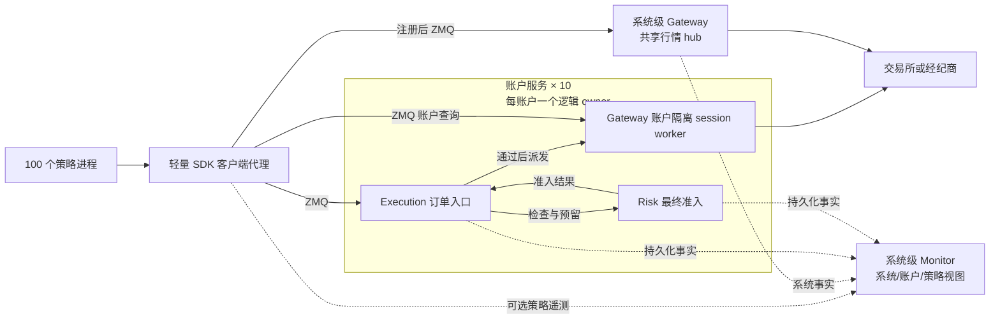

# bt_api_py 迭代10 可选组件与可配置通信完善计划

日期：2026-10-13

本版修订：服务端声明提供的能力，显式启动后默认激活；策略端通过 SDK 注册申请使用。账户政策不受策略开关支配。Gateway 定位为系统共享基础设施并隔离账户会话；Monitor 系统级部署，提供账户和策略视图。

编号依据：本仓已有迭代04（CTP）及迭代09，本计划由误用的迭代04改为迭代10；Backtrader 迭代44引用保持原义。

状态：设计完成，待实施；本文不代表功能已经实现或运行验收通过。

范围：`bt_api_gateway`、`bt_api_risk`、`bt_api_execution`、`bt_api_monitor`，以及配套的 `bt_api_transport_zmq`、SDK 装配和 Backtrader 接入。

本迭代将四个子包完善为可选择部署的服务端功能。**不部署服务、不配置客户端时，原有 BtApi 和 Backtrader 路径照常运行。显式启动某项服务后，声明的组件默认运行，不再重复填写 `enabled: true`。** 策略端 `config.yaml` 申请接口、订阅及代理挂载，服务端 `config.yaml` 决定提供的能力、账户政策和访问权限；策略的注册申请不能改变服务政策。第一版通信实现统一使用 `bt_api_transport_zmq`，为以后增加其他后端保留接口。

主要规模目标是 **100 个策略进程属于 10 个真实账户**。按账户集中管理共享状态和交易写入，按行情订阅需求复用上游连接。四个 Python 包不等于四个独立微服务；可以在同一个账户工作进程中组合，也可以部署到不同机器。

## 1 用户要求和迭代边界

### 1.1 已确定要求

1. 不开发新的 Optional16 验收入口。已经停用的入口继续停用，历史记录保留；功能验收复用各包及 SDK 的正常入口。
2. gateway 重点解决行情转发、账户信息转发和上游连接共享。同品种的多个策略不应各连一份行情，同账户的多个策略不应各自重复登录账户。
3. risk、execution、monitor、gateway 都是可选部署的服务端功能，允许单独使用和组合使用；未选择部署的组件不得成为普通路径的安装或启动前提。已启动服务的能力按部署清单激活，策略申请注册使用；共享账户政策和账务不能逐策略自行退出。策略端只用 SDK 代理，不安装、导入或实例化四个领域包。
4. 通信后端可配置。首版只实现 ZMQ，不同时引入 NATS、Redis、Kafka 或 gRPC 服务。
5. 支持同机多进程，并完成跨机器通信设计与验证；首版跨机器部署采用静态服务地址和固定账户归属。
6. 结合 Backtrader 使用，同时保留组件独立于 Backtrader 的公开接口。
7. 当前交付仅为本计划。后续代码开发按现有各仓 `dev`、小轮验收、明确范围提交的方式推进。

### 1.2 本迭代不承担的工作

- 自动跨机器主备切换、共识集群、Kubernetes 调度、热迁移和无中断配置热更新。
- 在策略进程嵌入 gateway、risk、execution 或 monitor 的领域实现；单策略调试和研究也不为新服务路径增加这种部署模式。
- 新增 TWAP/VWAP 等算法执行器、机器学习风控、完整合规系统或监控前端平台。
- 一次性支持所有交易所的生产写单。通用功能按合同实现；具体交易所按实际接入能力逐个验证。
- 重写全部历史 gateway/forwarding API、删除旧配置或修改历史验收结论。
- 把“可不启用风控包”解释为取消已有权限、输入校验、账户身份校验或交易所限制。

## 2 当前基线和实际缺口

源码核对基线为主仓 `cfe6543e7bc9aaa3622624f1b490b4d5f99f3766`。下列是当前代码事实，不是目标能力的完成声明。

| 位置 | 当前已有能力 | 本迭代缺口 |
|---|---|---|
| `bt_api_gateway`，`8a702c2` | 持久化命令路由、账户 writer authority、本地事件 journal、游标与快照接口 | 没有完整的上游行情订阅共享、账户会话管理和远程快照加增量闭环 |
| `bt_api_risk`，`126d906` | 风险规则基础、持久化预留、分配、冻结与 admission 合同 | 真实账户状态接入、策略虚拟分账、完整订单敞口转换、账户级并发组合尚不完整 |
| `bt_api_execution`，`bf67f06` | intent/order 状态机、持久化派发与 UNKNOWN、观察回填、部分撤单和 CTP 基础合同 | 多策略共用账户 owner、完整撤单与成交归属、统一恢复和 Backtrader 主路径接入尚不完整 |
| `bt_api_monitor`，`a2d108f` | 指标、健康检查、durable outbox、只读查询、受验证控制入口 | 实际事件生产链、账户和策略聚合、断线补传、控制执行结果闭环尚不完整 |
| `bt_api_transport_zmq`，`43751c7` | 版本化 wire、ROUTER/DEALER、远程 CURVE/ZAP、命令 ACL、序号和有限内存重放 | 没有行情 PUB/SUB 实现；私有事件的持久化读取、消息派发接口和配置工厂需要补齐 |
| `bt_api_py/forwarding`、`bt_api_base/gateway` | 旧行情和账户转发、局部订阅计数、source supervisor | 两套协议并存，ZMQ 构造硬编码；订阅生命周期、退订与新子包没有贯通 |
| `bt_api_py/runtime_plugins` | 代码登记、按需加载、受约束的装配 | 当前 managed 路径固定要求 execution/risk/monitor 等组合，并非独立可选组件体系 |
| Backtrader Store/Broker | 现有 direct/forwarding 接入、订单和账户投影 | 同一 Cerebro 共享 Broker；不能直接等同于跨进程账户 owner 或每策略独立虚拟账户 |

优先复用的源码：

- [组件合同](../../../bt_api_py/runtime_plugins/contracts.py)、[可信登记](../../../bt_api_py/runtime_plugins/catalog.py)、[现有组合](../../../bt_api_py/runtime_plugins/managed.py)。
- [现有转发运行器](../../../bt_api_py/forwarding/service.py)、[订阅源生命周期](../../../bt_api_py/forwarding/source_supervisor.py)、[旧 ZMQ 传输](../../../bt_api_py/forwarding/transport.py)。
- [Gateway 定位及 journal](../../../bt_api/bt_api_gateway/README.md)、[Risk admission 边界](../../../bt_api/bt_api_risk/README.md)、[Execution 合同](../../../bt_api/bt_api_execution/README.md)、[Monitor outbox](../../../bt_api/bt_api_monitor/README.md)、[ZMQ 传输合同](../../../bt_api/bt_api_transport_zmq/README.md)。

Backtrader 迭代44仅负责参数与配置校验，其目标 v5 配置还不是当前运行能力。本计划承接其字段校验接口，不把本迭代的服务、订单和进程功能塞回迭代44，也不重复建设校验器。

## 3 四个包的职责和状态归属

| 服务端组件与层级 | 核心职责 | 服务端维护的状态 | 策略侧使用方式 |
|---|---|---|---|
| gateway：系统共享服务，内部按账户分区 | 共享行情源、账户会话、查询合并、数据标准化与转发 | 公共行情订阅；按账户隔离的凭据、会话代次、原始事实和可重放读模型 | SDK Store 代理注册订阅/账户读取；provider session 仅供账户服务派发 |
| risk：账户级决策 | 交易前准入、账户和策略限额、资源预留、敞口与冻结 | 每账户政策、分配版本、预留、占用、冻结及处理依据 | SDK 可选查询预算；最终 admission 由订单入口按账户政策执行 |
| execution：账户级订单权威 | 接收交易意图、幂等派发、订单/撤单生命周期、成交归属与恢复 | 每账户意图、订单、成交、撤单、UNKNOWN 及策略虚拟持仓 | SDK Broker 代理注册订单能力；未申请该能力不能在此受管账户另开直连写路径 |
| monitor：系统级观测服务，账户/策略分层视图 | 消费事实，提供运行状态、指标、告警、只读查询和经授权的控制请求 | system/process、account、strategy 维度的投影、指标、告警与控制结果 | SDK 可选上报策略遥测；账户服务自身的事实上报不由策略关闭 |

`bt_api_py` 负责配置解析后的组合、账户路由、适配器注入和生命周期。`bt_api_transport_zmq` 只负责通信，不持有交易所登录凭据、不决定订单状态、不判断风险规则。领域包不导入 ZMQ，也不硬编码其他通信后端。

一个实际账户的原始余额和持仓事实来自 provider，经服务端 gateway 或原有 provider adapter 获取；execution 维护订单与策略归属，risk 使用这些事实计算限制。monitor 是消费者，不用监控缓存替代交易准入事实。没有 execution 时，risk 由账户服务内的 SDK 派发适配层接收原有订单端口的事实，不自行实现另一套 OMS。SDK 代理允许缓存只读投影、消费游标和有界待发送指标，不拥有四包的业务状态库、规则引擎或连接 owner。

层级描述状态和管理范围，不等同于进程数量。Gateway 是系统级部署组，由行情 hub 与多个账户 session worker 组成；每个实际 RPC 服务有独立 service_id、作用域、epoch 和地址，不共用一个能读取所有私有数据的 system scope。Monitor 可以集中部署但按账户授权查询。Risk/Execution 可以共享进程，但各账户状态和准入必须隔离。跨账户组合风控是另外的决策边界，本期不由 Monitor 汇总代替。

## 4 进程和账户管理模型

### 4.1 推荐组合



图示为推荐的四组件启用部署；箭头表示调用关系，最终 provider 派发和订单状态仍由 execution 协调，risk 不直接写 provider。`AccountOwner` 是 SDK 的服务端账户装配和写入归属，不是新增第五个业务包，也不要求四包全部存在。组件不在部署清单内时采用第 5.2 节定义的服务端适配，不在策略进程补一个组件实例。

Gateway 的系统级定位不要求将全部私有连接集中到一个大进程。首版将公共行情 hub 独立部署，账户 session worker 放在对应账户 owner 的同一进程内，作为其内部组成，共用该账户 RPC 服务身份。部署清单登记市场服务及各账户服务的端点和 worker 实例，同一真实账户只有一套必要会话集合。将私有 session worker 拆出 owner 进程需另行完成远程派发幂等、授权和 UNKNOWN 恢复合同，不作为首版已支持拓扑。

每个账户唯一的远程订单写入口是 `service.order_entry`，由 execution 或 risk-only 的 SDK 派发适配器实现；该 owner 只有一个最终 dispatcher。risk admission 和 `service.provider_session` 在首版属于账户服务内部端口，不作为策略可直接调用的写接口。账户查询仍可访问相应只读端口；管理控制经授权接口进入同一个账户命令处理链。

- 策略与账户采用显式映射，例如 `s001–s010 -> a01`。服务端以可信配置/身份授权校验映射，不能相信消息自行声明的 `account_id`。
- 一个 owner 可以服务同账户多个策略；多个账户也可以共处一个工作进程，但账户队列、状态和权限隔离。首版推荐一个账户一个工作进程，便于故障隔离。
- gateway、execution、risk 的写入检查绑定同一逻辑 owner 及代次，不各自选举相互独立的账户 writer；各包原有必须保持的存储/租约约束由组合层协调。
- 账户键包含 provider、environment、真实账户引用，以及必要的产品/子账户维度，避免同名账户或模拟/生产混用。
- 行情可在多个账户之间共用，但仅合并数据源、环境、产品、品种、频道、深度、周期及访问权完全兼容的订阅。
- “一份连接”指一套必要的上游连接集合，不承诺把独立的行情、私有 WebSocket、REST 或 CTP 会话合成一个 socket。
- 策略退出只释放自己的订阅和代理；最后一个订阅者退出才按策略释放上游，不能关闭别人的账户会话。

### 4.2 同机与跨机器

新服务路径只支持两种部署：同机多进程和静态跨机器部署。策略到服务始终通过配置的 ZMQ 客户端代理访问；策略进程不直接调用四包实现。同一个服务进程内的领域模块可以经内部端口调用，例如一个账户进程组合 gateway、execution 和 risk，这属于服务端内部组合。

四组件均未部署时保留原有 direct/回测路径，不为了“兼容”启动空服务。切换到服务管理的账户后，策略进程不持有该账户的 provider 凭据，不同时为同一账户保留可绕过服务的 direct writer。后续拆分服务应依据独立扩容、故障隔离或部署边界，首版不为了包名不同强制增加网络往返。

跨机器时，一个账户的写入仍固定到一个 owner。其他机器部署策略、共享行情或 monitor，不能各启动一个可写的同账户副本。租约和进程心跳不能单独阻止旧节点继续对外写入；没有外部 fencing 能力时不开放自动接管。计划内恢复先确认旧写入路径失效、处理在途订单、恢复状态，再人工切换固定归属。

SQLite journal 留在状态 owner 的本地磁盘，由远程接口访问。SQLite WAL 要求共享数据库的进程位于同一主机，不能用网络共享目录冒充跨机器数据库。[SQLite 官方 WAL 说明](https://www.sqlite.org/wal.html)

## 5 可选配置与兼容合同

### 5.1 服务启用、策略注册和政策的边界

| 概念 | 决定方 | 含义 |
|---|---|---|
| 服务能力 | 运维部署清单 | 进程提供哪些组件/端口；显式启动后清单内组件激活 |
| 账户/系统政策 | 服务端可信配置 | 账户额度、策略分配、权限、观测及恢复要求；客户端不能修改 |
| 策略使用申请 | 策略端配置 | 订阅、查询、交易或上报哪些接口，以及本地代理挂载位置 |
| 有效注册 | 对应服务端 | 校验真实身份、策略与账户映射、可用能力和政策后，授予明确范围的会话 |

**启动服务就是启用其声明能力，不再要求双方填写相同的 enabled 开关。** 专用启动模板分别提供 Gateway、Risk、Execution、Monitor，账户组合模板可展开 execution+risk+账户 session worker；模板只生成可检查的明确部署清单。普通 SDK 导入、安装包或启动未指定角色的通用进程，不自动开启所有组件。模板须带版本并在启动摘要展示展开结果，不能随软件升级悄悄增加组件。

新服务配置中，`components` 的键就是本进程的激活清单；缺少组件则不加载它。键存在但缺少必要账户、政策、存储或身份引用时报告配置错误。业务规则有自己的适用条件和参数；服务运行不代表开启每一种业务规则，更不代表立即登录全部账户或自动开始交易。

政策再区分三类，不能互相替代：`registration_policy_ref` 定义真实身份可申请哪些接口/动作/作用域；risk 的 `options.policy_ref` 定义账户/策略限额和风险规则；`service_requirements_ref` 定义哪些数据、恢复状态和依赖必须满足才可交易。就绪要求只校验部署及运行事实，不自动激活缺失组件。服务端回执分别返回适用的访问政策、风险政策和就绪要求版本，没有 risk 包时明确无该包政策，不能伪造“风控已通过”。

| 输入/事件 | 目标行为 |
|---|---|
| 无新服务部署，策略无 clients 或 clients 为空 | 原有普通路径，无新增四包依赖/资源 |
| 服务清单声明组件并显式启动 | 创建并恢复该组件，就绪后接受注册；不再要求 enabled |
| 策略 clients 声明 SDK 代理 | 申请接口，授权成功才挂载；不加载领域包、不启动服务 |
| 服务未提供必需能力，或账户政策要求的服务未就绪 | 启动/注册失败，明确原因；不自动改为 direct |
| 明确声明非必需的遥测/只读扩展申请失败 | 显式返回未授予/降级；不能移除订单链必要的风控或记账 |
| 通信 profile 未被使用 | 纯配置校验，不创建资源 |
| 显式启动通用服务但 components 为空 | 拒绝无能力部署；普通路径不会启动该服务，二者不混为一谈 |
| 已授予接口运行中失联 | 按既定失联政策处理，不重新解释成“未配置” |

新 schema 不接受 `enabled`，避免“已声明但又关闭”的歧义；删除申请项表示不使用接口，删除服务组件表示下一次维护启动不部署。旧 v4/v5 的历史语义保持不变，不能将旧 enabled 缺省直接按新语义迁移；转换必须明确列出最终激活清单。未知组件名、未知 backend 和任意 Python 模块路径仍拒绝。

**“未申请就不适用”仅限可选接口与附加功能，不适用于共享账户的事实和政策。**

| 策略未申请的接口 | 对该策略不提供什么 | 仍然有效的服务端行为 |
|---|---|---|
| gateway 行情/账户读取 | 不创建其订阅/读取代理 | 其他策略及账户服务仍可使用会话；只回收该策略订阅引用 |
| execution 订单接口 | 不授予该受管账户的下单能力 | 原有订单、成交、持仓仍被管理；不能改走 Gateway 直连写单 |
| risk 预算查询 | 无本地预算查询代理 | 已启用的账户风控仍作用于全部受管订单，所有占用计入账户总量 |
| monitor 策略遥测 | 不采集该策略的附加指标/自定义日志 | 已启用的账户/系统事件、订单拒绝与审计仍由服务端产生 |

策略特有的附加风控规则可按服务端已批准的策略 profile 选择，账户底线不随选择关闭。例如账户上限 100，策略 A 已占 80，策略 B 没申请 risk 查询便下单 40；仍须拒绝，否则不构成账户级风控。某策略停止注册也不能释放它尚未结束的订单预留。

策略未申请服务而继续使用旧路径，仅限未纳入服务管理的账户/运行环境。同一真实账户不能一部分策略受管、一部分策略用同一凭据绕过。外部人工活动必须纳入观察及未分配残差；事实不完整时停止依赖它的新增风险，不能宣称完整账户保证。

### 5.2 单独启用时必须有实际用途

| 组合 | 应提供的功能 | 边界 |
|---|---|---|
| 均不部署 | 原有回测、行情、模拟或已支持的交易入口 | 不新增共享账户或风控保证；已有入口限制继续有效 |
| gateway 单独开启 | 共享行情和账户查询/推送 | 默认只读共享；不会因为启用网关而开启写单 |
| monitor 单独开启 | 独立 monitor 服务接收现有策略 SDK 发射器的指标、健康和事件 | 不依赖 gateway/risk/execution，不接管交易 |
| risk 单独开启 | 账户服务内原有派发路径的风险准入、预算查询和订单观察 | 策略经 SDK 订单代理到服务端最终准入点；不要求 execution/gateway 包 |
| execution 单独开启 | 独立账户执行服务在已有 provider port 上管理订单、幂等和恢复 | 保留交易授权、身份及参数校验；不声明启用了 risk 包的限额/组合风控；不满足账户强制政策时不开放写能力 |
| execution + risk | 订单生命周期与风险预留的完整闭环 | 最终派发前再次校验，未知结果继续保留对应占用 |
| gateway + execution | 共享会话和账户订单 owner | 通过同一会话端口派发，不再为 execution 重建重复账户连接 |
| 任意组合 + monitor | 增加观测和允许的控制请求 | 监控进程故障不自动中断交易；业务持久化失败另行处理 |

以上是新可选路径的开发目标。现有 `managed_live_direct`/`managed_live_gateway` 是固定组合的旧合同，保留原语义，不通过删除配置绕过其准入。本迭代增加独立登记的可选装配路径，让普通路径和可选组件使用不必选择这些旧 profile。

“不部署 execution 包”与“不管理订单”不同。受管账户没有 execution 时，原有 OMS/SDK 派发适配器必须继续提供唯一订单入口、幂等、完整订单观察和恢复；否则只能只读。服务可选性不承诺任意缺失必要依赖的组合都能实盘下单。

execution 单独启用需要实现与 risk 包解耦的基础 admission 端口，验证已有的写授权、账户身份、provider 能力及订单参数；risk 启用后再叠加风险 admission。不能把当前测试专用 `allow_unprotected=True` 或固定返回 True 的假验证器变成生产默认值。对应适配器未实现时明确限制该路由的写能力，而不是暗中要求用户安装另外三个组件；单独启用的完整验收仍须完成。

基础 admission 采用类型明确的服务端合同，由宿主原有的可信授权上下文和代码登记的验证器提供，绑定账户、策略、具体动作/意图摘要、owner 代次及有效期，在最终派发处重新验证。客户端提交的对象、摘要或注册申请本身不构成授权。验证通过只代表基础派发条件满足，不提供账户资金或组合风险上限保证。

### 5.3 配置结构

Backtrader 新服务路径采用目标 `config_schema_version: 6`，角色为 `process_role: strategy_client`，根部使用 `registration`、`clients` 和 `communication`。SDK 服务启动配置单独使用 `service_config_schema_version: 1`、`process_role: service`、`components`、`registration_policy_ref` 和 `communication`，不装载 Cerebro。四包 `components.<name>.config_schema_version/settings` 外壳沿用迭代44的校验形式，新增服务端合同版本为 2；客户端合同独立版本为 1。以上新版本尚未发布，本修订直接替代前稿的 enabled/register_to 设计。

v4/v5 旧路径按既定版本读取，不偷偷解释新字段。v6 策略角色拒绝领域 `components` 和原草案的 `placement: embedded`；旧受约束入口只保留其历史兼容范围，不作为本迭代的新嵌入式部署方式。SDK 独立使用时直接读取客户端或服务配置子块，不依赖 Backtrader 的根 schema。

| 配置位置 | 字段及用途 |
|---|---|
| `registration` | `strategy_ref` 声明要绑定的策略；运行时生成 run_id；服务端按认证 principal 验证身份归属，不相信自报身份 |
| `clients.<name>.settings` | 块存在即申请 SDK 代理；`bindings` 选择挂载槽和目标服务；`options` 仅含 SDK 代理超时、心跳等选项 |
| 每个 client binding | `mount`、`service_id`、`instance_id`、`scope_ref`、`transport_ref`；`required` 缺省 true；引用只表达申请，不是授权或模块路径 |
| 服务根部 | `service_id`、`scope_ref`、`transport_ref` 明确服务身份、管理范围和监听 profile；`registration_policy_ref` 管访问授权，`service_requirements_ref` 管就绪要求；多个组件可共用 RPC listener |
| `components.<name>.settings` | 组件存在即激活；`instance_id`、`bind_ports`、`options` 指定实例、内部端口和领域规则；没有 enabled/placement |
| `communication.profiles` | 选择代码登记的 backend、明确 bind/connect 地址、容量、协议及身份配置引用 |

客户端挂载槽是 `store.market`、`store.account`、`broker.orders`、`risk.read_model`、`runtime.telemetry`。服务端挂载槽是 `service.market_source`、`service.account_read`、`service.provider_session`、`service.order_entry`、`service.order_admission`、`service.risk_query`、`service.telemetry_ingress`、`service.monitor_query`。客户端的 risk 代理用于预算/政策状态查询；账户订单入口会自行执行服务端启用的 risk，不能依赖策略先取一个“已批准”标记。

`bind_ports` 只描述服务进程内的端口装配，不自动导出 RPC。SDK 代码登记的 RPC 白名单仅将 market_source、account_read、order_entry、risk_query、telemetry_ingress、monitor_query 映射成相应远程操作，再按登记权限过滤；`service.provider_session`、`service.order_admission` 始终仅供 owner 内部调用，不能出现在客户端可调用/可申请能力列表。服务组件运行状态可以展示，但不能据此推导所有内部方法都是公开接口。

risk 单独部署时，由 SDK 代理把 `broker.orders` 绑定到该账户服务已有派发适配层；基础 SDK/provider adapter 注册唯一 `service.order_entry`，最终派发必须调用本账户的 `service.order_admission`，凭据仍只在 owner。risk 与 execution 同时部署时，该槽绑定 execution 入口。一个客户端独占槽只允许一个绑定，`runtime.telemetry` 可有多个消费者；角色不适用槽、同槽争用、依赖环和跨账户误绑在启动前拒绝。

`bt_api_py` 唯一维护客户端绑定、服务装配图及 communication 跨组件校验。客户端公共配置和 wire DTO 位于 base/SDK，不依赖四包；服务端才导入部署包的 `options` 校验器。Backtrader 只映射根 v6 配置和可信运行上下文，不复制领域规则。握手报告能力，注册再授予使用范围；离线校验不能代替远端就绪或授权。`mount` 挂本地 SDK 代理，`bind_ports` 装配服务内部端口，远程策略注册使用独立协议操作，三者不再共用 register_to 名称。

以下是 **行情/账户读取及遥测的目标客户端配置片段，当前不可直接运行**。它仅连接行情、账户和监控服务，未配置订单入口；没有任何领域组件在策略进程创建。`clients.gateway/monitor` 是 SDK 代理目录名，不表示导入同名领域包。行情与账户可以位于不同服务，因此按挂载槽分别选择端点。

```yaml
config_schema_version: 6
process_role: strategy_client
registration:
  strategy_ref: strategy-s001
clients:
  gateway:
    config_schema_version: 1
    settings:
      bindings:
        - mount: store.market
          service_id: market-main
          instance_id: market-gateway
          scope_ref: public-market-access
          transport_ref: market-zmq
        - mount: store.account
          service_id: account-a01
          instance_id: account-gateway
          scope_ref: account-a01
          transport_ref: account-zmq
  monitor:
    config_schema_version: 1
    settings:
      bindings:
        - mount: runtime.telemetry
          service_id: monitor-main
          instance_id: operations-monitor
          scope_ref: current-strategy
          transport_ref: monitor-zmq
          required: false
      options:
        heartbeat_interval_seconds: 5
communication:
  config_schema_version: 1
  profiles:
    market-zmq:
      backend: zmq
      config_schema_version: 1
      endpoints:
        rpc_connect: tcp://127.0.0.1:7600
        market_connect: tcp://127.0.0.1:7602
      security_profile_ref: local-market-access
    account-zmq:
      backend: zmq
      config_schema_version: 1
      endpoints:
        rpc_connect: tcp://127.0.0.1:7601
      security_profile_ref: local-account-a01
    monitor-zmq:
      backend: zmq
      config_schema_version: 1
      endpoints:
        rpc_connect: tcp://127.0.0.1:7603
      security_profile_ref: local-monitor-access
```

对应的账户服务可组合三个包。下例同样是目标片段，政策、账户会话和安全 profile 引用由部署端单独管理；交易权限必须在实际启动时验证，示例不授予权限。行情和 monitor 服务使用相同服务外壳，只启用各自需要的组件和服务端槽。

```yaml
service_config_schema_version: 1
process_role: service
service_id: account-a01
scope_ref: account-a01
transport_ref: account-listener
registration_policy_ref: account-a01-strategy-grants
service_requirements_ref: account-a01-readiness
components:
  gateway:
    config_schema_version: 2
    settings:
      instance_id: account-gateway
      bind_ports: [service.account_read, service.provider_session]
      options:
        role: account_session_worker
        account_session_ref: a01-session
  execution:
    config_schema_version: 2
    settings:
      instance_id: account-execution
      bind_ports: [service.order_entry]
      options:
        provider_session_ref: account-gateway
  risk:
    config_schema_version: 2
    settings:
      instance_id: account-risk
      bind_ports: [service.order_admission, service.risk_query]
      options:
        policy_ref: a01-risk-policy
communication:
  config_schema_version: 1
  profiles:
    account-listener:
      backend: zmq
      config_schema_version: 1
      endpoints:
        rpc_bind: tcp://127.0.0.1:7601
      security_profile_ref: account-a01-server
```

服务配置使用明确的 `rpc_bind`、`market_bind`；客户端使用 `*_connect`，不根据 URL 或角色猜测 bind/connect。通信参数有统一有界默认值，初始拟定请求超时 2000 ms、HWM 1000、单消息上限 1 MiB，由 P0 字段表统一登记。跨机器替换连接端点并引用 CURVE 身份及服务端 ACL；秘密值不内联到公开 YAML。服务端安全 profile 绑定账户、策略和操作权限；`scope_ref` 只是选择项，不能自行创建授权。

通信 profile 可复用，但 `transport_ref` 不是账户路由表。服务端维护 account→owner 和 strategy→account 的可信映射；多个账户共用 RPC 端点时仍逐请求鉴权。首版选中的 backend 名称由代码登记工厂解析，配置不能填任意 distribution、module、class 或 source hash。

旧 `BtApi(transport_mode=...)` 保持兼容；`bt_api_base.gateway.GatewayConfig.transport` 的 `tcp/ipc` 仍代表端点类型，不改成后端选择。新字段明确使用 `backend: zmq`，避免三个概念混用。

### 5.4 配置生命周期

策略端：解析 → SDK 公共 schema 与引用预校验 → 生成申请/代理绑定图 → 按需加载通信客户端 → 认证与能力发现 → 注册及政策确认 → 恢复消费基线 → ready。整个过程不导入四包；策略不会自动启动对应服务。

服务端：展开版本化部署模板/读取明确清单 → 外层/引用预校验 → 加载清单组件的纯校验接口 → 领域/政策及跨组件校验 → 装配 → 创建实例 → 恢复状态 → ready/接受注册。未部署组件不加载校验器。两端的离线校验都不得启动进程、网络连接或创建状态库；客户端校验成功不等于远端已运行或已授权。

首版通过重启应用配置变化；不支持运行中关闭正在管理未完成订单的组件。启动失败按反向顺序关闭本次已创建资源，不关闭调用者共享的 context。关闭时停止新请求、记录在途状态和消费游标，再有界排空；超时明确记录未完成状态，不清空 UNKNOWN 或风险占用。

### 5.5 注册协议与冲突裁决

注册由 SDK 完成，策略业务代码不手工逐包注册。服务能力目录和登记表属于 SDK 控制层，不新增第五个业务微服务；首版使用静态端点及各服务的本地登记存储，不引入中心发现集群。

1. **认证和发现。** 服务返回 service_id、实例/能力列表、协议版本、服务 epoch 和就绪状态；这是可用性信息，不是授权。客户端校验目标身份后，再提交 strategy_ref、run_id、请求接口/作用域及请求 ID。
2. **服务端登记。** 按认证 principal → 可信策略 → 账户映射验证申请，再与实际能力、动作权限、账户政策求交。策略不能用自报 account_id 或 risk=false 获得豁免。每服务使用稳定注册键及内容摘要去重；同键不同内容拒绝。
3. **回执。** 返回 registration_id、实际授予接口/作用域、访问/风险/就绪要求的各自版本、强制依赖、有效期/会话 epoch、拒绝或降级原因。订单申请意味着接受服务端适用政策，不需要额外申请 risk 查询；服务不把隐藏的必需依赖伪装成客户端已选择的功能。
4. **客户端就绪。** 所有 required 申请均成功且依赖数据/账户 ready 才挂载相应能力；拒绝必需申请则启动失败。只有显式 required=false 的遥测/只读扩展可缺失；broker.orders 及账户必要条件不能标为可降级。未获订单授权的受管账户只有只读/观察能力，SDK 不挂载该账户的 direct writer。
5. **续期与重连。** 注册租约管理连接和订阅，订单账本的寿命独立。首版同一策略只允许一个活跃写会话，新 run 必须经可信恢复流程交接；服务重启或 epoch 变化后重新验证注册，恢复旧业务 ID 和游标，不重下旧订单。
6. **注销和异常退出。** 停止新增请求、释放会话订阅；未决订单、持仓、UNKNOWN 和风险预留继续保留。账户 owner 自身的恢复/观察需求也占用 session 引用，不能因最后一个策略断线就关闭仍有责任的账户会话。

跨服务注册不承诺分布式事务。某必需服务拒绝时，SDK 注销本次已获得的临时登记，尚未进入策略运行/新订单阶段；注销失败的临时资源由租约回收，不能回滚或删除已有账户事实。注册状态不授予永久权限：每次敏感请求仍检查会话、账户/动作及当前政策，政策冲突或强制依赖缺失时拒绝写入。首版政策变化按受控重启生效，不实现任意热切换。

冲突裁决以服务端实际能力和可信政策为准；客户端必需请求不满足时明确失败，不能静默扩大授权或缩小账户保护。错误至少区分 CAPABILITY_UNAVAILABLE、SCOPE_DENIED、POLICY_REQUIREMENT_UNMET、DUPLICATE_ACTIVE_RUN 和 NOT_READY。

## 6 通信抽象与 ZMQ 第一版

### 6.1 接口归属

在 `bt_api_base` 放置最小、无 ZMQ 依赖的通信端口和消息头合同；`bt_api_py` 维护代码登记的 backend 工厂及客户端公共请求/结果 DTO；`bt_api_transport_zmq` 实现端口。领域内部 DTO 继续由四包拥有，仅由服务端 SDK adapter 映射到版本化 wire payload。客户端不反序列化领域类，不为生成请求导入四包；公共消息合同随 base/SDK 版本交付。

端口按用途分为请求应答、行情发布订阅、持久化事实读取/确认、生命周期。后端声明支持的能力；一个只支持广播的后端不能被配置成可靠私有事件通道。后续增加其他后端时实现同一端口、登记工厂并通过合同测试，无须修改策略和四包业务逻辑。

| 数据/动作 | ZMQ 首版路径 | 可靠性和业务语义 |
|---|---|---|
| 能力发现、注册、续期和注销 | ROUTER/DEALER | 认证后按策略/账户授权；返回有效能力与政策，不把注册当作订单或风险预留 |
| 行情 | PUB/SUB；控制请求走 ROUTER/DEALER | 实时广播；订阅确认、丢失检测和恢复属于应用合同 |
| 订阅/退订、快照/状态查询 | ROUTER/DEALER | 请求 ID、超时、关联响应、服务端作用域检查 |
| 下单/撤单 | ROUTER/DEALER 到账户 `service.order_entry` | 先由业务 owner 持久化；启用的 risk 在服务端内部准入；超时按稳定 ID 查结果 |
| 风险预算/政策状态查询 | ROUTER/DEALER，只读 | 返回带时间/版本的参考视图，不构成派发批准 |
| 私有账户、订单、成交、关键风险事件 | 经鉴权 RPC 批量 `read_after` 与 `ack` | 从持久化 journal/outbox 读取，按消费者游标重放；每个订阅策略有独立进度 |
| 普通指标 | 有界队列经 RPC 批量发送 | 可采样/丢弃并记录计数；不占用交易请求队列 |
| 关键监控事实和控制请求 | 持久化 outbox/ledger + RPC | 允许重投递，按事件/命令 ID 幂等，持久化处理后确认 |

首版不把账户隐私数据放入所有客户端可订阅的共享 PUB 端口。SUB topic 过滤不是服务端权限控制；私有流采用服务端鉴权后的游标拉取。以后可增加经过同等授权的定向推送，不改变读模型合同。

账户事实先进入 gateway 的规范账户流；对策略可见的事件在同一个本地事务中生成策略视图和连续的 `view_cursor`。快照与后续读取都绑定该视图、epoch 和 cursor，并记录对应的账户源版本。账户级授权查询使用账户视图；策略查询使用对应策略视图，不暴露隐藏事件，也不使用源序号缺口推测其他策略活动。这个投影层是新增工作，不能直接将现有 `(account_scope, strategy_scope)` journal 键解释成已经实现的全账户流。

接收端在业务投影与本地消费 cursor 持久化后才发送 ACK；崩溃发生在提交后 ACK 前时允许重投递，由事件 ID 去重。gateway 新增按可信消费者身份、视图和 epoch 隔离的服务端进度记录；monitor 的源端复用其 outbox checkpoint。ACK 只表示该消费者已经接收并保存到某 cursor，不是交易所确认，也不能代替接收端自己的恢复点。服务端拒绝越权、超出已发范围或错误 epoch 的 ACK。压缩遵循各 journal 的快照/保留政策，不依赖所有慢消费者无限等待；落后于保留边界必须重建快照，订单/审计历史的保留不由客户端 ACK 决定。以上不宣称现有 gateway 已有 ACK API。

PUB 在达到高水位时可能丢消息，不能给它附加“消息必达”的承诺。行情逐笔/深度增量与允许只取最新值的 ticker 分别配置恢复策略，不能一律合并或丢弃。[libzmq socket 语义](https://libzmq.readthedocs.io/en/latest/zmq_socket.html)

### 6.2 最小消息合同

- 新消息头使用 wire 协议 **v2**。现有 `bt_api_transport_zmq` v1 严格字段集合保持原样；旧 forwarding schema、transport v1 和目标 v2 使用明确的协议选择与适配器，不能直接给 v1 添加字段。适配器只能用于已定义的兼容操作；旧端无法表达 epoch、权限或恢复语义时明确拒绝该操作，不伪造字段补全。
- 消息头包含协议版本、消息种类、request/event ID、correlation ID、账户/策略作用域、生产者 stream ID 与 epoch、序号、时间和 schema 版本。字段按消息类型规定必填性，金额和数量采用明确的十进制表示与单位。
- 序号只在规定的流内有序；不同账户不追求全局顺序。流重建必须更换 epoch。权限过滤后的可见流有自己的游标，不能把被过滤事件误判为丢包。
- 服务端从鉴权身份取得允许的作用域和 kind；请求中的 account/strategy 只用于匹配。禁止 pickle、任意对象反序列化和敏感字段回显。
- `RECEIVED/DURABLE`、`ADMITTED`、`DISPATCHED`、provider `ACKED` 与 `FILLED` 分开表达。socket send 成功和服务器函数返回都不等于交易所接受。
- 写请求一旦可能发送但没有确定结果，返回 UNKNOWN 和原请求 ID；查询及可重放事件可以有界重试，写单不能生成新 ID 后盲目重试。
- 首版每个请求客户端只允许一个在途 RPC，由所属 I/O 线程串行发送，并有有界等待队列。响应必须匹配 transport request ID、correlation ID、预期 scope 和操作类型；流读取还校验 stream/epoch。连接被认证到指定服务，写请求另外校验预期 owner 代次。初次只读发现返回的代次不能自行成为写授权。
- transport request ID 与业务 intent/command ID 分开：查询/对账使用新的请求 ID，payload 引用原有稳定业务 ID。接收循环丢弃晚到的无关响应并继续等待至原总截止时间，不重置超时，不让旧响应污染下一请求；超时后保留 UNKNOWN 业务记录。首版不实现无限响应缓存或多在途无界 demux。

### 6.3 Socket 与平台约束

PUB/SUB、ROUTER/DEALER 由各自所属 I/O 线程创建、使用和关闭，其他线程通过有界队列交接。context 可以按进程共享，socket 不能由多个线程并发使用；PyZMQ 官方明确区分了二者。[PyZMQ 线程安全说明](https://pyzmq.readthedocs.io/en/latest/howto/morethanbindings.html)

Windows 基线使用 loopback TCP 和 spawn 多进程；`inproc` 仅限同进程同 context。IPC 仅在实际 libzmq/平台支持并通过验证时开放，不把 Linux 的 IPC 结果当成 Windows 结果。远程 TCP 必须显式配置 CURVE 身份和服务端 ACL；加密连接仍需账户和动作授权。[CURVE 官方说明](https://libzmq.readthedocs.io/en/latest/zmq_curve.html)

涉及真实私有账户的 loopback TCP 同样需要可信客户端身份，不能把 `127.0.0.1` 或客户端自选的 ROUTER identity 当成授权。P2 补齐本地与远程一致的 CURVE/ACL 接入；不带身份认证的本地配置仅用于明确标记的合成测试。服务端模块之间的进程内调用使用宿主已经验证的作用域上下文，不新增策略侧进程内调用路径。

## 7 各组件功能工作包

### G Gateway 共享连接与转发

**G1 订阅管理。** 统一旧 SubscriptionManager 与 SourceSupervisor 可复用的语义。首个订阅者启动上游，重复订阅幂等，最后一个订阅者离开触发退订/释放。断线策略进程通过会话租约回收引用；重连以当前有效订阅集合恢复。上游不支持单品种退订时保留必要连接并明确报告，不伪造退订成功。

**G2 账户会话。** 每个账户由一个 session owner 管理登录、私有流、REST 查询预算及重连。相同正在进行的查询可合并，缓存必须包含来源时间、会话代次和新鲜度。查询降级不得把旧余额标成当前可用余额；session 失效使依赖它的写入准入失效。

**G3 快照与增量。** 构建账户读模型，在同一版本边界得到快照及 cursor，再读取其后增量。多个 provider 查询无法证明原子快照时，显式给出各字段观察时间和一致性等级；风险规则不能假装强一致。保留期不足时返回 GAP_REQUIRED_SNAPSHOT，消费者替换基线后再续读。定期查询流 head，检测没有后续消息时的尾部丢失。

**G4 转发隔离。** 市场订阅分发与私有账户读取分开；慢策略有独立有界队列，不阻塞其他策略。账号不符、scope 越权、过期会话必须在返回数据前拒绝。

**G5 下行调用。** gateway 会话端口只供所属账户 owner 的最终 dispatcher 在完成准入后使用，不向策略暴露另一条写路径；gateway 不复制订单状态机。已有命令 journal 保留为此链路内部的接入记录，确定订单结果来自 execution/provider 观察；`returned_unverified` 不改成 ACKED。

沿用现有 gateway 写路由时，`GatewayCommandRouter` 作为唯一派发链路内部的 adapter/journal，不另开并行 writer；它和 `GatewayAccountWriterAuthority` 必须指向同一个实际 SQLite 文件，装配时核验文件身份。第 E5 项允许不同包拥有不同 journal，不解除这对对象现有的同库要求。

### R Risk 账户与策略准入

**R1 规则范围。** 首版实现可验证的订单金额/数量、净/总敞口、账户可用资源、策略预算、活动订单数量和请求速率限制；日内损失/回撤规则仅在完整权益和基线可用时启用。所有规则定义计价单位、合约乘数、价格来源和过期条件，跨币种先明确定价再汇总。缺失或过期的必需事实应拒绝增加风险，而非使用零值或虚构余额。

**R2 并发预留。** 在服务端最终共同的账户准入点校验“已有占用 + 在途预留 + 本次新增”及策略分配，原子生成一次性预留。各策略读取同一余额后分别检查，不算账户级风控。策略通过 SDK 查询得到的预算只是带版本和时间的提示，不能替代最终检查，也不在策略侧复制 risk 引擎。

**R3 生命周期。** 未派发预留可按合同过期；已派发、UNKNOWN、活动挂单、已成交敞口分别转换和保留，不能因 TTL 到期全部释放。部分成交只转换对应数量；撤单回执不能抹掉此前成交。释放/解冻引用确定订单事实并幂等处理。

**R4 策略分配。** `allocation` 表达预算或额度，不冒充交易所子账户。按策略保存版本及调整历史；减配低于已用/预留时拒绝新增并等待处置，不强制删除持仓。真实账户资源上限始终优先于各策略预算。

**R5 独立使用。** 在账户服务内为原有订单路由提供 admission/订单观察适配器，使 risk 无需 execution/gateway 包也能工作。SDK 订单代理将请求发到这个服务端派发适配层，账户凭据和最终调用均留在服务端；不采用“策略远程问风控后自己直连下单”的可绕过模式。没有统一最终入口或完整观察来源时只开放只读风险查询，不放行该受管写路径，也不能标成跨进程账户级保护。

### E Execution 账户订单管理

**E1 独立装配。** 拆分当前风险包依赖与基础写入准入；没有 risk 包也可按已有授权路由管理订单，启用 risk 后才增加其业务政策。没有 monitor 时保留自己的 journal/outbox；没有 gateway 时使用已有 provider adapter。

**E2 订单与撤单。** 统一 intent ID、稳定 client order ID、provider order ID 和策略归属；同 ID 同内容幂等返回，内容冲突拒绝。撤单拥有独立动作 ID，关联目标订单；覆盖部分成交、撤单与成交竞态、晚到响应、重复回报及成交去重。

**E3 恢复。** 记录派发前状态与关联；可能已提交而缺少结果时保留 UNKNOWN，不直接改成失败重发。启动后核对活动订单、成交、余额/持仓及外部变更，数据不完整时暂停相关新增风险操作。区分“请求确定送达”“订单还在活动”“风险资源可以释放”。

**E4 虚拟分账。** 维护策略订单、成交、虚拟持仓、费用和已实现盈亏；账户层另有未归属残差桶。人工订单和无法归属的成交不能随意分配给一个策略。首版不跨策略自动净额合单；相同品种的策略订单分别追踪，交易所净持仓与虚拟分账按声明的规则对账。平仓只能消耗该策略可支配数量及账户实际能力。

**E5 跨包一致性。** 各包继续拥有状态，不宣称多个 SQLite 文件是一个事务。先持久化 intent，再请求带稳定 ID 的预留，记录回执后才派发；崩溃恢复查询既有预留与订单状态，不创建重复预留/订单。业务状态与事件在所属包同一本地事务中写出，跨包按幂等消费和恢复状态推进。

### M Monitor 观测与控制闭环

**M1 统一事实接入。** 接入 gateway 连接/订阅/数据年龄、execution 订单与 UNKNOWN、risk 预留/拒绝/冻结、策略心跳和进程资源。区分账户事实、策略归属事实和策略估计值；monitor 不另算一份交易权威状态。

Monitor 按系统部署，事件含明确 scope_type 及相应 system/process、account、strategy 标识；共享行情 hub 事件允许没有 account_id，不虚构账户归属。账户面板按授权过滤并可下钻到策略，全局运维角色才能跨账户汇总。策略不注册遥测时，只能报告“未采集/无心跳可用”，不能从账户订单活跃推断该策略进程健康；服务端订单审计和账户告警照常产生。

策略进程只由 SDK 的轻量发射器收集并发送心跳/指标，不调用 `bt_api_monitor` 的全局 setup、告警引擎、查询库或后台服务。交易关键事件的 durable outbox 位于相应服务端 producer；策略侧有界遥测队列不能被描述为可靠交易日志。

**M2 可靠消费。** 用现有 outbox 和 checkpoint 接通实际生产者；事件 ID 加内容校验去重，sink 持久化成功才 ack。重启后可补传，普通高频指标有单独的采样/丢弃政策。交易关键 journal 存储满需要业务阻断，普通 monitor 不可达只造成观测降级，二者分开报告。

**M3 查询与告警。** 提供账户/策略维度的持仓、订单、盈亏来源、风险占用、连接状态、事件延迟和恢复状态查询。告警覆盖行情 stale、断线、积压、拒单异常、UNKNOWN、预算超限及 owner 不可用；同类告警合并并有恢复通知。

**M4 控制请求。** 首版支持请求暂停新增订单、恢复和撤单，不让 monitor 直接调用 provider。服务端重新校验身份、scope、有效期、命令 ID 和当前账户状态；记录已接收、已执行、拒绝或未知结果。恢复请求不能自动解除尚未解决的风险冻结。不启用 monitor 时，账户 owner 自身的授权管理接口仍可使用。

## 8 Backtrader 接入

1. 新服务路径的 Store/Broker 一律使用 SDK 通信代理；不配置时保留原有路径。策略代码不直接创建 ZMQ socket、不导入四包，不持有服务管理账户的 provider 凭据。
2. gateway 客户端绑定 Store 行情/账户读取；execution 客户端绑定 Broker 提交/撤单/订单观察；risk 客户端提供只读预算，实际 admission 在服务端；monitor 客户端绑定 SDK 运行事件和指标出口。risk 单独启用的订单代理规则见 R5。
3. 首版共享账户运行采用一个策略进程一个 Cerebro/Broker 投影。现有单 Cerebro 多策略方式保持兼容，但不由此宣称每策略资金天然隔离。
4. 远程回报通过安全队列送回 Backtrader 执行线程，再转换成 `notify_order`、`notify_trade` 和数据状态；网络线程不直接修改策略对象。
5. 明确 `getcash/getvalue/getposition` 的视图。启用虚拟分账时返回当前策略视图，账户总值走独立查询接口；只启用 gateway 时仍是显式标记的真实账户视图，不能把账户总余额当成每策略预算。
6. 网络断开或账户流不完整时标记 stale，恢复基线和订单状态后才重新放行依赖这些数据的操作。普通关闭组件不改变既有 Broker 通知顺序。
7. `validate/doctor` 离线展示部署清单/代理申请/挂载槽与账户路由，默认不探测远端；单独在线状态检查展示已授予能力、政策版本、注册状态和降级原因，不能把已请求当成已获准。

## 9 分轮实施与交付顺序

所有轮次初始状态均为 **待开发**。轮次是可独立审查的工作范围；每轮按包再拆成可验收的小提交，不把多个仓库的全部工作攒到最后一次提交。

| 轮次 | 交付范围和主要仓库 | 依赖 | 退出条件 |
|---|---|---|---|
| P0 合同与迁移规格 | SDK/base：激活清单、注册/授予/政策合同及 schema、公共 DTO、层级/账户映射、错误码、旧配置迁移；核对迭代44字段 | 本计划 | 无重复开关；服务内端口与策略注册分开；必需/可选申请及账户强制政策可测试 |
| P1 代理与服务配置骨架 | SDK 版本化启动模板、代理、服务 bootstrap/实例图/登记表、四包纯校验；Backtrader 最小代理接入 | P0 | 策略只装 SDK；无配置兼容；清单组件启动即激活，注册/注销状态与交易状态分离 |
| P2 可替换通信与 ZMQ | base 端口；transport_zmq 注册/请求/行情/可靠读取；SDK 工厂和旧协议适配 | P0/P1 | 真实 loopback TCP 认证注册、能力授予、部分失败/租约恢复、关联响应和关闭验证通过 |
| P3 Gateway 共享读取 | gateway 订阅和账户会话、snapshot/replay；SDK provider 适配 | P2 | 一个账户十策略共享上游；最后订阅者退订、异常退出回收、快照并发一致性和私有流授权通过 |
| P4 Execution 订单闭环 | execution 独立 admission、订单/撤单/归属/恢复；SDK provider port | P1/P2；共享会话路径用 P3 | 单独 execution 可用；同 ID 不重复派发；部分成交/撤单/UNKNOWN 和重启恢复通过 |
| P5 Risk 账户协调 | risk 服务端独立最终准入、SDK 原有派发桥及 execution 集成、分配/预留/资源转换 | 独立路径用 P1/P2；组合路径用 P4 合同 | 无 execution/gateway 的风险服务也能最终拦截；并发额度/资源转换正确；策略不能绕过 |
| P6 Monitor 事实闭环 | 系统 monitor 的 system/account/strategy 视图、SDK 发射器、生产者 outbox、查询/告警/控制 | P1/P2；生产者集成用 P3–P5 | 未申请策略遥测不抹去账户事实；分层授权、补传/控制可追踪；故障不触发交易绕路 |
| P7 Backtrader 完整接入 | Store/Broker/runtime 代理、虚拟账户视图、公开样例和兼容迁移 | P3–P6 | 通过正常 Backtrader 入口运行；通知/资金/持仓含义正确；全关闭仍通过旧路径回归 |
| P8 多进程和跨机器交付 | 100 策略/10 账户、静态双机部署、故障与负载验证、运维说明 | P7 | 下表完整执行，记录实际证据等级；未完成环境项明确列为未验收 |

P1/P2 先交付实际代理到服务的最小纵向链路，P3 交付用户最需要的共享行情和账户只读功能。P4/P5 再闭合交易与风险，避免把所有功能绑在一个巨型实现轮次。P5 的独立 risk 路径与 P6 的单独监控服务可在 P1/P2 后推进，组合事实验收等待实际生产者完成；P7 汇总完整 Backtrader 行为，不把首次代理接入拖到最后。

未来每轮记录：范围、实际来源仓库/分支、用例及结果、局限、提交 SHA。子包先提交，父仓随后更新对应 gitlink，Backtrader 再集成已提交版本；只暂存本轮文件。回滚使用已记录的兼容版本，不直接降级正在持有订单/预留的新 schema 数据库。

## 10 验收计划

不用旧 Optional16 的 16 格矩阵作为新功能的验收入口。以下编号属于本迭代普通测试/集成用例，按真实行为验收，不以脚本数或 source/fake 用例总数代替可用性。

| 编号 | 必须验证的行为 | 证据类型 |
|---|---|---|
| CFG01 | 原有配置、不含新块、空 clients 保持普通行为；不启动新服务且不加载四包 | 隔离安装与正常 SDK/Backtrader 路径；新增可选资源为零 |
| CFG02 | 专用模板/组件清单显式启动后无需 enabled；未列出的包未安装不影响服务；策略注册后实际访问 | 真实服务/代理功能；校验启动摘要与精确激活清单 |
| CFG03 | 全部启用及 gateway+execution、execution+risk、任意+monitor；错账户、挂载冲突、缺 backend 和拼错字段 | 配置正反例及无副作用检查 |
| CFG04 | 策略端未安装四包仍能校验和运行所有代理；拒绝领域 components、embedded 及服务端槽 | 隔离安装、实际代理交互、导入/资源观察；服务端测试必须置于不同进程 |
| CFG05 | 新 schema 拒绝 enabled、旧 register_to、空服务清单、缺政策/身份引用；旧配置迁移无隐式启用 | 离线正反例及无副作用检查；v4/v5 原语义回归 |
| REG01 | 认证策略申请接口，回执列出有效能力和账户政策；伪造策略/账户、未授予订单能力、绕过 gateway 写端口均拒绝 | 真实注册/RPC；服务端实际授权和零越权 provider 调用 |
| REG02 | 必需服务拒绝/缺失则注册失败并回收本次临时登记；非必需遥测缺失显式降级 | 多服务部分成功/失败；无 direct 回退，无删除已有事实 |
| REG03 | 重复注册幂等、双活写会话拒绝、服务重启重新登记；注销/租约过期不清订单或风险占用 | 真实进程/持久状态；恢复后原业务 ID 可查询，不重复派发 |
| TRN01 | 配置驱动 ZMQ 请求响应、晚到响应、超时 UNKNOWN、尺寸/HWM/并发上限、正常关闭 | 真实 socket/进程的合成集成；无 provider |
| TRN02 | 行情慢订阅者、首次订阅就绪、断线、epoch 改变、乱序/重复/末尾丢失、gap | 故障注入和 seq/head 观察；不把 PUB send 成功算接收成功 |
| TRN03 | 本地和远程未授权 client、跨账户/策略读取、伪造 scope/ROUTER identity、重放控制请求 | 真实 CURVE/ACL RPC；身份由服务端取得，逐请求校验作用域和动作 |
| GW01 | 同账户十策略订阅同一品种，上游只订阅一次；任一策略退出不影响其余九个 | 真实策略进程 + 可计数合成 provider；最后退出释放一次 |
| GW02 | 十账户一百策略，重复公共行情去重，账户会话恰好按十个账户隔离 | 连接/订阅观测；可合并连接集合数量按 provider 合同计算 |
| GW03 | 快照边界接续、过滤流、过期 cursor 重建；接收端提交后 ACK 前崩溃、越权/越界 ACK | 真实 journal/本地消费事务/服务端进度；账户数据无混入、无静默缺口 |
| GW04 | 旧写路由 router/authority 同文件绑定通过，异文件或错误 owner 绑定拒绝 | 实际存储身份与零 provider 调用检查 |
| EXE01 | 相同请求重复提交只派发一次，重复 ID 不同内容拒绝，撤单与成交竞态正确 | 真实状态机/存储 + 合成 provider |
| EXE02 | 派发前、派发中、回报前、写回报后崩溃及重启；不产生第二次未知写单 | 故障注入、provider 调用计数、重启后真实持久化状态 |
| EXE03 | 多策略同品种、部分成交/手续费/人工外部订单进入正确分账与残差 | 订单和虚拟持仓/账户事实对账 |
| EXE04 | execution 单独启用的基础 admission 正例，以及缺失/过期/错账户/错动作/旧 owner 代次反例 | 正例走真实组合端口；所有反例 provider 调用为零，不导入 risk 包 |
| RISK01 | 十账户一百策略同时竞争，各账户十策略抢剩余额度，账户与策略限额均不能超用或串账 | 真实跨进程共同 admission、持久化预留和账户隔离 |
| RISK02 | TTL、UNKNOWN、部分成交、撤单及重启的敞口转换；汇率/乘数/数据过期 | 规则及完整订单观察链；不凭模拟余额宣称账户通过 |
| RISK03 | risk 单独服务接原有派发，未安装 execution/gateway 仍最终准入；策略省略 risk 客户端也不能绕过已启用规则 | SDK 代理、真实服务 gate/订单观察、拒绝时零 provider 写入、无 direct 回退 |
| MON01 | SDK 发射器接独立 monitor 服务；服务端 durable 事件补传和重投递不重复累计；策略心跳/普通指标有界及丢弃计数 | 真实服务端 producer/outbox/sink 和策略发射器，策略不导入 monitor，不把内存遥测队列称为持久补传 |
| MON02 | monitor 停机不阻塞非监控必需的交易路径；授权控制得到最终结果，重复控制幂等 | 正常入口与故障场景；未解决冻结不能被 resume 清除 |
| MON03 | 共享行情无账户事件可观测；账户/策略视图隔离；策略不注册遥测仍有服务端订单事实 | 系统/账户/策略三种 scope 和授权反例；未采集不能标记为策略健康 |
| BT01 | Backtrader 正常数据推进与通知、策略资金/持仓视图、重连恢复和全关闭回归 | 真实 Cerebro/Store/Broker，替换最末端 provider 即可 |
| DIST01 | 策略与 owner/monitor 分布至少两台机器；静态地址、加密、断网和恢复 | 真正双机证据；同机多个进程不冒充跨机器 |
| DIST02 | owner 故障停止相关写入；失联不启动第二 writer、不自动改成 direct | 双机分区/恢复和实际调用计数；不宣称自动 HA |
| LOAD01 | 一百独立 SDK 代理策略进程、十账户服务、共享行情服务及 monitor 服务稳定运行 | 真实进程负载报告，分别记录策略/owner/hub 数量、慢消费者和重连情况 |
| VENUE01 | 选定交易所的正常入口完成真实共享行情、账户读取、订阅恢复 | 每 venue 独立的只读/模拟环境验证，列出实际账户及权限条件的脱敏引用 |
| VENUE02 | 如交付某 venue 写能力，验证提交/撤单/成交/对账/风险全链路 | 已授权测试/模拟账户的真实结果；未完成时该 venue 写能力仍未验收 |

LOAD01 初始工程负载为 100 策略进程、10 合成账户、20 公共行情主题、总计每秒 200 条上游消息、每条约 256 字节、全部策略订阅，连续 30 分钟；同时每账户每秒 2 次合成订单生命周期。记录输入 200 条/秒与输出约 20,000 条/秒的区别。这只是初始验收负载，不能代表全部行情场景或极限性能。

量化报告包括吞吐、端到端 p50/p95/p99、请求超时、序号缺口、补传时长、CPU、内存、队列/磁盘水位、连接数及关闭后资源。强制要求队列/磁盘保留界限生效、关键事实不静默丢失、无跨账户泄漏、无重复未知派发；性能阈值在 P0 根据固定机器基线登记，未登记或未达到时不能声称性能验收通过。跨机单向延迟需要记录时钟同步误差，否则使用往返时延，不比较不同主机的单调时钟。

源码测试、真实本地 socket/进程、真实双机、真实 provider 是四种不同证据。按层复用已有测试，不另起多代临时 runner 或反复运行已接受测试来增加通过数。只对受本轮影响的行为补充分辨力足够的测试。

## 11 迁移和交付完成定义

### 11.1 迁移顺序

先增加新配置/端口和兼容适配器，旧用户保持原行为；再使新策略客户端到服务端的通信边界统一通过配置的 `bt_api_transport_zmq`。同进程服务端模块使用内部领域端口，不为每次内部调用增加 ZMQ。旧 forwarding wire 与新 wire 采用显式协议适配及版本拒绝，不直接混接，不凭异常自动改协议。稳定后另行发布废弃通知，本迭代不直接删除旧 API。

所有组件的 Python 安装依赖、导入路径、命令入口和示例同步说明“未安装且未配置也可用”。策略客户端安装范围为 SDK/base 及所选通信适配器，不包含四包；服务端按实际功能选择包及 extras。四包不加入普通安装的强制依赖。现有其他必需依赖的移除另作兼容评估，不为本迭代顺手裁剪。

### 11.2 完成定义

- 四包只在服务端运行，分别开启有实际功能；策略只有 SDK 代理；普通路径完全不配置也能运行。
- 两端 config.yaml 分别声明代理申请和服务激活清单，不重复配置 enabled；注册回执与强制账户政策明确，策略不能自行豁免。
- Gateway 系统共享与账户私有分区、Risk/Execution 账户权威、Monitor 系统/账户/策略视图均有实际证据。
- gateway 完成共享订阅、账户会话及一致性等级明确的快照/增量恢复。
- execution 和 risk 既能独立接入，也能正确组合；账户级并发、订单不确定性和虚拟分账有明确处理。
- monitor 接到真实生产者，查询/告警/授权控制闭环完整，关闭或失联不隐式改变订单路由。
- 正常 Backtrader 入口通过本迭代的兼容、进程、双机和场景验收；具体 provider 的可用范围按 VENUE01/VENUE02 单独列明。
- 使用说明提供零配置、四种专用服务启动、账户组合、两端配置/注册回执、同机/双机 ZMQ、停机/恢复和旧配置迁移示例。

## 12 如何选用和运行这四个组件

### 12.1 实践依据和选择原则

没有一个通用行业标准规定交易系统必须部署这四个微服务。本计划采用成熟交易系统常见的职责分离，并针对“100 个策略进程、10 个共享账户”选择部署边界。NautilusTrader 将策略命令、风险检查、执行引擎和交易接口分层，这支持职责划分，不代表其要求与本计划相同的跨进程拓扑。[NautilusTrader 执行架构](https://nautilustrader.io/docs/latest/concepts/execution/)

包是否启用是产品能力选择；启用后的状态归属、订单入口和故障行为必须确定。运维上优先选择能独立恢复和隔离故障的账户边界，再依据实际负载拆出更多服务。监控和共享公共行情通常适合独立部署；同一账户的 execution、risk 和账户 gateway 首版放在同一个账户进程内，减少共享状态协调和网络往返。

本次选择“显式部署即激活、策略申请使用、服务端政策决定适用范围”。OpenTelemetry 将组件配置与 service pipeline 的实际启用区分开，支持部署端明确选择运行能力这一原则；本计划用组件激活清单表达选择，不照搬其配置字段或通信协议。[OpenTelemetry 配置说明](https://opentelemetry.io/docs/collector/configuration/)

不采用“策略没选 risk 就不受账户风险限制”：共享余额和敞口不会随注册隔离。VeighNa 区分风控模块加载和规则激活，并在发单前执行规则检查；NautilusTrader 按实际执行账户检查资金/持仓，这些实现说明服务能力、规则政策及订单作用域需要分别处理。[VeighNa RiskManager](https://www.vnpy.com/docs/cn/community/app/risk_manager.html)、[NautilusTrader 风险与账户选择](https://nautilustrader.io/docs/latest/concepts/execution/)

也不把 Monitor 限定为每账户一个服务：共享行情断线、节点资源耗尽和全局事件积压可能没有单一账户归属。OpenTelemetry 官方 gateway 模式使用独立的一个或多个 collector，聚合应用遥测并按集群/数据中心/区域部署；本计划据此采用系统级观测、账户/策略分层视图，仍用既定 ZMQ 接入。[OpenTelemetry Gateway 部署模式](https://opentelemetry.io/docs/collector/deploy/gateway/)

### 12.2 按场景选择

| 使用场景 | 推荐选择 | 使用理由和限制 |
|---|---|---|
| 历史回测、单机研究 | 四者均不部署；批量作业可单独接 monitor | 沿用 Backtrader 模拟 Broker，不为回测增加在线账户服务依赖 |
| 实时行情研究、多策略只读观察 | gateway；需要长期运行时加 monitor | 共享行情和账户读取，没有真实订单就不必引入 execution/risk；模拟交易可另做订单链路验证 |
| 单账户单策略原型 | 保留已有普通路径；按需接 execution/risk/monitor | 没有连接复用需求时 gateway 收益较小；需要订单恢复、额度限制或无人值守时分别启用对应服务 |
| 单账户多策略实盘 | gateway + execution + risk，持续运行时配 monitor | 连接共享之外，还需要一个最终写入口、成交归属和共同额度检查；gateway 本身不解决后两项 |
| 十账户、一百策略、跨机器 | 四者启用，按第 12.4 节部署 | 按账户隔离写入与恢复，共享合适的行情源，集中观测多个进程 |
| 已有独立 OMS 或经纪商托管执行系统 | 按需选 gateway、monitor、risk；execution 可关闭 | 由已有 OMS 保持订单权威；适配它的最终派发与订单事实，不再建立并行派发的第二套 OMS |
| 单独增加运行告警 | monitor | SDK 发射器接入独立服务；不改变现有订单路径，也不宣称已具备风控或订单恢复 |

推荐生产组合不改变可选合同：仅限未纳入服务管理的账户/环境，不部署、不注册即可继续旧路径；显式启动的服务按清单运行。已受管账户不能让部分策略继续绕过服务直连写单。若外部 OMS 无法提供最终派发检查和完整订单观察，单独 risk 只能提供明确标记的只读评估，不能声称能强制拦截。

### 12.3 每个组件如何使用

**Gateway：让数据和连接成为共享资源。** 多个策略订阅同一兼容行情主题时，服务端合并上游订阅，再按权限转发给各策略。账户查询使用同一账户会话及读模型；返回内容携带来源时间、序号和完整性状态。策略通过 Store 代理订阅和读取，不接触上游连接生命周期。交易会话已经由 gateway 持有时，execution 复用其 provider session 端口。只有 gateway 的部署默认只读，不能据此宣称共享账户交易已经协调完成。

**Execution：让订单有唯一管理者。** 策略提交带稳定意图 ID 的订单或撤单请求，服务端负责归属、持久化、派发和回报。通信成功、服务接收、交易所接受和最终成交是不同阶段。特别是撤单待确认期间仍可能成交，收到撤单请求不能立即将剩余敞口归零；这与 FIX 的订单状态场景一致。[FIX 订单状态变化规范](https://www.fixtrading.org/online-specification/order-state-changes/)

启用 execution 后，重启先恢复未完成意图，并与上游订单、成交和持仓核对，再允许相关策略继续交易；运行期间持续核对。成熟框架也将启动与运行中 reconciliation 作为独立执行职责。[NautilusTrader 对账说明](https://nautilustrader.io/docs/latest/concepts/execution/reconciliation/) 本计划的具体规则仍是：无法确认的派发保留 UNKNOWN，通过查询和回报解析；不因超时重新下单，不因本地超时推定交易所已取消。

**Risk：让所有策略共享同一份可用额度。** 账户服务维护账户上限，再给各策略分配预算或限额。最终派发时，以最新可用事实原子检查并预留；成交、撤单确认、拒绝及对账事实驱动占用转换。策略可查询预算用于 sizing，但返回值只是一个时点的参考，不是未来一定可用的承诺。即使策略没有 risk 查询代理，订单入口仍执行已启用的账户规则。

例如账户有 10 万可分配预算，十个策略不能各自把账户的 10 万余额当作自己的额度。可以配置每策略 8 千、账户保留 2 万缓冲，但真实准入仍需同时检查账户可用资金、保证金、在途订单和敞口；多资产预算不能简单把不同币种余额相加。预算分配不等于真实资金划拨，也不隔离经纪商层面的净持仓或强平风险。

**Monitor：让操作人员知道系统是否可信。** 监控消费服务端交易事实和策略心跳，展示“行情是否新鲜、策略是否活着、订单是否卡住、额度占用是否异常、账户是否对账完成”。基础设施指标覆盖延迟、流量、错误和饱和度，业务指标再加入 UNKNOWN 数量、对账差异、账户流缺口及风险冻结。前四类来自 Google SRE 的常用监控方法，后者是本计划针对交易业务的补充。[Google SRE 分布式系统监控](https://sre.google/sre-book/monitoring-distributed-systems/)

告警应指向可执行的处理动作，并区分策略故障、账户服务故障与共享行情故障，避免同一断线产生一百条重复告警。操作人员通过受授权控制接口请求暂停、撤单或恢复；monitor 仅发请求，账户服务执行并返回结果。普通监控查询和告警投递不进入每次交易确认的必经链路。

### 12.4 针对一百策略、十账户的推荐部署

1. **100 个策略工作进程。** 每个进程运行 Cerebro、策略和 SDK Store/Broker/遥测代理，按可信映射归属一个账户。策略环境安装 SDK/base/所选 transport，不安装四个领域包。
2. **系统 Gateway 的共享行情 hub。** 按 provider、环境、权限和数据类型合并兼容订阅。它与账户 session worker 共同形成 Gateway 部署组；可信目录列出各实际服务端点及内部实例，不用一个全局私有缓存混合账户。
3. **10 个账户服务进程。** 每账户一个逻辑 owner，内部组合 execution/risk，本账户 Gateway session worker 也在同一进程内。系统级 Gateway 的资源分布在这些进程中，每账户凭据、限流、游标和写入代次都独立。首版不拆开 owner 与私有 session worker 的写链路。
4. **系统级 monitor 服务。** 首版一个实例聚合系统、账户和策略事实；账户视图是一种数据/权限分区，无需每账户复制整套监控。监控读模型不参与账户 writer 选举，也不提供跨账户原子风控保证。

同机部署使用 loopback TCP，跨机部署更换静态 endpoint 和对应身份配置，不改策略业务逻辑。账户状态数据库留在 owner 所在机器；策略机器不挂载并共享这些 SQLite 文件。首版不自动启动第二个同账户 writer。

**共享账户必须有策略分账。** execution 记录订单/成交归属及策略虚拟持仓，risk 管预算；真实账户总值与各策略归属加未分配/外部活动残差进行核对。人工订单、第三方机器人、手续费及持仓调整不能随意分给某个策略。净持仓账户内，相反方向的策略头寸可以在内部账上分开，但交易所仍可能只看到净头寸；不能把虚拟分账描述成真实账户隔离。

如果业务需要资金、保证金或权限层面的独立边界，应优先评估交易所/经纪商提供的子账户。QuantConnect 的平台部署文档采用“一算法一个 live node，多算法独立 brokerage subaccount”的方式，说明子账户是另一条可行的隔离路径；该平台约束不等于通用要求。[QuantConnect 实盘部署](https://www.quantconnect.com/docs/v2/cloud-platform/live-trading/deployment) 本计划仍支持用户已选定的十个真实账户共享模式，只是不承诺虚拟分账拥有同等隔离能力。

账户级 risk 分别保障十个账户。跨账户相关性、组合敞口与资金调拨约束属于另一个全局决策边界；本期 monitor 可以聚合展示，不能把异步监控汇总当成原子组合风控。如以后需要全局强制限额，再单独定义限额分配和协调合同。

### 12.5 策略使用流程和上线顺序

正常 Backtrader 策略继续使用 `self.buy()`、`self.sell()`、`self.cancel()`、`notify_order()` 等接口。SDK Broker 将订单发给已配置的账户入口，由服务端协调 execution、启用的 risk 和 provider session；结果经 SDK 队列返回策略线程。策略不为每个订单手工依次调用四个组件。预算查询可用于 sizing；策略心跳由 SDK 发射器处理。

第 5.3 节客户端片段只申请读数据和遥测，**未申请 `broker.orders`，不会获得受管账户交易能力**。选择交易时需申请 execution 客户端的 `broker.orders` 绑定，指向账户服务中的 `account-execution`；risk 单独启用时绑定 SDK 派发入口。两者不能同时占用一个 Broker 订单槽。服务侧选择规则，实际授予以注册回执为准；示例中的 monitor 为非必需申请，不能将订单入口改成同样的降级选项。

运行流程：

1. 运维先配置账户与策略映射、服务身份、访问权限、策略预算和持久化路径；凭据只部署到实际持有上游会话的服务。
2. 启动已选服务。账户服务恢复 journal、未决订单、风险占用并完成所需对账；行情服务建立数据基线。monitor 可提前启动观察该过程，其临时不可达不等于账户必须停机。
3. 策略认证并注册申请，确认授予能力、账户政策及必需依赖，再恢复游标与订单投影。服务运行、注册成功、账户可交易是三个不同状态；未通过必需政策或数据恢复时不放行相关新增订单。
4. 运行中按策略发送幂等意图并处理回报；断线后先查询和恢复。稳定的策略身份及意图关联需跨进程重启保留，不能每次重启都把同一意图变成一个新订单。
5. 停止某策略先禁止其新增意图，按显式政策处理未完成订单，再释放订阅。退出策略进程不自动表示撤单成功，也不清除已持有仓位。账户服务关闭前处理持久化和不确定状态，下次恢复仍能识别。

| 故障或异常 | 应采用的行为 |
|---|---|
| 共享行情断线或数据过期 | 标记 stale；阻断依赖该数据的新决策/新风险，不伪造实时数据；独立评估账户控制通道是否仍可用 |
| 账户流缺口、对账差异 | 按相关范围冻结依赖操作，补齐和核对后恢复；不清除未决订单来制造“已就绪” |
| 已启用 risk 不可用或额度状态不确定 | 拒绝新增风险；撤单、查询及事先定义且可验证的减险动作按独立动作政策处理，不统一伪装成关闭 risk |
| execution 请求超时或 owner 失联 | 客户端标记结果未知，恢复后用原 ID 查询/重试协议；不得以新 ID 重下，不切 direct |
| monitor 暂时不可达 | 普通遥测有界排队/采样并记录丢弃，服务端关键 outbox 保留待补传；不等待告警服务确认才完成交易 |
| 订单 journal 或关键 outbox 持久化失败/保留容量耗尽 | 停止需要该可靠记录的新业务写入，保持可用且可验证的安全控制；这是交易事实保存失败，不能按普通指标丢弃处理 |

上线采用逐层放量：先交付并验证 gateway 只读共享和基本遥测，再以一个账户、少量策略闭合 execution/risk/归属与恢复，最后扩到十账户、一百进程并做真实双机验证。监控从早期可用链路就接入，完整业务查询等待生产者完成。服务功能验收与某交易所的真实写能力验收分别登记，不能用压力测试替代订单和账户正确性。

本次仅修订本计划，未修改运行代码、配置加载器或子包版本，未运行组件服务、账户或功能验收。后续实施从 P0 开始，不恢复 Optional16，也不将历史 source/fake 结果计为本迭代已完成。
